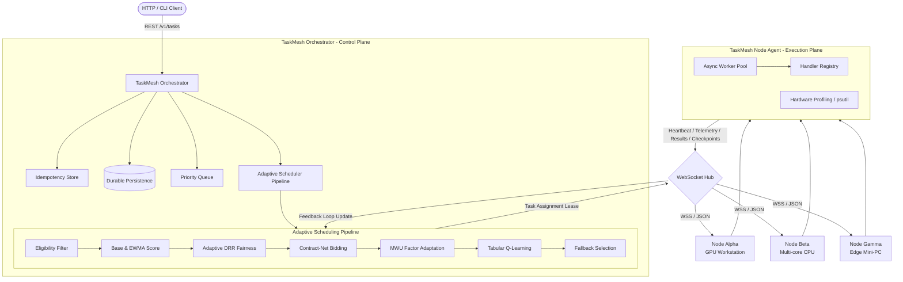

# TaskMesh

**TaskMesh** is a lightweight distributed multi-node task orchestration and adaptive scheduling system designed for heterogeneous machines across ordinary local area networks (LAN / Wi-Fi).

Built with Python, FastAPI, WebSockets, and asyncio, TaskMesh allows a cluster of diverse computers (workstations with GPUs, standard laptops, mini-PCs) to pool their compute resources. Users submit work to the TaskMesh Orchestrator via REST or CLI, and TaskMesh dynamically assigns each task to the most suitable node through an adaptive multi-layer scheduling pipeline combining hardware profiling, dynamic performance tracking (EWMA), fairness guarantees (Deficit Round Robin), auction bidding (Contract-Net), online factor adaptation (Multiplicative Weight Update), and Tabular Reinforcement Learning (Q-learning).

---

## Architecture Overview



---

## Key Features

1. **True Distributed Multi-Node Execution**: Nodes run as independent processes or machines connecting to the Orchestrator via persistent bi-directional WebSockets (`/v1/ws/nodes`).
2. **Workload-Agnostic Handler Model**: Supports generic compute tasks (`log`, `sleep`, `cpu_test`) as well as optional AI inference (`image_inference` with PyTorch/YOLO/NumPy).
3. **Adaptive Multi-Stage Scheduling**:
   - **Eligibility Filtering**: Matches tasks based on CPU/RAM limits, GPU presence, and capability tags.
   - **Hardware Profiling & Base Score**: Computes initial hardware capacity from core counts, frequencies, RAM, and GPU presence.
   - **EWMA Dynamic Multiplier**: Adjusts node score based on observed execution speed ratios ($\text{expected} / \text{actual}$).
   - **Deficit Round Robin (DRR)**: Prevents node starvation by granting adaptive quantums based on effective scores and compensating underserved machines.
   - **Contract-Net Bidding**: Evaluates suitability bids combining CPU, GPU, load, network latency, and reliability.
   - **Online Weight Learning (MWU / Hedge)**: Dynamically shifts bidding factor weights according to outcome losses.
   - **Tabular Q-Learning**: Uses discretized state buckets and candidate slot actions to select optimal node ranks.
   - **Robust Fallback**: Never blocks execution when RL state is novel; falls back deterministically.
4. **Resilience & Fault Tolerance**:
   - **Heartbeat Timeout Detection**: Automatically flags unresponsive nodes as `OFFLINE`.
   - **Task Lease Expiry & Resumption**: Detects orphaned tasks, attaches the latest saved checkpoint, and redistributes to healthy nodes.
   - **Retries with Exponential Backoff & Jitter**: Avoids thundering herds.
   - **Dead-Letter Queue (DLQ)**: Isolates poison pills after retry exhaustion with manual/API recovery support.
5. **Idempotency**: Prevents duplicate executions using client-provided idempotency keys.
6. **Built-in CLI & Multi-Process Dev Cluster**: Launch a 3-node local cluster with a single command.

---

## Quick Start

### 1. Requirements & Installation

Requires Python 3.11+.

```bash
# Clone and install in editable mode
pip install -e .

# Optional: install with AI acceleration packages
pip install -e .[ai]
```

### 2. Launch Local 3-Node Development Cluster

To test full distributed execution on a single physical machine with real separate processes:

```bash
taskmesh-cluster --nodes 3 --port 8000
```
This spawns:
- 1 Orchestrator on `http://127.0.0.1:8000`
- 3 independent Node Agent processes (`node-alpha`, `node-beta`, `node-gamma`) connected via WebSocket.

### 3. Or Launch Components Manually

**Start the Orchestrator:**
```bash
taskmesh-server --port 8000 --mode adaptive
```

**Start Node Agents (on the same or different machines across LAN):**
```bash
# Machine A (or terminal 2)
taskmesh-node --node-id node-alpha --url ws://<ORCHESTRATOR_IP>:8000/v1/ws/nodes --workers 4

# Machine B (or terminal 3)
taskmesh-node --node-id node-beta --url ws://<ORCHESTRATOR_IP>:8000/v1/ws/nodes --workers 4
```

---

## CLI (`taskmeshctl`) Usage

### Submit Tasks
```bash
# Submit an immediate generic task
taskmeshctl task submit --type log --payload '{"message": "Hello TaskMesh"}' --priority 10

# Submit a CPU-intensive computational task
taskmeshctl task submit --type cpu_test --payload '{"iterations": 100000}' --priority 5

# Submit an AI image inference task
taskmeshctl task submit --type image_inference --payload '{"model": "yolov8n", "image_dim": 640}' --gpu
```

### Inspect Tasks and Status
```bash
# List all tasks
taskmeshctl task list

# Get task status and result
taskmeshctl task get <TASK_ID>

# Cancel a task
taskmeshctl task cancel <TASK_ID>
```

### Cluster & Node Management
```bash
# Check cluster health, online nodes, and fairness CV
taskmeshctl cluster health

# List connected compute nodes
taskmeshctl node list

# Inspect specific node telemetry and capabilities
taskmeshctl node inspect node-alpha

# Gracefully drain a node (finishes active tasks without accepting new ones)
taskmeshctl node drain node-alpha
```

### Scheduler & Explainability Audit
```bash
# View scheduler weights, Q-table size, and fairness CV
taskmeshctl scheduler status

# View explainable decision records (scores, bids, RL actions, fallback reasons)
taskmeshctl scheduler decisions
```

### Dead-Letter Queue (DLQ)
```bash
# List permanently failed tasks
taskmeshctl dlq list

# Recover task from DLQ back into execution
taskmeshctl dlq recover <TASK_ID>
```

---

## REST API Overview

Interactive Swagger/OpenAPI documentation is available automatically at `http://localhost:8000/docs`.

| Method | Endpoint | Description |
|---|---|---|
| `POST` | `/v1/tasks` | Submit new task with priority, requirements, and retry policies |
| `GET` | `/v1/tasks` | List tasks (supports filtering by `status`) |
| `GET` | `/v1/tasks/{id}` | Inspect task details, progress, lease, and result |
| `POST` | `/v1/tasks/{id}/cancel` | Cancel task across orchestrator and remote node worker |
| `POST` | `/v1/tasks/{id}/retry` | Re-queue a failed/cancelled task |
| `GET` | `/v1/nodes` | List registered compute nodes |
| `GET` | `/v1/nodes/{id}` | Inspect node profile, hardware specs, and telemetry |
| `POST` | `/v1/nodes/{id}/drain` | Put node into draining mode |
| `GET` | `/v1/cluster/health` | Cluster status, active/pending counts, fairness metric |
| `GET` | `/v1/scheduler/status` | Current MWU factor weights, Q-table stats, fairness CV |
| `GET` | `/v1/scheduler/decisions`| Recent explainable scheduler decisions |
| `GET` | `/v1/dlq` | List dead-letter queue items |
| `POST` | `/v1/dlq/{id}/recover` | Recover dead-lettered task back to pending queue |
| `WS` | `/v1/ws/nodes` | WebSocket endpoint for persistent compute node connection |

---

## Scheduling Pipeline Details

### 1. Adaptive Node Scoring (EWMA)
Each node maintains a base hardware score derived from CPU, RAM, and GPU capabilities. Upon completion of each task, the performance multiplier is updated:
$$\text{ratio} = \frac{\text{expected\_time}}{\text{actual\_time}}$$
$$\text{new\_multiplier} = \alpha \cdot \text{ratio} + (1 - \alpha) \cdot \text{old\_multiplier}$$
$$\text{effective\_score} = \text{base\_score} \times \text{performance\_multiplier}$$

### 2. Deficit Round Robin (DRR) Fairness
To prevent weak nodes from starving while ensuring high-throughput nodes perform proportional work, DRR maintains a deficit counter for each node. Each cycle, nodes accumulate an adaptive quantum proportional to their effective score:
$$\text{quantum}_i = \text{base\_quantum} \times \frac{\text{effective\_score}_i}{\text{mean\_effective\_score}}$$
Nodes that have fallen behind are prioritized during fairness deficit compensation. Fairness equality across the cluster is quantified using the **Coefficient of Variation (CV)**:
$$\text{CV} = \frac{\sigma}{\mu}$$

### 3. Contract-Net Bidding & MWU Weight Adaptation
Nodes evaluate candidate suitability based on 5 weighted factors: CPU suitability, GPU availability, low load, low network latency, and reliability.
The weights $\mathbf{w}$ are updated online using Multiplicative Weight Update (Hedge):
$$w_k(t+1) = w_k(t) \cdot \exp(-\eta \cdot \text{loss}_k)$$
followed by normalization $\sum w_k = 1.0$.

### 4. Tabular Q-Learning
To select among ranked candidate nodes without unbounded state spaces caused by dynamic node IDs, TaskMesh discretizes states into bounded tuples `(score_bucket, load_bucket, priority_bucket)` and actions into candidate rank slots `(0: top-bid, 1: 2nd-bid, 2: 3rd-bid)`. Rewards incentivize fast completion and penalize timeouts and execution failures.

---

## Benchmark Evaluation

Run the reproducible benchmark evaluation comparing the 4 scheduler policies on a heterogeneous cluster:

```bash
python benchmarks/benchmark_schedulers.py
```

### Empirical Results (200 Mixed Workload Tasks):

| Policy | Throughput (tasks/s) | Avg Scheduling Latency | Fairness CV | Allocation Characteristics |
|---|---|---|---|---|
| **Round Robin** | 122,654 | 0.007 ms | **0.00** | Equal distribution, ignores node capabilities & load |
| **Least Loaded** | 137,542 | 0.007 ms | **1.73** | Greedily dumps work on single fastest node; starves others |
| **Highest Bid** | 85,782 | 0.011 ms | **1.73** | Greedily targets highest spec node; starves weaker nodes |
| **TaskMesh Adaptive** | 28,938 | 0.026 ms | **1.50** | Dynamically shifts load, balances throughput and fairness debt |

---

## Testing

Run the full pytest suite:

```bash
pytest tests/ -v
```

18 comprehensive tests cover:
- Core task lifecycle and lease expiration
- Heap-backed priority queues with FIFO tie-breaking
- EWMA score updates, DRR quantum replenishment, and MWU weight adaptation
- Tabular Q-learning state discretization and Bellman updates
- Worker pool async/sync execution, timeouts, and cancellation
- Exponential backoff with jitter and DLQ isolation
- Hardware capability eligibility filtering and checkpoint resumption
- FastAPI REST API endpoints
- End-to-end distributed task dispatching and automated node failure recovery

---

## Project Structure

```text
taskmesh/
├── core/                  # Domain entities, enums, errors, config
├── protocol/              # Typed WebSocket protocol messages & versioning
├── persistence/           # SQLite and In-Memory task repository
├── queue/                 # PriorityQueue with heap order & FIFO stability
├── scoring/               # Base score and EWMA performance multiplier
├── fairness/              # Deficit Round Robin (DRR) & CV metrics
├── bidding/               # Contract-Net candidate bidding
├── learning/              # MWU factor weights & Tabular Q-learning
├── scheduler/             # Adaptive, RoundRobin, LeastLoaded, HighestBid
├── retry/                 # Exponential backoff, jitter, retry evaluator
├── dlq/                   # Dead-letter queue manager & recovery
├── checkpoint/            # Task checkpoint manager
├── idempotency/           # Idempotency deduplication store
├── cluster/               # Node registry, health monitor, dev cluster runner
├── orchestrator/          # FastAPI server, REST routes, WebSocket hub, runtime
├── node/                  # Node agent, worker pool, hardware profiler
├── handlers/              # Generic & AI task handlers (cpu_test, log, image_inference)
└── cli/                   # taskmeshctl command-line client
```

---

## License

MIT
