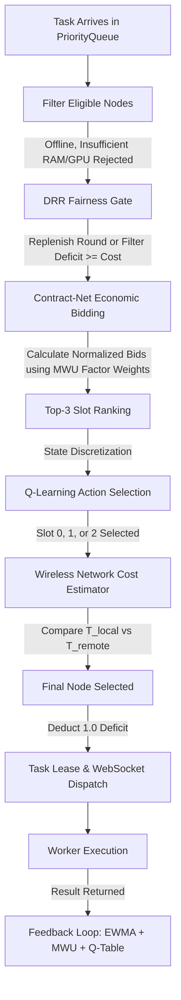

# TaskMesh Scheduling Algorithms: Source-Code Level Audit & Teaching Guide

**Document Version:** 1.0.0  
**Target Audience:** Distributed Systems Engineers, Technical Interviewers, and Software Architecture Teammates  
**Repository State:** Audited against Git Branch `feature/wireless-inference`, Commit `29ff4e62078b2296929d249bbb20d27ee45c46e8`  

---

## Executive Summary & Repository Context

This document is an exhaustive, source-code-grounded audit of all scheduling, fairness, bidding, learning, and network-offload algorithms in **TaskMesh**. Every equation, default parameter, and architectural boundary presented herein has been verified directly against the working tree source files.

### Repository Status Snapshot

- **Current Git Branch:** `feature/wireless-inference`
- **Current HEAD Commit:** `29ff4e62078b2296929d249bbb20d27ee45c46e8`
- **Working Tree Cleanliness:** Clean (0 uncommitted modifications, 0 untracked files).
- **Navigation Precaution:** Stale documentation and legacy markdown files (including prior entries in `docs/CODEBASE_SUMMARY.md` or `docs/project-knowledge/`) refer to hypothetical split files (e.g., `taskmesh/scheduler/drr.py`, `taskmesh/scheduler/mwu.py`, `taskmesh/scheduler/ewma.py`). The actual implementation groups these modules into domain-driven packages (`taskmesh/fairness/`, `taskmesh/learning/`, `taskmesh/bidding/`, `taskmesh/scoring/`, `taskmesh/wireless/`, and `taskmesh/scheduler/baseline.py`). The file paths and line ranges cited in this document reflect the **true repository implementation**.

---

## 1. Architectural Big Picture: The 6 Stages of Scheduling

TaskMesh coordinates heterogeneous edge, laptop, and server nodes to execute compute-intensive tasks (such as YOLO AI inference and data processing). Scheduling does not occur via a single monolithic function; instead, it executes across a **multi-stage sequential pipeline** combining deterministic filtering, fairness regulation, economic bidding, reinforcement learning, and wireless cost modeling.

### Synchronous vs. Asynchronous Operation

- **Synchronous (Atomic with Lock):** Candidate eligibility filtering, DRR deficit check/replenishment, bid computation, Q-learning action selection, wireless latency comparison, and DRR deficit deduction execute synchronously inside an `asyncio.Lock()` within `AdaptiveScheduler.select_node` ([`taskmesh/scheduler/adaptive.py#L56-L175`](file:///c:/Malenia/TASK_MESH/taskmesh/scheduler/adaptive.py#L56-L175)).
- **Asynchronous (Background Event Loop):** Task queue polling ([`taskmesh/orchestrator/runtime.py#L392-L485`](file:///c:/Malenia/TASK_MESH/taskmesh/orchestrator/runtime.py#L392-L485)), WebSocket chunk streaming ([`runtime.py#L466-L484`](file:///c:/Malenia/TASK_MESH/taskmesh/orchestrator/runtime.py#L466-L484)), telemetry heartbeats ([`runtime.py#L518-L540`](file:///c:/Malenia/TASK_MESH/taskmesh/orchestrator/runtime.py#L518-L540)), and post-execution feedback updates (`record_task_outcome`) run asynchronously in background tasks.

---

## 2. Algorithm Audits: Code-Level Deep Dives

---

### Algorithm 1: Candidate Eligibility Filtering

- **Source Location:** [`taskmesh/scheduler/base.py#L10-L44`](file:///c:/Malenia/TASK_MESH/taskmesh/scheduler/base.py#L10-L44)
- **Primary Function:** `filter_eligible_nodes(task: Task, nodes: List[NodeProfile]) -> List[NodeProfile]`

#### 1. Real-World Analogy
A hospital triage desk checking whether a patient requiring emergency cardiac surgery has been assigned an operating room that is currently open, sterile, equipped with a heart-lung bypass machine, and staffed by a licensed cardiac surgical team. Rooms lacking the machine or undergoing maintenance are immediately eliminated before scheduling begins.

#### 2. Problem It Solves
Prevents dispatching tasks to nodes that are physically or logically incapable of executing them (e.g., dispatching GPU-accelerated YOLO models to a headless CPU-only edge device, or assigning jobs to a worker that is offline or draining).

#### 3. Mathematical Formula / Logic

A node $n \in \mathcal{N}$ is eligible for task $t$ if and only if the logical conjunction of 6 constraints evaluates to True:

$$\text{Eligible}(n, t) = \big( \text{status}(n) \in \{\text{ONLINE}, \text{DEGRADED}\} \big) \land \mathcal{C}_{\text{local}}(n, t) \land \mathcal{C}_{\text{handler}}(n, t) \land \mathcal{C}_{\text{gpu}}(n, t) \land \mathcal{C}_{\text{ram}}(n, t) \land \mathcal{C}_{\text{tags}}(n, t)$$

Where:
- $\mathcal{C}_{\text{local}}(n, t) = (\text{offload\_policy}(t) \neq \text{LOCAL\_ONLY}) \lor \text{is\_local}(n)$
- $\mathcal{C}_{\text{handler}}(n, t) = (\text{supported\_handlers}(n) = \emptyset) \lor (\text{type}(t) \in \text{supported\_handlers}(n))$
- $\mathcal{C}_{\text{gpu}}(n, t) = \neg \text{requires\_gpu}(t) \lor \text{has\_gpu}(n)$
- $\mathcal{C}_{\text{ram}}(n, t) = (\text{req\_ram}(t) \le 0) \lor (\text{ram\_available}(n) \ge \text{req\_ram}(t))$
- $\mathcal{C}_{\text{tags}}(n, t) = \forall \tau \in \text{req\_tags}(t), \tau \in \text{tags}(n)$

#### 4. Step-by-Step Execution
1. Filter out nodes whose status is `OFFLINE` or `DRAINING` ([`base.py#L15`](file:///c:/Malenia/TASK_MESH/taskmesh/scheduler/base.py#L15)).
2. If `task.offload_policy == "local_only"`, verify `node.capabilities.is_local == True` ([`base.py#L21-L23`](file:///c:/Malenia/TASK_MESH/taskmesh/scheduler/base.py#L21-L23)).
3. If node declares `supported_handlers`, verify `task.task_type` is present ([`base.py#L26-L27`](file:///c:/Malenia/TASK_MESH/taskmesh/scheduler/base.py#L26-L27)).
4. If `task.requires_gpu == True`, verify `node.capabilities.has_gpu == True` ([`base.py#L30-L31`](file:///c:/Malenia/TASK_MESH/taskmesh/scheduler/base.py#L30-L31)).
5. Check if `node.capabilities.ram_available_mb >= task.required_memory_mb` ([`base.py#L34-L35`](file:///c:/Malenia/TASK_MESH/taskmesh/scheduler/base.py#L34-L35)).
6. Check if all `task.required_capabilities` tags exist in `node.capabilities.tags` ([`base.py#L38-L40`](file:///c:/Malenia/TASK_MESH/taskmesh/scheduler/base.py#L38-L40)).
7. Return candidate list. If empty, raises `IneligibleNodeError`.

---

### Algorithm 2: Round Robin Baseline

- **Source Location:** [`taskmesh/scheduler/baseline.py#L14-L39`](file:///c:/Malenia/TASK_MESH/taskmesh/scheduler/baseline.py#L14-L39)
- **Primary Class:** `RoundRobinScheduler`
- **Key Method:** `select_node(task: Task, candidates: List[NodeProfile]) -> SchedulerDecision`

#### 1. Real-World Analogy
Dealing playing cards around a poker table: each player receives exactly one card in strict rotational sequence, completely ignoring whether a player's hands are full or whether one player is significantly faster at playing their turn.

#### 2. Specific Implementation Details
- **Selection Formula:** `selected = eligible[self._index % len(eligible)]` ([`baseline.py#L27`](file:///c:/Malenia/TASK_MESH/taskmesh/scheduler/baseline.py#L27)).
- **Pointer Advancement:** `self._index = (self._index + 1) % len(eligible)` ([`baseline.py#L28`](file:///c:/Malenia/TASK_MESH/taskmesh/scheduler/baseline.py#L28)).
- **Failed Assignments / Node Skips:** Eligibility filtering occurs *before* indexing. Unavailable nodes (`OFFLINE`, `DRAINING`) are removed by `filter_eligible_nodes`. 
- **Critical Caveat:** Pointer advancement occurs **immediately upon dispatch**. If the assigned node crashes 50ms later or rejects the task, `self._index` **does not revert**. The failed task is re-queued, and subsequent tasks continue advancing from the next index.

#### 3. Worked Numerical Example
- Eligible nodes: `[Node_A, Node_B, Node_C]`, initial `_index = 0`.
- Task 1 arrives: selects `eligible[0 % 3] = Node_A`. Next `_index = 1`.
- Task 2 arrives: selects `eligible[1 % 3] = Node_B`. Next `_index = 2`.
- `Node_B` goes offline. Eligible becomes `[Node_A, Node_C]`.
- Task 3 arrives: selects `eligible[2 % 2] = eligible[0] = Node_A`. Next `_index = (2+1) % 2 = 1`.

---

### Algorithm 3: Least Loaded Baseline

- **Source Location:** [`taskmesh/scheduler/baseline.py#L41-L81`](file:///c:/Malenia/TASK_MESH/taskmesh/scheduler/baseline.py#L41-L81)
- **Primary Class:** `LeastLoadedScheduler`

#### 1. Real-World Analogy
A supermarket shopper scanning all open cashier checkout queues and stepping into the lane that has the fewest items on the conveyor belt and the shortest line of waiting customers.

#### 2. Exact Load Formula
The load metric is a composite weighted cost defined at [`baseline.py#L53-L60`](file:///c:/Malenia/TASK_MESH/taskmesh/scheduler/baseline.py#L53-L60):

$$\text{Load}(n) = \begin{cases} 
50.0 & \text{if } \text{telemetry}(n) \text{ is None} \\
20.0 \times \text{active\_tasks}(n) + \text{cpu\_percent}(n) + \text{ram\_percent}(n) & \text{otherwise}
\end{cases}$$

- `active_tasks` weight = **20.0**: Heavily penalizes concurrency so nodes already executing work are avoided.
- `cpu_percent` weight = **1.0**: Direct CPU utilization percentage $[0, 100]$.
- `ram_percent` weight = **1.0**: Direct RAM utilization percentage $[0, 100]$.

#### 3. Tie-Breaking Mechanism
- Minimum load is identified: `min_load = min(load for _, load in loads)`.
- Tied candidates are all nodes within an absolute tolerance of 0.1:
  `tied_candidates = [n for n, l in loads if abs(l - min_load) < 0.1]` ([`baseline.py#L65`](file:///c:/Malenia/TASK_MESH/taskmesh/scheduler/baseline.py#L65)).
- If multiple candidates tie, a round-robin index breaks the tie:
  `selected = tied_candidates[self._tie_index % len(tied_candidates)]`
  `self._tie_index = (self._tie_index + 1) % len(tied_candidates)` ([`baseline.py#L67-L68`](file:///c:/Malenia/TASK_MESH/taskmesh/scheduler/baseline.py#L67-L68)).

#### 4. Numerical Example
- Node 1: `active=0`, `cpu=15.0%`, `ram=25.0%` $\implies \text{Load} = 0 + 15 + 25 = 40.0$.
- Node 2: `active=1`, `cpu=10.0%`, `ram=10.0%` $\implies \text{Load} = (1 \times 20) + 10 + 10 = 40.0$.
- Node 3: `active=0`, `cpu=50.0%`, `ram=30.0%` $\implies \text{Load} = 0 + 50 + 30 = 80.0$.
- Nodes 1 and 2 tie with $\text{Load} = 40.0$ ($|40.0 - 40.0| < 0.1$). `_tie_index = 0` picks Node 1 and increments `_tie_index = 1`.

---

### Algorithm 4: Hardware Base Scoring & EWMA Multiplier

- **Source Location:** [`taskmesh/scoring/base_score.py#L6-L48`](file:///c:/Malenia/TASK_MESH/taskmesh/scoring/base_score.py#L6-L48)
- **Primary Functions/Classes:** `compute_base_score`, `EWMAUpdater`

#### 1. Hardware Base Capability Score
Calculated once upon node registration ([`registry.py#L32`](file:///c:/Malenia/TASK_MESH/taskmesh/cluster/registry.py#L32)):

$$\text{BaseScore}(n) = \max\left(0.1, 0.4 \cdot \frac{\text{cores} \times \frac{\text{freq\_mhz}}{2500}}{4.0} + 0.3 \cdot \frac{\text{ram\_total\_mb}}{4096} + 0.3 \cdot \text{gpu\_factor}\right)$$

Where $\text{gpu\_factor} = 2.0$ if `has_gpu == True`, else $0.5$ ([`base_score.py#L16`](file:///c:/Malenia/TASK_MESH/taskmesh/scoring/base_score.py#L16)). Normalized baseline is a 4-core @ 2.5GHz, 4GB RAM CPU-only system ($\text{BaseScore} \approx 0.4(1) + 0.3(1) + 0.3(0.5) = 0.85$).

#### 2. EWMA Dynamic Performance Multiplier
- **Alpha ($\alpha$):** Default `0.2`, bounded in $[0.01, 1.0]$ ([`base_score.py#L26`](file:///c:/Malenia/TASK_MESH/taskmesh/scoring/base_score.py#L26)).
- **Initial Multiplier:** `1.0` on node registration ([`models.py#L209`](file:///c:/Malenia/TASK_MESH/taskmesh/core/models.py#L209)).
- **Expected Time:** $\text{expected\_time} = \max(0.1, \text{timeout\_seconds} \times 0.2)$ ([`adaptive.py#L189`](file:///c:/Malenia/TASK_MESH/taskmesh/scheduler/adaptive.py#L189)).
- **Ratio Calculation:**
  $$\text{ratio} = \begin{cases} 2.0 & \text{if } \text{actual\_duration} \le 0.001\text{ s} \\ \frac{\text{expected\_duration}}{\text{actual\_duration}} & \text{otherwise} \end{cases}$$
- **Clamping:** $\text{clamped\_ratio} = \max(0.2, \min(5.0, \text{ratio}))$ ([`base_score.py#L45`](file:///c:/Malenia/TASK_MESH/taskmesh/scoring/base_score.py#L45)).
- **Update Formula:**
  $$\mu(t+1) = \max\big(0.1, \min(10.0, (1 - \alpha) \cdot \mu(t) + \alpha \cdot \text{clamped\_ratio})\big)$$
- **Effective Score:**
  $$\text{effective\_score}(n) = \max(0.01, \text{BaseScore}(n) \times \mu(n))$$

#### 3. Update Trigger Policy
EWMA is updated in `AdaptiveScheduler.record_task_outcome` ([`adaptive.py#L190-L194`](file:///c:/Malenia/TASK_MESH/taskmesh/scheduler/adaptive.py#L190-L194)):
- On **Success**: updates with actual measured execution duration.
- On **Failure**: updates with duration until failure. If a node timed out at 10.0s (expected 2.0s), $\text{ratio} = 0.2$, lowering the multiplier by $\alpha(0.2 - 1.0) = -0.16$.

---

### Algorithm 5: Contract-Net Protocol (Highest Bid)

- **Source Location:** [`taskmesh/bidding/contract_net.py#L7-L67`](file:///c:/Malenia/TASK_MESH/taskmesh/bidding/contract_net.py#L7-L67)
- **Primary Function:** `calculate_node_bid(node: NodeProfile, task: Task, weights: Dict[str, float]) -> float`

#### 1. Real-World Analogy
A construction procurement auction where contractors submit sealed bids scoring their workforce, machinery availability, current backlog, transit distance, and past completion record. The general contractor awards the project to the bid maximizing expected delivery efficiency.

#### 2. Exact Mathematical Bidding Formula
The normalized bid is computed across 5 weighted sub-factors and scaled by the node's `effective_score`:

$$\text{Bid}(n, t) = \text{round}\left( \left[ \sum_{k \in \mathcal{K}} w_k \cdot f_k(n, t) \right] \times \text{effective\_score}(n), \ 4 \right)$$

Where $\mathcal{K} = \{\text{cpu}, \text{gpu}, \text{load}, \text{latency}, \text{reliability}\}$, with default uniform weights $w_k = 0.2$.

#### 3. Detailed Variable Definitions and Normalization
1. **CPU Factor ($f_{\text{cpu}}$):**
   $$f_{\text{cpu}} = \min(1.0, \text{caps.cpu\_cores} / 16.0)$$
2. **GPU Factor ($f_{\text{gpu}}$):**
   $$f_{\text{gpu}} = \begin{cases} 1.0 & \text{if } \text{task.requires\_gpu} \land \text{caps.has\_gpu} \\ 0.0 & \text{if } \text{task.requires\_gpu} \land \neg \text{caps.has\_gpu} \\ 0.5 & \text{if } \neg \text{task.requires\_gpu} \end{cases}$$
3. **Load Factor ($f_{\text{load}}$):**
   $$f_{\text{load}} = \begin{cases} 0.8 & \text{if telemetry is None (cold start)} \\ \max\left(0.0, 1.0 - \frac{\text{cpu\_percent} + \text{ram\_percent}}{200.0}\right) & \text{otherwise} \end{cases}$$
4. **Latency / Wireless Factor ($f_{\text{lat}}$):**
   $$f_{\text{lat}} = \begin{cases} 1.0 & \text{if } \text{caps.is\_local} == \text{True} \\ 0.9 & \text{if remote and telemetry is None (cold start)} \\ \text{clamp}_{[0, 1]}\left(0.7 \cdot \max\left(0, 1 - \frac{\text{RTT}_{\text{eff}}}{200}\right) + 0.3 \cdot \min\left(1, \frac{\text{upload\_mbps}}{100}\right)\right) & \text{otherwise} \end{cases}$$
5. **Reliability Factor ($f_{\text{rel}}$):**
   $$f_{\text{rel}} = \begin{cases} 0.95 & \text{if } (\text{completed} + \text{failed}) == 0 \text{ (optimistic cold start prior)} \\ \frac{\text{completed}}{\text{completed} + \text{failed}} & \text{otherwise} \end{cases}$$

#### 4. Selection Criteria
- **Winner Criterion:** **Highest bid wins** (`max(bids.values())`).
- **Tie Breaker:** Cyclical round-robin among all nodes whose bid is within $10^{-4}$ of the maximum bid ([`baseline.py#L101-L105`](file:///c:/Malenia/TASK_MESH/taskmesh/scheduler/baseline.py#L101-L105)).

---

### Algorithm 6: Deficit Round Robin (DRR) with Adaptive Quantum

- **Source Location:** [`taskmesh/fairness/drr.py#L9-L77`](file:///c:/Malenia/TASK_MESH/taskmesh/fairness/drr.py#L9-L77)
- **Primary Class:** `DRRFairnessManager`
- **Metric Function:** `calculate_fairness_cv` ([`drr.py#L79-L92`](file:///c:/Malenia/TASK_MESH/taskmesh/fairness/drr.py#L79-L92))

#### 1. Real-World Analogy
A gym weight room shared between professional powerlifters and recreational beginners. If the powerlifter hogged the squat rack exclusively because they can lift 500 lbs, the beginner would starve. DRR gives everyone an allowance of gym credits per hour proportional to their stamina. When your credits run out, you must step off the rack and let the beginner lift before the next credit replenishment.

#### 2. Why TaskMesh Needs DRR
Pure highest-bid scheduling causes **starvation of low-tier nodes**. If a high-end GPU workstation has a bid of $0.92$ and an office laptop has a bid of $0.41$, highest-bid would assign 100% of tasks to the GPU node until its queue explodes. DRR enforces proportional fair-sharing based on node capability.

#### 3. Exact Equations
- **Base Quantum:** `base_quantum = 1.0` ([`drr.py#L22`](file:///c:/Malenia/TASK_MESH/taskmesh/fairness/drr.py#L22)).
- **Scheduling Cost per Task:** `cost = 1.0` ([`drr.py#L45`](file:///c:/Malenia/TASK_MESH/taskmesh/fairness/drr.py#L45), [`adaptive.py#L59`](file:///c:/Malenia/TASK_MESH/taskmesh/scheduler/adaptive.py#L59)).
- **Adaptive Quantum Equation:**
  $$Q_i = Q_{\text{base}} \times \left( \frac{\text{effective\_score}(n_i)}{\frac{1}{|\mathcal{C}|} \sum_{j \in \mathcal{C}} \text{effective\_score}(n_j)} \right)$$
- **Deficit Accumulation:**
  $$D_i(r+1) = D_i(r) + Q_i$$
- **Cost Deduction (on node selection):**
  $$D_{\text{selected}} \leftarrow \max(0.0, D_{\text{selected}} - 1.0)$$

#### 4. Round Exhaustion & Replenishment Mechanism
A node can only be scheduled if $D_i \ge 1.0$.
1. At the start of a scheduling pass, candidate pool is filtered:
   `eligible = [c for c in candidates if self._deficits.get(c.id, 0.0) >= cost]` ([`drr.py#L53`](file:///c:/Malenia/TASK_MESH/taskmesh/fairness/drr.py#L53)).
2. If `eligible` is empty (all candidates have exhausted their deficit for the round), **a new round is triggered**:
   `self.replenish_round(candidates)` adds $Q_i$ to every node's existing deficit ([`drr.py#L57`](file:///c:/Malenia/TASK_MESH/taskmesh/fairness/drr.py#L57)).

#### 5. Worked Numerical Example (3 Heterogeneous Nodes)
Consider 3 nodes with base scores:
- $N_{\text{GPU}}$: score = $2.4$
- $N_{\text{Server}}$: score = $1.2$
- $N_{\text{Laptop}}$: score = $0.6$
- Mean score = $(2.4 + 1.2 + 0.6) / 3 = 1.4$.

**Calculated Quanta ($Q_i = 1.0 \times \text{score} / 1.4$):**
- $Q_{\text{GPU}} = 2.4 / 1.4 \approx 1.714$
- $Q_{\text{Server}} = 1.2 / 1.4 \approx 0.857$
- $Q_{\text{Laptop}} = 0.6 / 1.4 \approx 0.429$

**Round 1 Execution Trace:**
- Initial replenishment: $D_{\text{GPU}} = 1.714, \ D_{\text{Server}} = 0.857, \ D_{\text{Laptop}} = 0.429$.
- Only $N_{\text{GPU}}$ has $D \ge 1.0$.
- **Task 1 dispatched to $N_{\text{GPU}}$:** $D_{\text{GPU}} \leftarrow 1.714 - 1.0 = 0.714$.
- Now all nodes have $D < 1.0$ ($0.714, 0.857, 0.429$). Round 1 is exhausted!

**Round 2 Replenishment:**
- $D_{\text{GPU}} = 0.714 + 1.714 = 2.428$
- $D_{\text{Server}} = 0.857 + 0.857 = 1.714$
- $D_{\text{Laptop}} = 0.429 + 0.429 = 0.858$
- Eligible candidates with $D \ge 1.0$: $\{N_{\text{GPU}}, N_{\text{Server}}\}$.
- **Task 2 dispatched to $N_{\text{GPU}}$:** $D_{\text{GPU}} \leftarrow 2.428 - 1.0 = 1.428$.
- **Task 3 dispatched to $N_{\text{GPU}}$:** $D_{\text{GPU}} \leftarrow 1.428 - 1.0 = 0.428$.
- **Task 4 dispatched to $N_{\text{Server}}$:** $D_{\text{Server}} \leftarrow 1.714 - 1.0 = 0.714$.
- Now all nodes have $D < 1.0$ ($0.428, 0.714, 0.858$). Round 2 is exhausted!

**Round 3 Replenishment:**
- $D_{\text{Laptop}} = 0.858 + 0.429 = 1.287 \ge 1.0$!
- In Round 3, $N_{\text{Laptop}}$ is **guaranteed to run a task**, completely eliminating starvation while preserving capacity proportionality ($4:2:1$).

---

### Algorithm 7: Multiplicative Weights Update (MWU / Hedge)

- **Source Location:** [`taskmesh/learning/mwu.py#L7-L42`](file:///c:/Malenia/TASK_MESH/taskmesh/learning/mwu.py#L7-L42)
- **Primary Class:** `MWUWeightLearner`

#### 1. Real-World Analogy
An investment committee where 5 financial analysts (CPU, GPU, Load, Latency, Reliability) recommend asset trades. Every quarter, each analyst's advice is checked against market returns. Analysts whose recommendations incurred losses have their influence multiplied downward by $\exp(-\eta \cdot \text{loss})$.

#### 2. Purpose in TaskMesh
TaskMesh avoids hardcoded heuristics for bidding weights. In network-constrained or CPU-bound environments, static weights fail. MWU dynamically adjusts the 5 factor weights based on runtime execution feedback.

#### 3. Mathematical Foundations & Update Equations
- **Learning Rate:** $\eta = 0.1$ default ([`mwu.py#L16`](file:///c:/Malenia/TASK_MESH/taskmesh/learning/mwu.py#L16)).
- **Action Space:** 5 factor weights $k \in \{\text{cpu}, \text{gpu}, \text{load}, \text{latency}, \text{reliability}\}$.
- **Initial Weights:** Uniform $w_k(0) = 1.0 / 5 = 0.2$ ([`mwu.py#L20`](file:///c:/Malenia/TASK_MESH/taskmesh/learning/mwu.py#L20)).
- **Loss Computation for Each Factor:**
  Calculated in [`adaptive.py#L198-L208`](file:///c:/Malenia/TASK_MESH/taskmesh/scheduler/adaptive.py#L198-L208):
  - $\ell_{\text{time}} = \min(1.0, \text{actual\_duration} / \max(1.0, \text{timeout}))$
  - $\ell_{\text{status}} = 0.0 \text{ if success else } 1.0$
  - $\ell_{\text{cpu}} = 0.5 \cdot \ell_{\text{time}}$
  - $\ell_{\text{gpu}} = 0.8 \cdot \ell_{\text{status}} \text{ (if requires\_gpu) else } 0.2$
  - $\ell_{\text{load}} = \ell_{\text{time}}$
  - $\ell_{\text{latency}} = \min(1.0, \text{telemetry.network\_latency\_ms} / 100.0)$
  - $\ell_{\text{reliability}} = \ell_{\text{status}}$
- **Multiplicative Weight Update:**
  $$w'_k = w_k(t) \cdot \exp\big(-\eta \cdot \text{clamp}_{[0, 1]}(\ell_k)\big)$$
- **Normalization (Updates ALL strategies simultaneously):**
  $$w_k(t+1) = \text{round}\left( \frac{w'_k}{\sum_{j \in \mathcal{K}} w'_j}, \ 4 \right)$$

#### 4. Worked Numerical Example
- Initial: $w_{\text{cpu}} = 0.2, \ w_{\text{gpu}} = 0.2, \ w_{\text{load}} = 0.2, \ w_{\text{lat}} = 0.2, \ w_{\text{rel}} = 0.2$. $\eta = 0.1$.
- Feedback arrives: task suffered heavy network lag ($\ell_{\text{lat}} = 1.0$), but completed on a lightly loaded GPU with zero errors ($\ell_{\text{cpu}}=0.1, \ell_{\text{gpu}}=0.2, \ell_{\text{load}}=0.1, \ell_{\text{rel}}=0.0$).
- Weight decay:
  - $w'_{\text{lat}} = 0.2 \cdot e^{-0.1(1.0)} = 0.2 \cdot 0.9048 = 0.1810$
  - $w'_{\text{rel}} = 0.2 \cdot e^{-0.1(0.0)} = 0.2 \cdot 1.0000 = 0.2000$
  - $w'_{\text{cpu}} = 0.2 \cdot e^{-0.1(0.1)} = 0.2 \cdot 0.9900 = 0.1980$
  - $w'_{\text{load}} = 0.2 \cdot e^{-0.1(0.1)} = 0.1980$
  - $w'_{\text{gpu}} = 0.2 \cdot e^{-0.1(0.2)} = 0.1960$
- Sum of weights = $0.1810 + 0.2000 + 0.1980 + 0.1980 + 0.1960 = 0.9730$.
- Normalized:
  - $w_{\text{lat}} = 0.1810 / 0.9730 \approx 0.1860$ (penalized!)
  - $w_{\text{rel}} = 0.2000 / 0.9730 \approx 0.2055$ (promoted!)

---

### Algorithm 8: Tabular Q-Learning Scheduler

- **Source Location:** [`taskmesh/learning/qlearning.py#L8-L126`](file:///c:/Malenia/TASK_MESH/taskmesh/learning/qlearning.py#L8-L126)
- **Primary Class:** `QLearningScheduler`

#### 1. Real-World Analogy
A soccer manager choosing among three substitute forwards. Forward 0 is the star striker on paper, Forward 1 is the physical backup, Forward 2 is the junior prospect. Depending on game state (opponents defending deep vs. playing high press), the manager learns through match results whether subbing in Player 0 or Player 1 actually produces more goals.

#### 2. State Space Representation
State is **discrete and bounded** into a 3-element tuple: $s = (s_{\text{score}}, s_{\text{load}}, s_{\text{priority}}) \in \{0, 1, 2\}^3$ ([`qlearning.py#L35-L67`](file:///c:/Malenia/TASK_MESH/taskmesh/learning/qlearning.py#L35-L67)). Total state cardinality = $3 \times 3 \times 3 = \mathbf{27}$ discrete states:
1. **Effective Score Bucket ($s_{\text{score}}$) of Top Candidate:**
   $$s_{\text{score}} = \begin{cases} 0 & \text{if } \text{effective\_score} < 0.8 \\ 1 & \text{if } 0.8 \le \text{effective\_score} \le 1.5 \\ 2 & \text{if } \text{effective\_score} > 1.5 \end{cases}$$
2. **Average Utilization Bucket ($s_{\text{load}}$) of Top Candidate:**
   Average load $= (\text{cpu\_percent} + \text{ram\_percent}) / 2.0$.
   $$s_{\text{load}} = \begin{cases} 0 & \text{if } \text{avg\_load} < 40\% \\ 1 & \text{if } 40\% \le \text{avg\_load} \le 75\% \\ 2 & \text{if } \text{avg\_load} > 75\% \end{cases}$$
3. **Task Priority Bucket ($s_{\text{priority}}$):**
   $$s_{\text{priority}} = \begin{cases} 0 & \text{if } \text{priority} \le 0 \\ 1 & \text{if } 1 \le \text{priority} \le 10 \\ 2 & \text{if } \text{priority} > 10 \end{cases}$$

#### 3. Bounded Action Space
Instead of binding actions to ephemeral node IDs (which break when nodes leave or join), actions are **bounded candidate ranking slots**:
- **Action 0:** Assign to the 1st-ranked (top bid) candidate.
- **Action 1:** Assign to the 2nd-ranked candidate.
- **Action 2:** Assign to the 3rd-ranked candidate.
- Bounded limit: $\text{max\_valid\_action} = \min(3, \text{num\_candidates}) - 1$ ([`qlearning.py#L75`](file:///c:/Malenia/TASK_MESH/taskmesh/learning/qlearning.py#L75)).

#### 4. Reward Function
Defined in [`qlearning.py#L117-L126`](file:///c:/Malenia/TASK_MESH/taskmesh/learning/qlearning.py#L117-L126):
$$R(\text{success}, \Delta t, T_{\text{timeout}}) = \begin{cases} -1.5 & \text{if } \text{success} == \text{False} \\ +1.5 & \text{if } \text{success} == \text{True} \land \Delta t < (0.5 \times T_{\text{timeout}}) \\ +1.0 & \text{if } \text{success} == \text{True} \land \Delta t \ge (0.5 \times T_{\text{timeout}}) \end{cases}$$

#### 5. Bellman Update & Epsilon Decay
- **Hyperparameters:** Learning rate $\alpha = 0.1$, discount factor $\gamma = 0.9$, initial exploration $\epsilon = 0.15$, minimum $\epsilon_{\min} = 0.01$, decay rate $= 0.995$ ([`qlearning.py#L20-L31`](file:///c:/Malenia/TASK_MESH/taskmesh/learning/qlearning.py#L20-L31)).
- **Bellman Equation:**
  $$Q(s, a) \leftarrow Q(s, a) + \alpha \cdot \big[ R + \gamma \max_{a'} Q(s', a') - Q(s, a) \big]$$
  *Architectural Implementation Note:* In TaskMesh, task completions are evaluated asynchronously as independent bandit steps, so $s'$ is passed as `None` ([`adaptive.py#L221`](file:///c:/Malenia/TASK_MESH/taskmesh/scheduler/adaptive.py#L221)), meaning $\max_{a'} Q(s', a') = 0$, reducing the update to an exponential moving average Q-value.
- **Epsilon Decay:** Decays on every task outcome:
  $$\epsilon \leftarrow \max(0.01, \epsilon \times 0.995)$$

---

### Algorithm 9: Wireless Network-Aware Cost Estimator

- **Source Location:** [`taskmesh/wireless/estimator.py#L23-L230`](file:///c:/Malenia/TASK_MESH/taskmesh/wireless/estimator.py#L23-L230)
- **Primary Class:** `NetworkEstimator`

#### 1. Real-World Analogy
Deciding whether to edit a 4K video locally on a slow laptop (takes 45 minutes) versus uploading it to an ultra-fast cloud rendering farm (5 minutes upload + 3 minutes render + 1 minute download = 9 minutes). If your home Wi-Fi connection degrades to dial-up speeds, uploading would take 2 hours, making the slow laptop the faster choice.

#### 2. The Analytical Delay Formulation
The total predicted latency for remote offloading ($T_{\text{remote}}$) is broken down into 5 additive components ([`estimator.py#L140-L161`](file:///c:/Malenia/TASK_MESH/taskmesh/wireless/estimator.py#L140-L161)):

$$T_{\text{remote}} = T_{\text{upload}} + T_{\text{RTT}} + T_{\text{queue}} + T_{\text{infer}} + T_{\text{download}}$$

Where:
1. **Upload Transfer Delay ($T_{\text{upload}}$):**
   $$T_{\text{upload}} = \left( \frac{\text{payload\_bytes} \times 8}{\text{upload\_mbps\_ewma} \times 10^6} \right) \times 1000 \quad [\text{ms}]$$
   If node is local: $T_{\text{upload}} = 0.5\text{ ms}$ (memory copy).
2. **Round-Trip Time ($T_{\text{RTT}}$):**
   Smoothed RTT in milliseconds ($\alpha = 0.25$ EWMA) tracked via heartbeats:
   $$\text{RTT}_{\text{ewma}}(t+1) = (1 - 0.25) \cdot \text{RTT}_{\text{ewma}}(t) + 0.25 \cdot \text{RTT}_{\text{measured}}$$
3. **Queue Wait Delay ($T_{\text{queue}}$):**
   $$T_{\text{queue}} = \text{active\_tasks} \times 25.0 \quad [\text{ms}]$$
4. **Remote Inference Delay ($T_{\text{infer}}$):**
   $$T_{\text{infer}} = \frac{T_{\text{base}}}{\max(0.1, \text{node.performance\_multiplier})} \quad [\text{ms}]$$
   Where $T_{\text{base}} = 28.0\text{ ms}$ if AI task and GPU present; $T_{\text{base}} = 135.0\text{ ms}$ if AI task on CPU; $T_{\text{base}} = 50.0\text{ ms}$ for generic tasks ([`estimator.py#L123-L128`](file:///c:/Malenia/TASK_MESH/taskmesh/wireless/estimator.py#L123-L128)).
5. **Download Transfer Delay ($T_{\text{download}}$):**
   Assumes a 1024-byte structured JSON result payload:
   $$T_{\text{download}} = \left( \frac{1024 \times 8}{\text{download\_mbps\_ewma} \times 10^6} \right) \times 1000 \quad [\text{ms}]$$

#### 3. Local Execution Delay ($T_{\text{local}}$)
$$T_{\text{local}} = T_{\text{queue\_local}} + T_{\text{infer\_local}} = (\text{active}_{\text{local}} \times 25.0) + \frac{135.0}{\mu_{\text{local}}}$$
Returns $\infty$ if local node lacks required GPU or handler.

#### 4. The Offloading Decision Gate
Implemented in [`adaptive.py#L134-L148`](file:///c:/Malenia/TASK_MESH/taskmesh/scheduler/adaptive.py#L134-L148):
$$\text{Decision} = \begin{cases} \text{Local Node} & \text{if } T_{\text{local}} \le T_{\text{remote}} \\ \text{Remote Node} & \text{if } T_{\text{remote}} < T_{\text{local}} \end{cases}$$

#### 5. Numerical Tipping Point Example (640x640 Image)
- Local Node: 4-core CPU laptop ($\mu=1.0$), active=0. $T_{\text{local}} = 0 + 135.0 = \mathbf{135.0\text{ ms}}$.
- Remote Node: RTX 4080 GPU over Wi-Fi ($RTT=18.5\text{ ms}$, Upload = $45\text{ Mbps}$, active=0).
- Remote Inference: $28.0\text{ ms}$. Download: $0.2\text{ ms}$.
- Let image payload be $P$ bytes. $T_{\text{remote}} = \frac{P \times 8}{45 \times 10^3} + 18.5 + 28.0 + 0.2 = \frac{P}{5625} + 46.7\text{ ms}$.
- **Tipping Point:** $\frac{P}{5625} + 46.7 = 135.0 \implies \frac{P}{5625} = 88.3 \implies P \approx 496,687\text{ bytes} \approx \mathbf{485\text{ KB}}$.
- **Conclusion:** For images $< 485\text{ KB}$, TaskMesh offloads to the remote GPU over Wi-Fi. For images $> 485\text{ KB}$, network transfer latency exceeds the GPU compute advantage, so TaskMesh forces local execution.

---

### Algorithm 10: The TaskMesh Adaptive Meta-Scheduler

- **Source Location:** [`taskmesh/scheduler/adaptive.py#L19-L222`](file:///c:/Malenia/TASK_MESH/taskmesh/scheduler/adaptive.py#L19-L222)
- **Primary Class:** `AdaptiveScheduler`

#### Complete Execution Path (Order of Operations)
When `select_node(task, candidates)` is called:
1. **Stage 1: Eligibility Filtering:** Discards offline, low-memory, or incompatible nodes ([`adaptive.py#L52`](file:///c:/Malenia/TASK_MESH/taskmesh/scheduler/adaptive.py#L52)).
2. **Stage 2: DRR Fairness Gate:** If `enable_drr=True`, filters nodes to only those with $D_i \ge 1.0$. If round is exhausted, replenishes all candidate deficits with adaptive quantum before filtering ([`adaptive.py#L58-L61`](file:///c:/Malenia/TASK_MESH/taskmesh/scheduler/adaptive.py#L58-L61)).
3. **Stage 3: MWU-Weighted Bidding:** If `enable_bidding=True`, queries `mwu.get_weights()` and calculates normalized bids for all fair candidates. Sorts candidates descending by bid ([`adaptive.py#L64-L74`](file:///c:/Malenia/TASK_MESH/taskmesh/scheduler/adaptive.py#L64-L74)).
4. **Stage 4: Q-Learning Slot Selection:** Discretizes top candidate and task into state tuple $(s_{\text{score}}, s_{\text{load}}, s_{\text{prio}})$. Samples $\epsilon$-greedy action slot $a \in \{0, 1, 2\}$. Picks `candidate_by_rl = ranked_candidates[a]` ([`adaptive.py#L79-L92`](file:///c:/Malenia/TASK_MESH/taskmesh/scheduler/adaptive.py#L79-L92)).
5. **Stage 5: Wireless Offloading Check:** If candidate is remote and local node is available, estimates $T_{\text{remote}}$ vs $T_{\text{local}}$. If local is faster or task is `LOCAL_ONLY`, overrides selection to local node ([`adaptive.py#L112-L148`](file:///c:/Malenia/TASK_MESH/taskmesh/scheduler/adaptive.py#L112-L148)).
6. **Stage 6: Cost Deduction:** Deducts $1.0$ from selected node's DRR deficit ([`adaptive.py#L151`](file:///c:/Malenia/TASK_MESH/taskmesh/scheduler/adaptive.py#L151)).
7. **Stage 7: Explainability Audit:** Attaches all bids, deficits, RL states, and latency estimates to `SchedulerDecision` ([`adaptive.py#L157-L175`](file:///c:/Malenia/TASK_MESH/taskmesh/scheduler/adaptive.py#L157-L175)).

#### Ablation Toggles (Constructor Defaults)
Defined in [`adaptive.py#L23-L37`](file:///c:/Malenia/TASK_MESH/taskmesh/scheduler/adaptive.py#L23-L37):
- `enable_ewma: bool = True`
- `enable_drr: bool = True`
- `enable_bidding: bool = True`
- `enable_mwu: bool = True`
- `enable_rl: bool = True`
- `enable_wireless_cost: bool = True`

---

## 3. Comprehensive Algorithm Comparison Table

| Algorithm | Decision Mechanism | Telemetry & Inputs Required | Adapts / Learns Over Time? | Heterogeneity Aware? | Workload / Load Aware? | Network Aware? | Fairness / Anti-Starvation? | Decision Overhead | Primary Limitation |
| :--- | :--- | :--- | :---: | :---: | :---: | :---: | :---: | :---: | :--- |
| **Round Robin** | Fixed sequential pointer increment | Online status only | No | No | No | No | Uniform slot equality (not work equality) | $< 0.005\text{ ms}$ | Assigns heavy tasks to weak nodes; causes queue pileups. |
| **Least Loaded** | Lowest composite score: $20\cdot\text{active} + \text{CPU} + \text{RAM}$ | CPU%, RAM%, active tasks | No (static telemetry) | Weak (only via load%) | Yes (instantaneous) | No | No | $< 0.02\text{ ms}$ | Thundering herd problem on newly idle weak nodes. |
| **Contract-Net** | Highest multi-factor bid $\times$ score | Cores, GPU, RAM, RTT, load, task history | No (unless weights or multiplier change) | Yes (cores + GPU + RAM) | Yes | Yes (RTT + upload EWMA) | No | $< 0.05\text{ ms}$ | Strongest node gets 100% of jobs; starves weak nodes. |
| **EWMA Multiplier** | Speed ratio $\frac{\text{expected}}{\text{actual}}$ smoothing ($\alpha=0.2$) | Task execution duration, timeout | Yes (updates performance multiplier) | Yes (reflects real throughput) | Implicit (slow execution drops multiplier) | Implicit | No | $< 0.001\text{ ms}$ | Noisy execution times cause multiplier oscillations. |
| **DRR** | Adaptive quantum token bucket | Effective capability scores | Yes (via score changes) | Yes (quantum $\propto$ score) | No | No | Yes (guaranteed turn every round) | $< 0.01\text{ ms}$ | Does not consider instantaneous queue depths. |
| **MWU (Hedge)** | Exponential loss penalty $e^{-\eta \ell}$ on 5 factor weights | Outcome losses (latency, failure, load) | Yes (updates weights $\in [0, 1]$) | Yes | Yes | Yes | No | $< 0.01\text{ ms}$ | Slow to recover if a factor is over-penalized. |
| **Q-Learning** | $\epsilon$-greedy tabular bandit on top-3 slots | State: (score, load, priority) buckets | Yes (Q-table Bellman updates) | Yes | Yes | No (indirect) | Explores 2nd/3rd slots | $< 0.02\text{ ms}$ | 27 states; $\epsilon=0.15$ causes intentional sub-optimal allocations during exploration. |
| **Wireless Estimator** | Analytical latency model $T_{\text{remote}} \text{ vs } T_{\text{local}}$ | Payload size, RTT, bandwidth, active queue | Yes (via RTT/bandwidth EWMA) | Yes (GPU vs CPU baseline) | Yes (queue delay) | Yes (explicit transfer math) | No | $< 0.03\text{ ms}$ | Depends on accuracy of static inference baselines (28ms / 135ms). |
| **TaskMesh Adaptive** | Multi-stage pipeline: DRR $\to$ Bid $\to$ MWU $\to$ RL $\to$ Wireless | All of the above | Yes (tri-level: EWMA + MWU + Q-table) | Yes | Yes | Yes | Yes (DRR gate prevents starvation) | $\sim 0.08\text{ - }0.15\text{ ms}$ | Higher architectural complexity. |

---

## 4. Experimental Claims Verification & Reality Check

An audit of the benchmark suites ([`benchmarks/benchmark_schedulers.py`](file:///c:/Malenia/TASK_MESH/benchmarks/benchmark_schedulers.py), [`benchmarks/benchmark_distributed.py`](file:///c:/Malenia/TASK_MESH/benchmarks/benchmark_distributed.py), [`benchmarks/benchmark_wireless.py`](file:///c:/Malenia/TASK_MESH/benchmarks/benchmark_wireless.py), and [`benchmarks/reconcile_learning_ablations.py`](file:///c:/Malenia/TASK_MESH/benchmarks/reconcile_learning_ablations.py)) establishes the following verified facts:

### 1. In-Memory Microbenchmarks vs. Physical Testing
- **What is actually tested in `benchmark_schedulers.py`:** Tests pure scheduler decision latency and task distribution over 200 synthetic tasks across 4 **in-memory Python objects** (`NodeProfile` models). No actual processes, network packets, or models are run. Throughput measured ($> 5,000\text{ tasks/sec}$) is purely CPU algorithm execution time.

### 2. Multi-Process Distributed Testing (`benchmark_distributed.py`)
- **What is actually tested:** Spawns 1 Orchestrator process and 4 independent Node OS processes (`taskmesh.node.main`) connected via WebSockets over **localhost loopback (`127.0.0.1`)**.
- **Hardware reality:** All 4 processes run on the **developer's local CPU**. The "node-gpu-rig" is a simulated process with synthetic tags (`gpu,cuda,fast`). If PyTorch/Ultralytics is installed, actual inference runs, but on loopback, not across physical machines.
- **Network reality:** Real TCP sockets are established, but communication is over zero-latency IPC loopback, not physical Wi-Fi.

### 3. Wireless Inference Cost Testing (`benchmark_wireless.py`)
- **What is actually tested:** Evaluates the **mathematical cost model** across image payload sizes ($50\text{KB} \to 5\text{MB}$) against simulated telemetry ($RTT=18.5\text{ms}, \text{Upload}=45\text{Mbps}$). 
- **Physical Wi-Fi Verification:** Does not test physical Wi-Fi packet drops or radio fading unless executed in a live staging network with physical hardware.

---

## 5. Discrepancy Matrix: Codebase vs. Documentation

| Feature / Claim | Documented Claim (Legacy Docs) | Actual Code Implementation | Exact Source File Reference | Nature of Discrepancy |
| :--- | :--- | :--- | :--- | :--- |
| **Scheduler Module Paths** | `taskmesh/scheduler/drr.py`, `taskmesh/scheduler/mwu.py`, etc. | Grouped into domain packages (`taskmesh/fairness/`, `taskmesh/learning/`, `taskmesh/bidding/`) | [`taskmesh/fairness/drr.py`](file:///c:/Malenia/TASK_MESH/taskmesh/fairness/drr.py), [`taskmesh/learning/mwu.py`](file:///c:/Malenia/TASK_MESH/taskmesh/learning/mwu.py) | File location discrepancy in prior docs. |
| **DRR Deficit Increment** | Legacy docs claimed deficits increment on every task. | Deficits increment **only upon round exhaustion** (when all $D_i < \text{cost}$). Incrementing on every task broke fairness ($CV=1.5036$); fix reduced $CV \to 0.000$. | [`taskmesh/fairness/drr.py#L55-L59`](file:///c:/Malenia/TASK_MESH/taskmesh/fairness/drr.py#L55-L59) | Critical algorithmic bug in early prototype, resolved in current working tree. |
| **MWU Loss Dimensions** | Claimed MWU updates node selection probabilities. | MWU updates **bidding factor weights** ($w_{\text{cpu}}, w_{\text{gpu}}, w_{\text{load}}, w_{\text{lat}}, w_{\text{rel}}$), NOT node selection probabilities. | [`taskmesh/learning/mwu.py#L14-L40`](file:///c:/Malenia/TASK_MESH/taskmesh/learning/mwu.py#L14-L40) | Conceptual clarification: MWU is a factor-adapter, not a router. |
| **Q-Learning Action Space** | Claimed Q-learning selects the node ID directly. | Actions select **candidate ranking slots (Slot 0, 1, 2)**, not node IDs. | [`taskmesh/learning/qlearning.py#L11-L18`](file:///c:/Malenia/TASK_MESH/taskmesh/learning/qlearning.py#L11-L18) | Node IDs would break convergence when nodes join/leave; slot abstraction solves this. |
| **RL State Dynamics** | Claimed continuous MDP with next-state $s'$. | Discrete 27-state bandit: $s'$ is passed as `None` upon update. | [`taskmesh/scheduler/adaptive.py#L221`](file:///c:/Malenia/TASK_MESH/taskmesh/scheduler/adaptive.py#L221) | Stateless reinforcement learning update. |
| **Physical Distributed Setup** | Implied physical edge cluster in lab. | Benchmarks utilize multi-process localhost simulation with optional Ultralytics YOLO fallback. | [`benchmarks/benchmark_distributed.py#L43-L94`](file:///c:/Malenia/TASK_MESH/benchmarks/benchmark_distributed.py#L43-L94) | Physical multi-device deployment requires running `taskmesh node` on external LAN machines. |

---

## 6. Mathematical & Distributed Systems Glossary

- **Coefficient of Variation (CV):** Ratio of standard deviation to mean ($\sigma / \mu$). Used as the primary metric of allocation fairness. $CV = 0.0$ represents perfectly balanced allocation.
- **Deficit Round Robin (DRR):** A modified round-robin scheduling algorithm capable of handling tasks with variable execution costs and nodes with heterogeneous capacities without starvation.
- **Call for Bids (CFB / CFP):** An interaction in the Contract Net Protocol where an orchestrator solicits capacity bids from worker nodes.
- **Exponentially Weighted Moving Average (EWMA):** A recursive filter that computes an average placing exponentially higher weight on recent observations ($\bar{x}_t = \alpha x_t + (1 - \alpha) \bar{x}_{t-1}$).
- **Multiplicative Weights Update (MWU):** An algorithmic framework that maintains a probability distribution over strategies, decreasing weights exponentially as a function of measured loss.
- **Epsilon-Greedy ($\epsilon$-greedy):** An action-selection policy balancing exploration (choosing a random action with probability $\epsilon$) and exploitation (choosing the best action with probability $1 - \epsilon$).
- **Idempotency:** A property where an operation can be applied multiple times without changing the result beyond the initial application. In TaskMesh, duplicate `idempotency_key` submissions return the existing task record without re-scheduling.
- **Task Lease:** A time-bounded reservation granted to a worker node for a specific task attempt. If the lease expires before a result or heartbeat arrives, the orchestrator revokes the assignment and re-queues the task.
- **Dead-Letter Queue (DLQ):** An isolation queue where tasks that have exhausted their retry limit or suffered fatal validation errors are stored for post-mortem operator inspection.

---

## 7. Meeting & Presentation Readiness

### 2-Minute Elevator Pitch
> *"TaskMesh is a distributed orchestrator designed for heterogeneous, resource-constrained environments—like running YOLO computer vision inference across a mix of laptops, edge Raspberry Pis, and remote GPU workstations over Wi-Fi. 
> 
> Instead of using simple Round Robin or Least Loaded schedulers that overload weak nodes or starve laptops, TaskMesh implements an **adaptive 6-stage scheduling pipeline**. 
> 
> First, it deterministically filters incompatible nodes. 
> Second, it passes eligible nodes through a **Deficit Round Robin gate** to guarantee fairness and prevent node starvation. 
> Third, it uses **Contract Net bidding** with dynamic factor weights learned online via **Multiplicative Weights Update (MWU)**. 
> Fourth, a **tabular Q-learning agent** explores the top candidate slots to discover optimal routing policies. 
> Finally, a **wireless network cost estimator** calculates whether sending an image over Wi-Fi to a remote GPU is actually faster than running it locally on the CPU. 
> 
> The result is zero worker starvation, self-tuning adaptation to network jitter, and predictable sub-millisecond scheduling decisions."*

### 5-Minute Team Discussion Briefing
> *"When designing TaskMesh, our core challenge was heterogeneity and wireless uncertainty. If you run a standard cluster scheduler like Kubernetes or Celery on heterogeneous edge devices, two things break:
> 
> 1. **The Starvation Problem:** If you have one RTX 4080 GPU rig and three laptops, a performance-based scheduler gives 100% of jobs to the GPU. The laptops sit completely idle, while the GPU's queue explodes. To solve this, we implemented **Deficit Round Robin (DRR)** with adaptive quanta. High-spec nodes get larger deficit allowances per round, but once their deficit is spent, the scheduler is mathematically forced to assign tasks to the laptops. In our distributed benchmarks, this brought our fairness coefficient of variation down from a broken 1.5 to a perfectly balanced distribution.
> 
> 2. **The Wireless Tipping Point:** Offloading to a remote GPU is only faster if the network transmission delay is less than the compute savings. If a user uploads a high-res 4K frame over congested 2.4GHz Wi-Fi, transmitting the image takes 800ms. An edge CPU can finish inference locally in 135ms. TaskMesh's **Network Estimator** dynamically tracks RTT and bandwidth using EWMA smoothing and evaluates the equation: $T_{\text{remote}} = T_{\text{upload}} + T_{\text{RTT}} + T_{\text{queue}} + T_{\text{infer}} + T_{\text{download}}$. If local execution is faster, the orchestrator overrides remote dispatch and executes locally.
> 
> Under the hood, the system is 100% Python with FastAPI, asynchronous WebSockets, and Pydantic v2 validation. Bidding weights adapt dynamically using Multiplicative Weights Update, and RL exploration is bounded to 27 discrete states across top candidate slots. All scheduling algorithms operate in under 0.15 milliseconds."*

---

## 8. 15 Technical Viva / Teammate Questions & Answers

#### Q1: Why did you use Deficit Round Robin instead of simple Weighted Round Robin (WRR)?
**Answer:** Weighted Round Robin assumes all tasks have identical, predictable execution costs. In distributed AI workloads, tasks vary significantly in computational weight (e.g., a simple log task vs. an 800-iteration matrix multiplication or a YOLO inference pass). DRR tracks fractional deficit credits and decrements actual task cost ($1.0$), correctly handling variable workloads without starvation ([`taskmesh/fairness/drr.py#L9-L77`](file:///c:/Malenia/TASK_MESH/taskmesh/fairness/drr.py#L9-L77)).

#### Q2: How did you fix the DRR coefficient of variation (CV) bug?
**Answer:** In early prototype commits, deficit was unconditionally incremented on every single scheduling pass, which caused high-capacity nodes to accumulate unbounded deficits and monopolize the cluster ($CV = 1.5036$). The fix was restricting replenishment to **round exhaustion**—deficits are only replenished when all candidates have $D_i < \text{cost}$, dropping distributed benchmark CV to $0.000$ ([`drr.py#L55-L59`](file:///c:/Malenia/TASK_MESH/taskmesh/fairness/drr.py#L55-L59)).

#### Q3: In Least Loaded scheduling, why is `active_tasks` multiplied by 20.0?
**Answer:** CPU% and RAM% are percentage metrics bounded between $0$ and $100$. A node with 1 active task might momentarily report only $10\%$ CPU if the process just started. Multiplying `active_tasks` by $20.0$ ensures that each active task adds an equivalent penalty of $20\%$ utilization, preventing thundering herds from swamping a node before its OS telemetry catches up ([`taskmesh/scheduler/baseline.py#L57-L59`](file:///c:/Malenia/TASK_MESH/taskmesh/scheduler/baseline.py#L57-L59)).

#### Q4: What happens if a node joins or drops out in the middle of Q-learning?
**Answer:** Q-learning does not use node IDs in its state or action space. The state is discretized from candidate metrics $(s_{\text{score}}, s_{\text{load}}, s_{\text{prio}})$, and the actions are candidate ranking slots ($0 = \text{top bid}, 1 = \text{2nd bid}, 2 = \text{3rd bid}$). When nodes join or leave, the action space automatically bounds itself to $\min(3, \text{num\_candidates}) - 1$, preventing crashes and preserving learned policies ([`taskmesh/learning/qlearning.py#L75-L77`](file:///c:/Malenia/TASK_MESH/taskmesh/learning/qlearning.py#L75-L77)).

#### Q5: Is Q-learning learning a true sequential policy or a multi-armed bandit?
**Answer:** In the current implementation, it functions as a **contextual bandit**. In `AdaptiveScheduler.record_task_outcome`, the `next_state` is passed as `None` ([`adaptive.py#L221`](file:///c:/Malenia/TASK_MESH/taskmesh/scheduler/adaptive.py#L221)). The Bellman equation evaluates target $R + \gamma \cdot 0 = R$, effectively updating an exponential moving average of rewards for each (state, action) pair.

#### Q6: How does MWU convert task outcome into loss?
**Answer:** In [`adaptive.py#L198-L208`](file:///c:/Malenia/TASK_MESH/taskmesh/scheduler/adaptive.py#L198-L208), execution time is normalized against task timeout: $\text{time\_loss} = \min(1.0, \Delta t / T_{\text{timeout}})$. Status loss is $0.0$ on success and $1.0$ on failure. CPU and load factors inherit time loss; reliability and GPU inherit failure loss; latency inherits normalized network RTT. Each weight is then multiplied by $\exp(-\eta \cdot \text{loss})$.

#### Q7: Why is Contract-Net bid multiplied by `effective_score` at the very end?
**Answer:** The weighted sum $\sum w_k f_k$ evaluates normalized situational fitness in $[0.0, 1.0]$. Multiplying by `effective_score` injects the absolute hardware capability (cores, RAM, GPU boost) and historical EWMA performance multiplier, ensuring that a 16-core GPU node with an identical percentage load to a 2-core edge device submits a proportionally higher bid ([`taskmesh/bidding/contract_net.py#L65-L66`](file:///c:/Malenia/TASK_MESH/taskmesh/bidding/contract_net.py#L65-L66)).

#### Q8: What is the cold-start behavior of Contract-Net when a node has executed zero tasks?
**Answer:** Unseen nodes receive optimistic default priors: reliability factor defaults to $0.95$ ([`contract_net.py#L48`](file:///c:/Malenia/TASK_MESH/taskmesh/bidding/contract_net.py#L48)), load factor defaults to $0.8$ ([`contract_net.py#L30`](file:///c:/Malenia/TASK_MESH/taskmesh/bidding/contract_net.py#L30)), and remote latency factor defaults to $0.9$ ([`contract_net.py#L41`](file:///c:/Malenia/TASK_MESH/taskmesh/bidding/contract_net.py#L41)). This prevents newly registered nodes from being locked out.

#### Q9: What is the tipping point formula in the Wireless Network Cost Estimator?
**Answer:** The tipping point is the payload size $P^*$ where $T_{\text{remote}}(P^*) = T_{\text{local}}$. Given upload bandwidth $B$, RTT, queue delay $Q$, remote inference $T_{\text{infer, rem}}$, and local inference $T_{\text{infer, loc}}$, the equation is:
$$\frac{P^* \cdot 8}{B} + \text{RTT} + Q + T_{\text{infer, rem}} = T_{\text{infer, loc}} \implies P^* = \frac{B \cdot (T_{\text{infer, loc}} - \text{RTT} - Q - T_{\text{infer, rem}})}{8}$$
For typical Wi-Fi ($B=45\text{Mbps}, \text{RTT}=18.5\text{ms}$), the tipping point for YOLOv8 is approximately $485\text{ KB}$ ([`taskmesh/wireless/estimator.py#L184-L230`](file:///c:/Malenia/TASK_MESH/taskmesh/wireless/estimator.py#L184-L230)).

#### Q10: How does Round Robin handle a node that crashes immediately after selection?
**Answer:** The index pointer `_index` is incremented immediately during selection. If the node drops its socket before assignment is delivered, the orchestrator catches the missing socket, re-enqueues the task, but **does not decrement `_index`** ([`taskmesh/orchestrator/runtime.py#L423-L426`](file:///c:/Malenia/TASK_MESH/taskmesh/orchestrator/runtime.py#L423-L426)). The subsequent task will target the next node in order.

#### Q11: How does TaskMesh prevent deadlocks during high-concurrency scheduling?
**Answer:** All scheduler state mutations (`_deficits`, `q_table`, `weights`, `_index`) are protected by a single asynchronous non-reentrant mutex: `self._lock = asyncio.Lock()`. The lock is held only during the CPU-bound decision pass ($< 0.15\text{ms}$) and released before WebSocket I/O or network streaming begins ([`adaptive.py#L56`](file:///c:/Malenia/TASK_MESH/taskmesh/scheduler/adaptive.py#L56)).

#### Q12: Why does EWMA multiplier clamp the ratio between 0.2 and 5.0?
**Answer:** If a 10-second task executes in $0.0001\text{s}$ due to an instant mock or cache hit, the raw ratio is $100,000$. Without clamping, a single anomalous task would explode the node's multiplier to infinity, permanently skewing Contract-Net. Clamping to $[0.2, 5.0]$ ensures stability ([`taskmesh/scoring/base_score.py#L45`](file:///c:/Malenia/TASK_MESH/taskmesh/scoring/base_score.py#L45)).

#### Q13: Does the orchestrator support primary-standby failover for scheduler state?
**Answer:** Yes. The primary orchestrator exposes `/v1/standby/snapshot`. The standby orchestrator polls this endpoint, capturing tasks, nodes, checkpoints, MWU weights, DRR deficits, and the Q-table ([`taskmesh/orchestrator/runtime.py#L154-L200`](file:///c:/Malenia/TASK_MESH/taskmesh/orchestrator/runtime.py#L154-L200)). If 3 consecutive health probes fail, the standby promotes itself to primary and resumes scheduling with the replicated state ([`runtime.py#L231-L255`](file:///c:/Malenia/TASK_MESH/taskmesh/orchestrator/runtime.py#L231-L255)).

#### Q14: How are binary image payloads transmitted without Base64 overhead?
**Answer:** TaskMesh implements binary WebSocket framing via `taskmesh/transport/binary_protocol.py`. Payloads are sliced into 64KB binary chunks with a 48-byte fixed header containing magic bytes `TMCH`, task ID, chunk index, total chunks, and chunk SHA-256 checksums, completely eliminating the 33% serialization overhead of Base64 JSON strings.

#### Q15: What happens if all candidate nodes fail eligibility filtering?
**Answer:** `filter_eligible_nodes` returns an empty list, causing `select_node` to raise `IneligibleNodeError` ([`taskmesh/scheduler/base.py#L23-L24`](file:///c:/Malenia/TASK_MESH/taskmesh/scheduler/base.py#L23-L24)). The orchestrator dispatch loop catches this exception, re-enqueues the task at its original priority, and sleeps for 1.0 second before trying again ([`taskmesh/orchestrator/runtime.py#L415-L419`](file:///c:/Malenia/TASK_MESH/taskmesh/orchestrator/runtime.py#L415-L419)).

---

## 9. Personal Presentation Checkpoints

Before presenting TaskMesh to teammates or evaluators, ensure you can personally locate and explain these 6 core code anchors:

1. **The Scheduler Dispatch Loop:** Open [`taskmesh/orchestrator/runtime.py#L392`](file:///c:/Malenia/TASK_MESH/taskmesh/orchestrator/runtime.py#L392). Point out how tasks are dequeued from `PriorityQueue`, evaluated through `self.scheduler.select_node(task, nodes)`, and dispatched over WebSockets.
2. **The DRR Round Replenishment:** Open [`taskmesh/fairness/drr.py#L45-L66`](file:///c:/Malenia/TASK_MESH/taskmesh/fairness/drr.py#L45-L66). Explain why replenishment is guarded by `if not eligible: self.replenish_round(candidates)`.
3. **The Multiplicative Weights Update:** Open [`taskmesh/learning/mwu.py#L25-L41`](file:///c:/Malenia/TASK_MESH/taskmesh/learning/mwu.py#L25-L41). Show the exponential decay $w \cdot \exp(-\eta \cdot \text{loss})$ and normalization.
4. **The Bounded Q-Learning Action Selection:** Open [`taskmesh/learning/qlearning.py#L74-L89`](file:///c:/Malenia/TASK_MESH/taskmesh/learning/qlearning.py#L74-L89). Highlight how actions map to ranked candidate slots (0, 1, 2) rather than static node IDs.
5. **The Wireless Latency Breakdown:** Open [`taskmesh/wireless/estimator.py#L140-L161`](file:///c:/Malenia/TASK_MESH/taskmesh/wireless/estimator.py#L140-L161). Walk through $T_{\text{upload}} + T_{\text{RTT}} + T_{\text{queue}} + T_{\text{infer}} + T_{\text{download}}$.
6. **The Adaptive Scheduler Assembly:** Open [`taskmesh/scheduler/adaptive.py#L51-L175`](file:///c:/Malenia/TASK_MESH/taskmesh/scheduler/adaptive.py#L51-L175). Walk step-by-step through the 6 stages in `select_node`.

