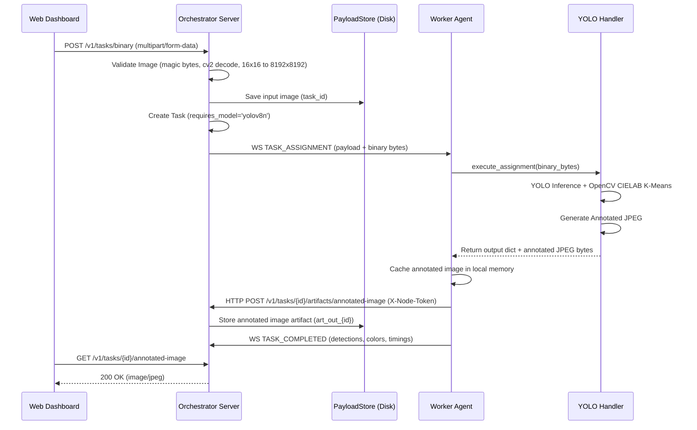

# TaskMesh — Real Distributed YOLO Image Colour Analysis Architecture

## 1. Executive Overview

TaskMesh introduces its first genuine computer vision and machine learning workload: **Distributed YOLOv8 Object Detection and OpenCV CIELAB Dominant Colour Analysis**.

Rather than relying on synthetic tensor fallbacks or simulated detections, this pipeline delivers end-to-end edge-cluster computer vision execution across independent operating system processes:

```mermaid
flowchart TD
    Client["User / Frontend"] -->|POST /v1/tasks/binary (multipart)| Orch["Orchestrator Server (:8000)"]
    Orch -->|Store raw image| ArtStore["PayloadStore (~/.taskmesh/artifacts)"]
    Orch -->|Schedule Task (Adaptive: BaseScore+DRR+MWU+Q-Learning)| Sched["Adaptive Scheduler"]
    Sched -->|Filter by Model Readiness & HW| Cand["Candidate Worker: worker-beta (:8082)"]
    Orch -->|WebSocket Dispatch Message| Agent["Worker Node Agent"]
    Agent -->|Execute Task in Pool| Handler["ai_inference_handler"]
    
    subgraph WorkerExecution ["Worker Compute Boundary"]
        Handler -->|Verify Local Cache| Prov["ModelProvisioner (~/.taskmesh/models)"]
        Prov -->|Load Weights into Memory| YOLO["YOLOv8n PyTorch Model"]
        Handler -->|Decode & Letterbox (cv2)| Preproc["Preprocessing Engine"]
        Handler -->|PyTorch Forward Pass| YOLO
        Handler -->|CIELAB K-Means Clustering| ColorEngine["OpenCV Color Engine"]
        Handler -->|Crop Object Bounding Boxes| ObjColor["Per-Object Color Estimation"]
        Handler -->|Draw Bounding Boxes & Swatches| Annotator["Visual Annotation Engine"]
    end
    
    Annotator -->|Annotated JPEG Artifact| WorkerStore["Worker Local Artifact Cache"]
    Agent -->|HTTP POST Artifact (join-token authenticated)| OrchArt["Orchestrator Artifact Store"]
    Agent -->|WebSocket TASK_COMPLETED (detections + colors + timings)| Orch
    Orch -->|Persist Result (SQLite)| DB[(taskmesh.db)]
    Orch -->|Live WebSocket Telemetry Broadcast| Dashboards["Orchestrator & Worker Dashboards"]
```

---

## 2. Pinned Model Provisioning Strategy

To eliminate redundant WAN downloads on every task dispatch and guarantee deterministic inference across heterogeneous worker nodes, TaskMesh implements a strict **Worker-Side Model Provisioner** (`taskmesh.node.model_provisioner.ModelProvisioner`).

### 2.1 Model Specification
- **Architecture**: Ultralytics YOLOv8 Nano (`yolov8n.pt`)
- **Parameters**: 3,157,200 parameters (3.2M)
- **Model Version**: Ultralytics 8.4.33
- **Pinned Weights Checksum**:
  - SHA-256: `f59b3d833e2ff32e194b5bb8e08d211dc7c5bdf144b90d2c8412c47ccfc83b36`
  - File Size: `6,549,796 bytes` (~6.25 MB)
- **Cache Location**: `~/.taskmesh/models/yolov8n.pt`

### 2.2 Startup Performance & Lazy Loading
Importing heavy scientific packages (`torch`, `ultralytics`) synchronously during worker startup introduces an 8.3-second delay on Windows systems, which disrupts cluster node heartbeats and failover deadlines. 

TaskMesh solves this by separating **capability verification** from **runtime forward-pass initialization**:
1. **Boot Check (`is_model_cached`)**: Performs a microsecond-level local filesystem existence and SHA-256 verification (under 10 ms). The node advertises `model_readiness["yolov8n"] = {"available": True}` in its registration payload without importing PyTorch.
2. **Lazy Runtime Loading (`verify_and_load`)**: Heavy PyTorch module imports occur on the worker only upon receipt of the first inference task, or via an asynchronous background warmup loop.

---

## 3. Computer Vision & Dominant Colour Mathematics

### 3.1 Object Detection
Input images are preprocessed via OpenCV letterboxing to normalize aspect ratios. YOLOv8n performs multi-scale anchor-free detection across 80 COCO classes, yielding bounding box coordinates $[x_1, y_1, x_2, y_2]$ and class confidence scores $c \in [0.0, 1.0]$. Detections below the operator-configured `confidence_threshold` (default 0.25) are filtered out.

### 3.2 Dominant Colour Extraction in CIELAB Colour Space
Human colour perception is non-linear and poorly represented in Euclidean RGB space. TaskMesh converts RGB imagery into the perceptually uniform **CIE $L^*a^*b^*$ (CIELAB)** color space:

$$\begin{aligned}
L^* &\in [0, 100] \quad \text{(Perceptual Lightness)} \\
a^* &\in [-128, 127] \quad \text{(Green to Red Axis)} \\
b^* &\in [-128, 127] \quad \text{(Blue to Yellow Axis)}
\end{aligned}$$

#### K-Means Clustering Formulation
The colour distribution is clustered into $K$ dominant centroids ($K \in [3, 12]$, default 8) by minimizing the sum of squared Euclidean distances in CIELAB space:

$$J = \sum_{j=1}^{K} \sum_{x_i \in S_j} \| x_i - \mu_j \|_{\text{CIELAB}}^2$$

where $x_i$ is the $i$-th pixel vector in CIELAB coordinates, $S_j$ is the $j$-th cluster set, and $\mu_j$ is the cluster centroid.

#### Initialization & Convergence
- Initialized using **K-Means++** (`cv2.KMEANS_PP_CENTERS`) for rapid convergence and centroid dispersion.
- Termination Criteria: $\epsilon = 0.5$ or maximum 15 iterations.
- Centroids are mapped back to RGB space: $\mu_j \rightarrow (R_j, G_j, B_j) \rightarrow \text{HEX}$.

#### Bounded Percentage Distribution
Let $C_j = |S_j|$ be the pixel count assigned to centroid $j$, and $N = \sum_{j=1}^K C_j$ the total sample count. The percentage representation $P_j$ is:

$$P_j = \text{round}\left(\frac{C_j}{N} \times 100, 2\right)$$

To eliminate floating-point rounding artifacts and guarantee that dashboard swatches sum exactly to 100.0%, TaskMesh adjusts the largest cluster:

$$P_{\text{largest}} \leftarrow P_{\text{largest}} + \left(100.00 - \sum_{j=1}^K P_j\right)$$

### 3.3 Perceptual Delta-E Colour Naming
Centroids are matched to human-readable names using the CIE76 perceptual colour difference metric:

$$\Delta E^*_{ab} = \sqrt{(L^*_1 - L^*_2)^2 + (a^*_1 - a^*_2)^2 + (b^*_1 - b^*_2)^2}$$

The closest predefined reference colour from a calibrated 55-colour dictionary ($d = \arg\min \Delta E^*$) determines the assigned name (e.g., `Slate Gray`, `Cobalt Blue`, `Burgundy`).

### 3.4 Per-Object Colour Estimation
For every detected bounding box $[x_1, y_1, x_2, y_2]$, the image region is cropped:

$$\text{Crop} = I[y_1:y_2, x_1:x_2]$$

A localized 2-cluster CIELAB K-means pass extracts the foreground object color while tagging the result with `"approximation": "bounding_box_crop"` to transparently denote crop-based estimation.

---

## 4. Binary Transport & Artifact Lifecycle



1. **Submission**: User uploads image via `POST /v1/tasks/binary` as standard `multipart/form-data`.
2. **Validation**: The orchestrator verifies that the binary payload represents a valid image (decodable by OpenCV, dimensions between $16 \times 16$ and $8192 \times 8192$, file size $\le 25\text{ MB}$).
3. **Dispatch**: The binary payload is transmitted to the chosen worker over the established authenticated WebSocket connection.
4. **Execution**: The worker executes the inference, extracts colours, and generates the annotated visual image.
5. **Artifact Upload**: The worker streams the annotated JPEG artifact back to the orchestrator via `POST /v1/tasks/{id}/artifacts/annotated-image` using its pre-shared `X-Node-Token`.
6. **Persistence**: Both the original input and the annotated output image are persisted with disk durability under `~/.taskmesh/artifacts/`.
7. **Viewing**: Both the Orchestrator Control Center and the Worker Console serve the images directly to the dual-image comparison drawer.

---

## 5. Security & Isolation Model

- **RBAC Enforcement**: Submitting binary tasks requires the `tasks.submit` permission. Viewing input/output images requires `tasks.view`.
- **Worker Authentication**: Artifact upload endpoints (`/v1/tasks/{task_id}/artifacts/annotated-image`) strictly require the cluster's pre-shared `X-Node-Token` or an authenticated token with operator privileges.
- **Node Scope Isolation**: In Worker Agent Console mode, nodes can only access artifacts and tasks belonging to their assigned node ID.
- **Memory Safety & DoS Prevention**: Image inputs larger than 25 MB are rejected immediately before decoding. Malformed or corrupted image streams trigger 400 Bad Request responses without crashing worker threads or leaking file descriptors.

