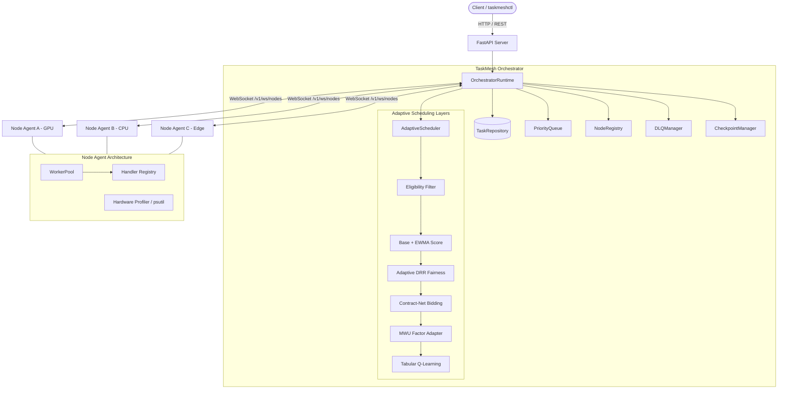

# TaskMesh Distributed Architecture

TaskMesh is an asynchronous distributed task orchestration and adaptive scheduling system for heterogeneous machine clusters across local IP networks.

## Core Design Principles

1. **Separation of Concerns**:
   - **Orchestration**: Global control plane (`taskmesh.orchestrator.runtime`), task persistence, heartbeat/telemetry monitoring, and fault recovery.
   - **Scheduling**: Decision pipeline (`taskmesh.scheduler`) selecting optimal compute nodes through multi-stage adaptive policies.
   - **Execution**: Local worker pools on compute nodes (`taskmesh.node.worker_pool`) executing isolated handlers without blocking the event loop.
2. **Network Decoupling via WebSockets**: Nodes connect over persistent full-duplex WebSockets using typed JSON protocol envelopes (`ProtocolMessage`), avoiding synchronous RPC polling.
3. **Lease-Based Task Ownership**: Assignments are guarded by task attempts (`task_id-attempt_id`) and expiration leases to prevent stale execution or duplicate retries during network partitions.

## System Components

## Lifecycle States

- `PENDING`: Task submitted and queued in `PriorityQueue`.
- `SCHEDULED`: Delayed future task awaiting ticker trigger.
- `RUNNING`: Dispatched to node under active lease (`TaskLease`).
- `COMPLETED`: Successfully executed by node with output attached.
- `FAILED`: Errored during execution.
- `RETRYING`: Transient failure waiting for exponential backoff delay before requeue.
- `CANCELLED`: Explicitly aborted by client (cancellation sent over network to node).
- `DLQ`: Permanent failure after exhausting retry policy; isolated in Dead-Letter Queue.

## Fault Tolerance & Node Disconnect

1. **Heartbeat Timeout**: The Orchestrator monitors `last_heartbeat` of every node. If silence exceeds `node_timeout_seconds` (default: 9.0s), the node is marked `OFFLINE`.
2. **Task Recovery**: All tasks currently `RUNNING` on that node are retrieved. If the task supports checkpoints, the latest saved checkpoint state is attached. The task is reset to `PENDING` and re-queued.
3. **Lease Expiration**: If a task does not report progress before its lease expires, the lease checker reclaims ownership and re-queues the task.

## Wireless Inference Offloading Layer

TaskMesh integrates wireless LAN awareness into its core scheduling and transport stack:

1. **Zero-Dependency UDP Discovery**:
   - `taskmesh.discovery.broadcast.NodeDiscoveryAdvertiser` broadcasts node capabilities, GPU models, and LAN IP on UDP `37020`.
   - `DiscoveryClient` passively listens for peers, enabling zero-configuration cluster formation.

2. **WebSocket Binary Transport**:
   - High-throughput binary image transport without base64 serialization overhead.
   - 48-byte binary framing header (`TMCH`) splits images into 64KB chunks.
   - `ChunkAssembler` reassembles chunks in-flight and verifies SHA-256 checksums before passing to the AI inference worker.

3. **Network-Aware Cost Estimator**:
   - `taskmesh.wireless.estimator.NetworkEstimator` maintains EWMA metrics for RTT, upload bandwidth, and download bandwidth.
   - Evaluates $T_{local} = T_{local\_queue} + T_{local\_infer}$ against $T_{remote} = T_{upload} + RTT + T_{remote\_queue} + T_{remote\_infer} + T_{download}$.
   - Offload decisions are recorded in `SchedulerDecision` with complete diagnostic explainability.

