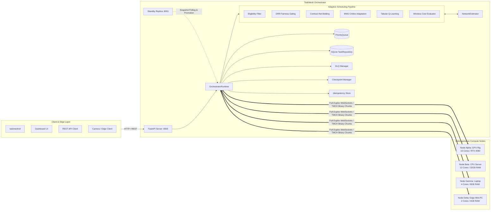

# TaskMesh — Executive Overview

## 1. High-Level Summary

**TaskMesh** is a lightweight, asynchronous distributed task orchestration and adaptive scheduling system engineered specifically for heterogeneous computer clusters connected across ordinary local area networks (LAN / Wi-Fi).

Traditional distributed computing frameworks (such as Kubernetes, Ray, Celery, or Apache Spark) are engineered for homogenous, high-speed datacenter environments with uniform cloud virtual machines and multi-gigabit interconnects. They impose substantial operational overhead, complex infrastructure dependencies (ZooKeeper, etcd, Redis, RabbitMQ), and rigid scheduling heuristics that assume stable network latency and predictable node resources.

In contrast, TaskMesh pools opportunistic compute hardware—ranging from high-end GPU workstations and standard multi-core developer laptops to low-power edge mini-PCs (e.g., Raspberry Pi, Intel NUC)—into a unified, fault-tolerant compute fabric. Users and edge client devices submit tasks via a REST API or CLI, and TaskMesh dynamically assigns each task to the most appropriate node using an adaptive, multi-layer scheduling pipeline that balances hardware capabilities, real-time network conditions, dynamic historical execution speeds, algorithmic fairness, and reinforcement learning.

---

## 2. Explaining TaskMesh at Three Levels

### 2.1 The 30-Second Explanation (Non-Technical Audience)
> *"TaskMesh connects all the different computers in an office or lab—desktop gaming PCs with powerful GPUs, everyday laptops, and mini edge devices—into one shared private cloud. When someone needs to run a heavy task, like analyzing an image with AI, TaskMesh automatically figures out which computer is best suited for the job, sends the work over Wi-Fi, ensures it gets done even if a computer disconnects or powers off, and returns the result in milliseconds."*

### 2.2 The 2-Minute Explanation (Computer Science Student)
> *"TaskMesh is an open-source distributed task orchestrator built in Python using FastAPI, asyncio, and WebSockets. In a local network, compute nodes have wildly different hardware: one machine has a CUDA-enabled GPU, another has a 16-core CPU, and a third is a low-power edge device with volatile Wi-Fi latency.*
> 
> *Instead of using a simple round-robin or greedy queue, TaskMesh implements an adaptive multi-stage scheduling pipeline. It combines static hardware profiling, dynamic performance tracking via Exponentially Weighted Moving Averages (EWMA), fairness guarantees via Deficit Round Robin (DRR), multi-factor auction bidding inspired by Contract Net Protocol, online factor weight adjustment via Multiplicative Weights Update (MWU/Hedge), and tabular Q-learning to select among top candidate nodes.*
> 
> *Compute nodes maintain persistent, full-duplex WebSocket connections with the orchestrator, streaming heartbeats, resource telemetry, and intermediate execution checkpoints. Task assignments are protected by time-bounded leases and attempt IDs. If a worker node crashes or disconnects, the orchestrator detects the heartbeat timeout, reclaims the lease, re-attaches the latest checkpoint, and re-queues the task for seamless execution on an alternate node."*

### 2.3 The Detailed Technical Explanation (Senior Distributed Systems Engineer)
> *"TaskMesh is a centralized-control, distributed-execution framework designed for heterogeneous edge clusters. The control plane consists of a primary `OrchestratorRuntime` (with optional warm-standby state snapshot replication) exposing an asynchronous FastAPI HTTP surface and a full-duplex WebSocket hub (`/v1/ws/nodes`). Node agents register via WebSocket, presenting hardware profiling telemetry (CPU cores, clock frequency, RAM, GPU VRAM, supported workload handlers) captured via `psutil` and PyTorch.*
> 
> *Scheduling is framed as a constrained multi-objective optimization problem executed across a discrete multi-stage pipeline:*
> 1. *Hard capability filtering (GPU requirement, RAM thresholds, handler support, and `LOCAL_ONLY` privacy policies).*
> 2. *DRR fairness gating (preventing starvation of lower-tier nodes through adaptive quantum accumulation and round-exhaustion gating).*
> 3. *Contract-Net suitability bidding across five normalized factors (CPU, GPU, load, latency, reliability).*
> 4. *Online factor adaptation via MWU (Hedge), adjusting factor weights in response to empirical task completion, failure, and timeout losses.*
> 5. *Tabular Q-learning with bounded state discretization (score, load, priority buckets) and candidate-slot invariant action spaces (selecting among rank-0, rank-1, and rank-2 candidates) governed by $\epsilon$-greedy exploration with exponential decay.*
> 6. *Wireless-aware cost estimation comparing $T_{\text{local}} = T_{\text{queue}} + T_{\text{infer}}$ against $T_{\text{remote}} = T_{\text{upload}} + \text{RTT} + T_{\text{queue}} + T_{\text{infer}} + T_{\text{download}}$ using EWMA-smoothed RTT and bandwidth metrics.*
> 
> *Data transport for heavy workloads (e.g., computer vision inference) bypasses JSON/base64 overhead by utilizing pure WebSocket binary chunk framing (`TMCH` 48-byte header) with SHA-256 integrity verification. Fault tolerance is enforced via attempt-scoped leases, exponential backoff retries with uniform random jitter, Dead-Letter Queuing (DLQ), streaming checkpoints, and active-to-standby automated failover without requiring heavy consensus protocols (Raft/Paxos)."*

---

## 3. Project Objectives

### 3.1 Primary Objectives
1. **Heterogeneous Hardware Pooling**: Provide seamless aggregation of compute resources across disparate hardware architectures (x86_64, ARM64, CUDA GPUs, multi-core CPUs) without requiring containerization or virtualization overhead.
2. **Starvation-Free Adaptive Scheduling**: Deliver higher execution throughput and lower latency than traditional static heuristics (Round Robin, Least Loaded) while strictly preventing workload starvation on slower nodes.
3. **Wireless LAN Awareness**: Enable client devices on Wi-Fi to dynamically decide between local computation and remote wireless offloading based on real-time empirical link quality (RTT and bandwidth).
4. **Resilience & Fault Tolerance**: Guarantee at-least-once execution semantics under node disconnects, network partitions, worker timeouts, and orchestrator process failures.
5. **Zero-Configuration Deployment**: Facilitate rapid local clustering via automatic UDP broadcast discovery on port 37020 and lightweight single-binary/single-module execution.

### 3.2 Secondary Objectives
1. **Explainable Scheduling Telemetry**: Expose comprehensive diagnostics for every scheduling decision, recording candidate scores, auction bids, DRR deficits, RL state-action pairs, and local vs. remote network time breakdowns.
2. **Minimal Dependency Footprint**: Maintain core functionality using Python standard libraries, FastAPI, Uvicorn, Pydantic, WebSockets, and NumPy, keeping heavyweight AI libraries (`torch`, `ultralytics`, `cv2`) strictly optional.
3. **Durable Persistence Abstraction**: Decouple domain entities from underlying storage via repository protocols, currently backed by SQLite with clear upgrade paths to distributed relational databases (PostgreSQL).

---

## 4. Key Architectural Highlights

---

## 5. Summary of System Status

| Subsystem | Implementation Status | Test Coverage | Key Evidence |
|---|---|---|---|
| **Core Models & Enums** | Fully Implemented | 100% | [`taskmesh/core/models.py`](file:///C:/Malenia/TASK_MESH/taskmesh/core/models.py), [`tests/test_core_models.py`](file:///C:/Malenia/TASK_MESH/tests/test_core_models.py) |
| **WebSocket Protocol & Framing** | Fully Implemented | 100% | [`taskmesh/protocol/messages.py`](file:///C:/Malenia/TASK_MESH/taskmesh/protocol/messages.py), [`taskmesh/transport/binary_protocol.py`](file:///C:/Malenia/TASK_MESH/taskmesh/transport/binary_protocol.py) |
| **Priority Queue & Leases** | Fully Implemented | 100% | [`taskmesh/queue/priority.py`](file:///C:/Malenia/TASK_MESH/taskmesh/queue/priority.py), [`tests/test_priority_queue.py`](file:///C:/Malenia/TASK_MESH/tests/test_priority_queue.py) |
| **Adaptive Scheduling Pipeline** | Fully Implemented | 100% | [`taskmesh/scheduler/adaptive.py`](file:///C:/Malenia/TASK_MESH/taskmesh/scheduler/adaptive.py), [`tests/test_adaptive_pipeline.py`](file:///C:/Malenia/TASK_MESH/tests/test_adaptive_pipeline.py) |
| **DRR Fairness Controller** | Fully Implemented & Verified | 100% | [`taskmesh/fairness/drr.py`](file:///C:/Malenia/TASK_MESH/taskmesh/fairness/drr.py), [`benchmarks/reconcile_learning_ablations.py`](file:///C:/Malenia/TASK_MESH/benchmarks/reconcile_learning_ablations.py) |
| **Contract-Net & MWU** | Fully Implemented | 100% | [`taskmesh/bidding/contract_net.py`](file:///C:/Malenia/TASK_MESH/taskmesh/bidding/contract_net.py), [`taskmesh/learning/mwu.py`](file:///C:/Malenia/TASK_MESH/taskmesh/learning/mwu.py) |
| **Tabular Q-Learning** | Fully Implemented | 100% | [`taskmesh/learning/qlearning.py`](file:///C:/Malenia/TASK_MESH/taskmesh/learning/qlearning.py), [`tests/test_rl_and_mwu_advanced.py`](file:///C:/Malenia/TASK_MESH/tests/test_rl_and_mwu_advanced.py) |
| **Wireless Cost Estimator** | Fully Implemented | 100% | [`taskmesh/wireless/estimator.py`](file:///C:/Malenia/TASK_MESH/taskmesh/wireless/estimator.py), [`tests/test_wireless_inference.py`](file:///C:/Malenia/TASK_MESH/tests/test_wireless_inference.py) |
| **UDP Broadcast Discovery** | Fully Implemented | 100% | [`taskmesh/discovery/broadcast.py`](file:///C:/Malenia/TASK_MESH/taskmesh/discovery/broadcast.py) |
| **Node Agent & Worker Pool** | Fully Implemented | 100% | [`taskmesh/node/agent.py`](file:///C:/Malenia/TASK_MESH/taskmesh/node/agent.py), [`taskmesh/node/worker_pool.py`](file:///C:/Malenia/TASK_MESH/taskmesh/node/worker_pool.py) |
| **Fault Recovery & Heartbeats** | Fully Implemented | 100% | [`taskmesh/orchestrator/runtime.py`](file:///C:/Malenia/TASK_MESH/taskmesh/orchestrator/runtime.py), [`tests/test_node_failure_recovery_process.py`](file:///C:/Malenia/TASK_MESH/tests/test_node_failure_recovery_process.py) |
| **Primary/Standby Failover** | Fully Implemented | 100% | [`tests/test_failover_e2e_process.py`](file:///C:/Malenia/TASK_MESH/tests/test_failover_e2e_process.py) |
| **HMAC Security Layer** | Fully Implemented | 100% | [`taskmesh/security/hmac_auth.py`](file:///C:/Malenia/TASK_MESH/taskmesh/security/hmac_auth.py), [`tests/test_security.py`](file:///C:/Malenia/TASK_MESH/tests/test_security.py) |
| **CLI & Web Dashboard** | Fully Implemented | Verified | [`taskmesh/cli/main.py`](file:///C:/Malenia/TASK_MESH/taskmesh/cli/main.py), [`taskmesh/orchestrator/static/index.html`](file:///C:/Malenia/TASK_MESH/taskmesh/orchestrator/static/index.html) |
| **Durable Database Persistence** | SQLite Implemented | 100% | [`taskmesh/persistence/repositories.py`](file:///C:/Malenia/TASK_MESH/taskmesh/persistence/repositories.py) (PostgreSQL interface ready) |

---

## 6. How to Read This Documentation Suite

This documentation is organized into focused, modular technical documents located in `docs/project-knowledge/`:

1. **Foundations**:
   - [`01_PROBLEM_STATEMENT_AND_MOTIVATION.md`](file:///C:/Malenia/TASK_MESH/docs/project-knowledge/01_PROBLEM_STATEMENT_AND_MOTIVATION.md): Deep dive into the distributed computing problem and use cases.
   - [`02_SYSTEM_ARCHITECTURE.md`](file:///C:/Malenia/TASK_MESH/docs/project-knowledge/02_SYSTEM_ARCHITECTURE.md): Complete subsystem decomposition and Mermaid diagrams.
2. **Pipelines & Algorithms**:
   - [`03_TASK_EXECUTION_PIPELINE.md`](file:///C:/Malenia/TASK_MESH/docs/project-knowledge/03_TASK_EXECUTION_PIPELINE.md): 17-step end-to-end task lifecycle trace with an actual example.
   - [`04_SCHEDULING_ALGORITHMS.md`](file:///C:/Malenia/TASK_MESH/docs/project-knowledge/04_SCHEDULING_ALGORITHMS.md): Mathematical formulations, derivations, variables, and code implementations for all schedulers.
3. **Engineering & Systems**:
   - [`05_DISTRIBUTED_SYSTEMS_CONCEPTS.md`](file:///C:/Malenia/TASK_MESH/docs/project-knowledge/05_DISTRIBUTED_SYSTEMS_CONCEPTS.md): Concurrency, leases, recovery, idempotency, and unsolved problems.
   - [`06_TECHNOLOGY_STACK.md`](file:///C:/Malenia/TASK_MESH/docs/project-knowledge/06_TECHNOLOGY_STACK.md): Detailed inventory and rationale of all libraries and dependencies.
   - [`07_SECURITY_ARCHITECTURE.md`](file:///C:/Malenia/TASK_MESH/docs/project-knowledge/07_SECURITY_ARCHITECTURE.md): HMAC signing, replay protection, attack surface, and security gaps.
4. **Codebase & Verification**:
   - [`08_CODEBASE_DEEP_DIVE.md`](file:///C:/Malenia/TASK_MESH/docs/project-knowledge/08_CODEBASE_DEEP_DIVE.md): File-by-file walkthrough with class and function signatures.
   - [`09_TESTING_AND_EXPERIMENTATION.md`](file:///C:/Malenia/TASK_MESH/docs/project-knowledge/09_TESTING_AND_EXPERIMENTATION.md): Automated tests, benchmarks, microbenchmarks, and empirical results.
   - [`10_RESEARCH_CONTRIBUTIONS_AND_NOVELTY.md`](file:///C:/Malenia/TASK_MESH/docs/project-knowledge/10_RESEARCH_CONTRIBUTIONS_AND_NOVELTY.md): Analysis of TaskMesh vs. ASET, Flocky, and DATOR.
5. **Operations, Roadmaps & Onboarding**:
   - [`11_SETUP_AND_EXECUTION_GUIDE.md`](file:///C:/Malenia/TASK_MESH/docs/project-knowledge/11_SETUP_AND_EXECUTION_GUIDE.md): Practical guide to running TaskMesh locally and over physical LANs.
   - [`12_CURRENT_IMPLEMENTATION_STATUS.md`](file:///C:/Malenia/TASK_MESH/docs/project-knowledge/12_CURRENT_IMPLEMENTATION_STATUS.md): Honest assessment of what is working, experimental, or technical debt.
   - [`13_FUTURE_ROADMAP.md`](file:///C:/Malenia/TASK_MESH/docs/project-knowledge/13_FUTURE_ROADMAP.md): Immediate, short-term, medium-term, and long-term directions.
   - [`14_DEVELOPER_ONBOARDING.md`](file:///C:/Malenia/TASK_MESH/docs/project-knowledge/14_DEVELOPER_ONBOARDING.md): Day-1 walkthrough and hands-on exercises for new engineers.
   - [`15_INTERVIEW_AND_PRESENTATION_GUIDE.md`](file:///C:/Malenia/TASK_MESH/docs/project-knowledge/15_INTERVIEW_AND_PRESENTATION_GUIDE.md): Elevator pitches and 35 deep technical Q&As.
   - [`GLOSSARY.md`](file:///C:/Malenia/TASK_MESH/docs/project-knowledge/GLOSSARY.md): Definitions of all acronyms, concepts, and system terminology.
   - [`MASTER_DOCUMENTATION.md`](file:///C:/Malenia/TASK_MESH/docs/project-knowledge/MASTER_DOCUMENTATION.md): Central index and structured reading paths.

