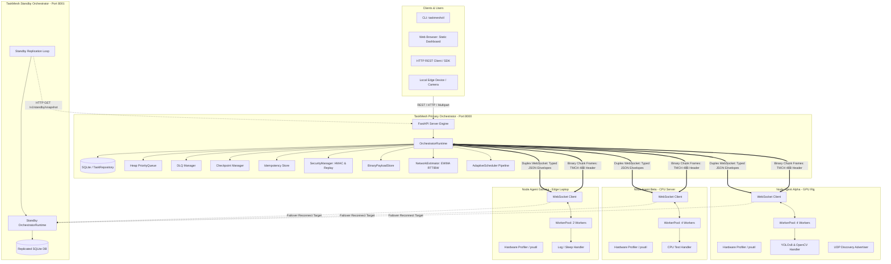
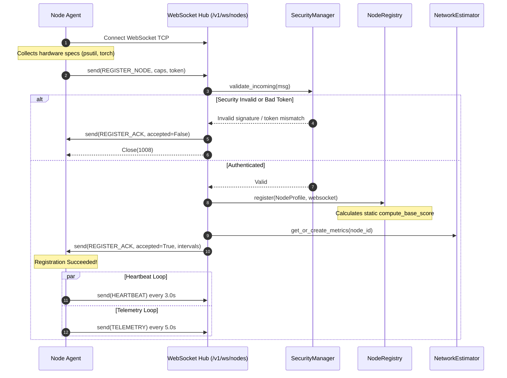
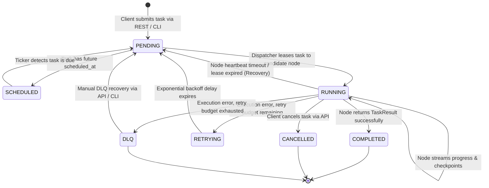
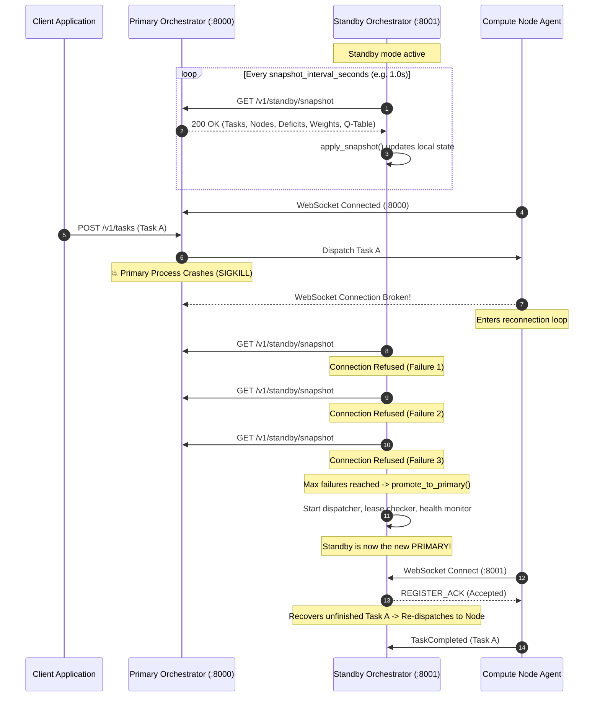

# TaskMesh — System Architecture

## 1. Architectural Philosophy

TaskMesh is designed according to four fundamental distributed systems principles:
1. **Decoupled Control and Execution Planes**: The orchestrator (`OrchestratorRuntime`) maintains global cluster state, task queues, and scheduling decisions, while node agents (`NodeAgent`) focus strictly on hardware profiling and executing local task handlers inside isolated worker pools.
2. **Persistent Asynchronous Communication**: Rather than relying on periodic HTTP client polling or heavyweight message brokers, nodes maintain persistent, full-duplex WebSocket connections with the orchestrator over `/v1/ws/nodes`.
3. **Lease-Based Distributed Ownership**: Tasks are not merely pushed to workers; they are leased for a discrete time window (`TaskLease`). If a node crashes or the lease expires before completion, ownership is safely revoked and the task is reassigned.
4. **Multi-Stage Adaptive Control**: Scheduling decisions are not treated as a single greedy calculation. Instead, a pipelined series of modular mathematical filters (eligibility, fairness, bidding, factor adaptation, reinforcement learning, and network cost) determine the optimal assignment.

---

## 2. Overall System Architecture



---

## 3. Subsystem Breakdown & Component Specifications

### 3.1 Control Plane: The Orchestrator

#### 3.1.1 `OrchestratorRuntime`
- **File**: [`taskmesh/orchestrator/runtime.py`](file:///C:/Malenia/TASK_MESH/taskmesh/orchestrator/runtime.py)
- **Purpose**: The central brain coordinating task ingestion, dispatching, node monitoring, lease maintenance, and failover.
- **Inputs**: Incoming HTTP tasks via FastAPI, protocol messages from connected WebSockets, state polling requests.
- **Outputs**: Dispatched assignments to nodes, cancellation signals, saved database entities, telemetry updates to schedulers.
- **Internal Logic**:
  - Launches 4 background asyncio tasks: `_dispatch_loop`, `_health_monitor_loop`, `_lease_checker_loop`, and `_delayed_tasks_loop`.
  - In standby mode, suppresses dispatch loops and runs `_standby_replication_loop`.
  - Implements the complete task completion and failure handler state transitions.
- **Dependencies**: `TaskRepository`, `PriorityQueue`, `NodeRegistry`, `AdaptiveScheduler`, `NetworkEstimator`, `SecurityManager`.

#### 3.1.2 `FastAPI Server` & Web UI
- **File**: [`taskmesh/orchestrator/server.py`](file:///C:/Malenia/TASK_MESH/taskmesh/orchestrator/server.py)
- **Purpose**: Exposes REST API endpoints for clients, hosts the WebSocket endpoint for worker nodes, and serves the static dashboard.
- **Key Routes**:
  - `POST /v1/tasks`: Submit standard JSON payload tasks.
  - `POST /v1/tasks/binary`: Submit image/tensor files via multipart or raw binary body.
  - `GET /v1/tasks/{task_id}`: Query task status, output, and execution metrics.
  - `POST /v1/tasks/{task_id}/cancel`: Abort a task in queue or running on a remote node.
  - `GET /v1/nodes`: List active compute nodes, hardware capabilities, and telemetry.
  - `GET /v1/cluster/health`: Summary metrics (online nodes, running tasks, queue size, fairness CV).
  - `GET /v1/scheduler/status` & `/decisions`: Explainability audit logs.
  - `WS /v1/ws/nodes`: WebSocket connection hub for compute nodes.
  - `GET /`: Serves the single-page HTML/JS dashboard from `taskmesh/orchestrator/static/`.

#### 3.1.3 `NodeRegistry`
- **File**: [`taskmesh/cluster/registry.py`](file:///C:/Malenia/TASK_MESH/taskmesh/cluster/registry.py)
- **Purpose**: Tracks live connected compute nodes and maps node IDs to active WebSocket socket instances.
- **Internal Logic**:
  - Manages thread-safe dictionary mappings: `_nodes: Dict[str, NodeProfile]` and `_sockets: Dict[str, WebSocket]`.
  - Computes baseline hardware capability score (`compute_base_score`) upon initial node registration.
  - Updates `last_heartbeat` and `last_telemetry` timestamps.
  - Supports node draining mode (`set_draining`), preventing new task assignments while existing tasks finish.

#### 3.1.4 `PriorityQueue`
- **File**: [`taskmesh/queue/priority.py`](file:///C:/Malenia/TASK_MESH/taskmesh/queue/priority.py)
- **Purpose**: Asynchronous, thread-safe task queue providing priority ordering with strict FIFO tie-breaking stability.
- **Internal Logic**:
  - Backed by Python's `heapq` min-heap.
  - Stores tuples of `(-priority, sequence_counter, task)`. High priority integers yield lower negative numbers, popping first.
  - Dequeue operations support non-blocking polling or asyncio event-waiting with timeout.

#### 3.1.5 `SQLiteTaskRepository`
- **File**: [`taskmesh/persistence/repositories.py`](file:///C:/Malenia/TASK_MESH/taskmesh/persistence/repositories.py)
- **Purpose**: Durable task persistence ensuring zero task loss across orchestrator process restarts.
- **Internal Logic**:
  - Initializes `tasks` table with indexes on `status` and `assigned_node_id`.
  - Stores complete domain models serialized as JSON strings (`data_json`).
  - Implements crash recovery queries: `find_by_assigned_node` and `find_expired_leases`.

#### 3.1.6 `BinaryPayloadStore` & `ChunkAssembler`
- **File**: [`taskmesh/transport/payload_store.py`](file:///C:/Malenia/TASK_MESH/taskmesh/transport/payload_store.py)
- **Purpose**: Handles high-speed in-memory binary buffering and chunk reassembly for image and tensor inference.
- **Internal Logic**:
  - Enforces safe payload boundaries (`max_payload_size_bytes = 50 MB`).
  - Pre-computes and verifies SHA-256 digests.
  - Reassembles out-of-order 64KB binary chunks and verifies end-to-end integrity before handler delivery.

#### 3.1.7 `NetworkEstimator`
- **File**: [`taskmesh/wireless/estimator.py`](file:///C:/Malenia/TASK_MESH/taskmesh/wireless/estimator.py)
- **Purpose**: Tracks real-time wireless link telemetry and predicts whether remote offload will complete faster than local execution.
- **Internal Logic**:
  - Maintains EWMA-smoothed metrics for RTT ($RTT_{\text{ewma}}$), upload speed ($B_{\text{up}}$), and download speed ($B_{\text{down}}$).
  - Evaluates $T_{\text{local}}$ vs. $T_{\text{remote}}$ using node performance multipliers and hardware profiling.

---

### 3.2 Execution Plane: The Node Agent

#### 3.2.1 `NodeAgent`
- **File**: [`taskmesh/node/agent.py`](file:///C:/Malenia/TASK_MESH/taskmesh/node/agent.py)
- **Purpose**: Runs as an independent daemon or CLI process on each physical machine, maintaining a persistent WebSocket connection to the orchestrator.
- **Internal Logic**:
  - On launch, profiles local hardware (`profile_hardware`) and starts UDP broadcast advertiser (`NodeDiscoveryAdvertiser`).
  - Initiates WebSocket connection to the orchestrator and sends `register_node`.
  - Runs three concurrent loops:
    1. `_heartbeat_loop`: Sends `heartbeat` every 3.0s and periodic `ping` to measure RTT.
    2. `_telemetry_loop`: Captures real-time CPU/RAM/GPU usage every 5.0s and transmits `telemetry`.
    3. `_listen_loop`: Ingests binary frames (chunks) and JSON control envelopes.
  - Handles automated failover: if the primary orchestrator disconnects, seamlessly rotates connection target to `standby_url`.

#### 3.2.2 `WorkerPool`
- **File**: [`taskmesh/node/worker_pool.py`](file:///C:/Malenia/TASK_MESH/taskmesh/node/worker_pool.py)
- **Purpose**: Local task execution engine managing concurrency, thread offloading, timeouts, and cancellations.
- **Internal Logic**:
  - Constrains concurrency using `asyncio.Semaphore(concurrency)`.
  - Executes asynchronous coroutine handlers directly on the event loop; executes synchronous CPU-bound handlers (e.g. `cpu_test_handler`, YOLO vision inference) in a background `ThreadPoolExecutor`.
  - Injects progress callbacks, checkpoint callbacks, and binary payload buffers into task handler signatures via `inspect.signature`.
  - Enforces hard task timeouts via `asyncio.wait_for`.

---

## 4. Communication Architecture

TaskMesh uses two distinct transport mechanisms over a single network connection:

### 4.1 Typed JSON Control Messages
All control, scheduling, telemetry, and lifecycle events are wrapped in a universal `ProtocolMessage` JSON envelope:

```json
{
  "protocol_version": "v1",
  "message_id": "9b1deb4d-3b7d-4bad-9bdd-2b0d7b3dcb6d",
  "message_type": "task_assignment",
  "node_id": "node-gpu-rig",
  "timestamp": "2026-10-30T06:00:00.123456Z",
  "sequence_number": 42,
  "signature": "3f7a1b... (HMAC-SHA256 in secure mode)",
  "payload": {
    "task_id": "task_47077ac05874",
    "attempt_id": "task_47077ac05874-A1",
    "lease_id": "7b099c2e-4b21-4f11-893f-c988e04b4d11",
    "lease_expires_at": "2026-10-30T06:00:30.123456Z",
    "task_type": "image_inference",
    "payload": {"model": "yolov8n"},
    "priority": 10,
    "timeout_seconds": 30.0,
    "checkpoint_state": null
  }
}
```

### 4.2 Binary Frame Transport (`TMCH`)
To transfer large images or tensors without base64 overhead (which inflates payloads by 33%), TaskMesh transmits raw binary WebSocket frames. Each binary chunk begins with a fixed **48-byte header**:

```
 0                   1                   2                   3
 0 1 2 3 4 5 6 7 8 9 0 1 2 3 4 5 6 7 8 9 0 1 2 3 4 5 6 7 8 9 0 1
+-+-+-+-+-+-+-+-+-+-+-+-+-+-+-+-+-+-+-+-+-+-+-+-+-+-+-+-+-+-+-+-+
|                       Magic: b"TMCH"                          |
+-+-+-+-+-+-+-+-+-+-+-+-+-+-+-+-+-+-+-+-+-+-+-+-+-+-+-+-+-+-+-+-+
|                                                               |
+                    Task ID (36 Bytes ASCII)                   +
|                                                               |
+-+-+-+-+-+-+-+-+-+-+-+-+-+-+-+-+-+-+-+-+-+-+-+-+-+-+-+-+-+-+-+-+
|                   Chunk Index (uint32 BE)                     |
+-+-+-+-+-+-+-+-+-+-+-+-+-+-+-+-+-+-+-+-+-+-+-+-+-+-+-+-+-+-+-+-+
|                   Total Chunks (uint32 BE)                    |
+-+-+-+-+-+-+-+-+-+-+-+-+-+-+-+-+-+-+-+-+-+-+-+-+-+-+-+-+-+-+-+-+
|                     Raw Payload Chunk Bytes                   |
|                              ...                              |
+-+-+-+-+-+-+-+-+-+-+-+-+-+-+-+-+-+-+-+-+-+-+-+-+-+-+-+-+-+-+-+-+
```

---

## 5. Comprehensive Architectural Diagrams

### 5.1 Node Registration Lifecycle



### 5.2 Task Execution Lifecycle State Machine



### 5.3 Primary / Standby High-Availability Failover



