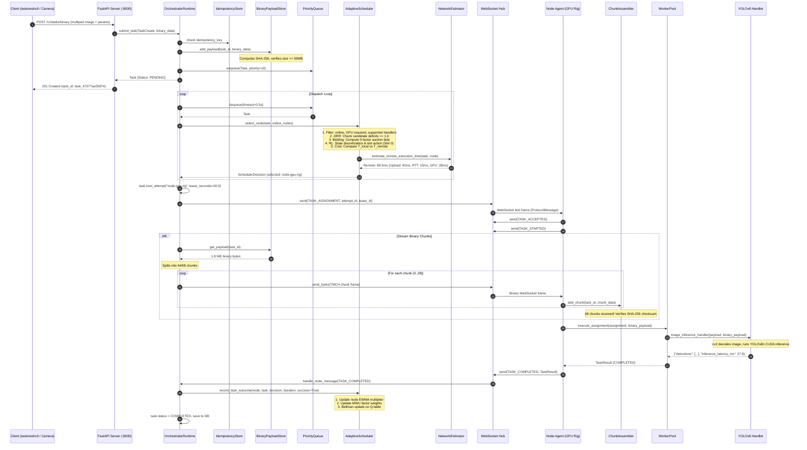

# TaskMesh — Complete Task Execution Pipeline

## 1. Overview of the 17-Step Lifecycle

The execution of a workload in TaskMesh traverses 17 discrete stages across the control plane, transport layer, and compute workers. This section details every stage, specifying the exact Python modules, classes, and function signatures responsible.

To ground the explanation, we follow a concrete example task throughout this document:

```json
{
  "task_type": "image_inference",
  "payload": {"model": "yolov8n", "batch_size": 1, "image_dim": 640},
  "priority": 10,
  "requires_gpu": true,
  "offload_policy": "wireless_allowed",
  "timeout_seconds": 30.0,
  "retry_policy": {"max_attempts": 3, "base_delay_seconds": 1.0, "max_delay_seconds": 30.0, "jitter": true},
  "binary_data": "<1.8 MB JPEG camera snapshot>"
}
```

---

## 2. End-to-End Execution Sequence Diagram



---

## 3. Detailed Step-by-Step Breakdown

### Step 1: Task Submission
- **Module**: [`taskmesh/orchestrator/server.py`](file:///C:/Malenia/TASK_MESH/taskmesh/orchestrator/server.py)
- **Functions**: `submit_task()` or `submit_binary_task()`
- **Mechanism**:
  - The client issues an HTTP `POST` request to `/v1/tasks` (for JSON tasks) or `/v1/tasks/binary` (for image/tensor workloads).
  - Binary uploads are accepted as `multipart/form-data` (form field `file`) or raw octet-streams (`application/octet-stream`, `image/jpeg`).
  - Query parameters define `task_type="image_inference"`, `priority=10`, `requires_gpu=true`, and `offload_policy="wireless_allowed"`.

### Step 2: Task Validation
- **Module**: [`taskmesh/core/models.py`](file:///C:/Malenia/TASK_MESH/taskmesh/core/models.py)
- **Functions**: Pydantic v2 model validation (`TaskCreate.model_validate()`)
- **Mechanism**:
  - Strict type checking ensures `timeout_seconds > 0`, priority is an integer, and policies match valid enumerations (`OffloadPolicy`).
  - If invalid fields are supplied, FastAPI returns HTTP 422 Unprocessable Entity immediately before touching internal state.

### Step 3: Task Registration & Idempotency Check
- **Module**: [`taskmesh/orchestrator/runtime.py`](file:///C:/Malenia/TASK_MESH/taskmesh/orchestrator/runtime.py), [`taskmesh/idempotency/store.py`](file:///C:/Malenia/TASK_MESH/taskmesh/idempotency/store.py)
- **Functions**: `OrchestratorRuntime.submit_task()`, `IdempotencyStore.get()`, `IdempotencyStore.set_if_absent()`
- **Mechanism**:
  - If an `idempotency_key` is supplied, the runtime checks the in-memory store. If a matching task ID exists, the existing task entity is returned immediately, preventing duplicate runs.
  - If binary data is attached, `BinaryPayloadStore.add_payload()` buffers the bytes in memory, calculates the SHA-256 digest (`compute_payload_sha256`), determines total 64KB chunk count, and attaches `BinaryPayloadMeta` to the task entity.
  - The task entity is instantiated with status `PENDING`, saved to durable storage (`TaskRepository.save()`), and enqueued into `PriorityQueue`.

### Step 4: Node Discovery & Advertising
- **Module**: [`taskmesh/discovery/broadcast.py`](file:///C:/Malenia/TASK_MESH/taskmesh/discovery/broadcast.py)
- **Functions**: `NodeDiscoveryAdvertiser.start()`, `DiscoveryClient.discover()`
- **Mechanism**:
  - In background Wi-Fi operations, compute nodes advertise their availability by listening for UDP discovery queries on port `37020`.
  - When clients or orchestrators probe `<broadcast>:37020`, nodes respond with hardware manifests (`cpu_cores`, `gpu_name`, `supported_handlers`).

### Step 5: Node Capability Collection & Handshake
- **Module**: [`taskmesh/node/hardware.py`](file:///C:/Malenia/TASK_MESH/taskmesh/node/hardware.py), [`taskmesh/cluster/registry.py`](file:///C:/Malenia/TASK_MESH/taskmesh/cluster/registry.py)
- **Functions**: `profile_hardware()`, `NodeRegistry.register()`
- **Mechanism**:
  - When a node connects to WebSocket `/v1/ws/nodes`, it transmits `REGISTER_NODE`.
  - The orchestrator validates the join token, initializes `NodeProfile`, and runs `compute_base_score(profile)` to set the node's normalized baseline capacity:
    $$\text{base\_score} = 0.4 \cdot \text{CPU\_factor} + 0.3 \cdot \text{RAM\_factor} + 0.3 \cdot \text{GPU\_factor}$$

### Step 6: Resource Monitoring & Telemetry Streaming
- **Module**: [`taskmesh/node/agent.py`](file:///C:/Malenia/TASK_MESH/taskmesh/node/agent.py), [`taskmesh/wireless/estimator.py`](file:///C:/Malenia/TASK_MESH/taskmesh/wireless/estimator.py)
- **Functions**: `NodeAgent._telemetry_loop()`, `NetworkEstimator.update_rtt()`
- **Mechanism**:
  - Every 3 seconds, the node sends a `HEARTBEAT` and periodic `PING`. The orchestrator calculates instantaneous RTT and updates the node's EWMA RTT metric.
  - Every 5 seconds, the node sends a `TELEMETRY` message containing current `cpu_percent`, `ram_percent`, `gpu_percent`, and active task counts.

### Step 7: Candidate Node Eligibility Filtering
- **Module**: [`taskmesh/scheduler/base.py`](file:///C:/Malenia/TASK_MESH/taskmesh/scheduler/base.py)
- **Functions**: `filter_eligible_nodes(task, nodes)`
- **Mechanism**:
  - Evaluates candidates against strict criteria:
    1. Node status must be `ONLINE` (nodes in `DRAINING` or `OFFLINE` are eliminated).
    2. Privacy policy: if `task.offload_policy == LOCAL_ONLY`, only local nodes are accepted.
    3. Handler capability: node must support `image_inference`.
    4. Hardware requirements: if `task.requires_gpu == True`, nodes without dedicated GPU (`caps.has_gpu == False`) are eliminated.
    5. Memory requirements: node available RAM must meet or exceed `required_memory_mb`.

### Step 8: Multi-Stage Scheduling & Allocation
- **Module**: [`taskmesh/scheduler/adaptive.py`](file:///C:/Malenia/TASK_MESH/taskmesh/scheduler/adaptive.py)
- **Functions**: `AdaptiveScheduler.select_node()`
- **Mechanism**:
  1. **DRR Fairness Gate**: Checks candidate deficits. If no candidate has `deficit >= 1.0`, round replenishment adds adaptive quanta to all candidates:
     $$\text{quantum}_i = \text{base\_quantum} \cdot \left(\frac{\text{effective\_score}_i}{\text{mean\_score}}\right)$$
  2. **Contract-Net Suitability Bidding**: Evaluates suitability bids across 5 dimensions weighted by MWU weights:
     $$\text{bid}_i = (w_{\text{cpu}} f_{\text{cpu}} + w_{\text{gpu}} f_{\text{gpu}} + w_{\text{load}} f_{\text{load}} + w_{\text{lat}} f_{\text{lat}} + w_{\text{rel}} f_{\text{rel}}) \cdot \text{effective\_score}_i$$
     Candidates are ranked in descending order of bid.
  3. **Tabular Q-Learning**: Maps continuous cluster state to discrete bucket tuple $(s_{\text{score}}, s_{\text{load}}, s_{\text{priority}})$. Selects candidate slot (0: Top bid, 1: 2nd bid, 2: 3rd bid) using $\epsilon$-greedy exploration.
  4. **Wireless Cost Comparison**: If the chosen candidate is remote, compares local execution against remote network transmission:
     $$T_{\text{remote}} = T_{\text{upload}} + \text{RTT} + T_{\text{queue}} + T_{\text{infer}} + T_{\text{download}}$$
     If local execution is predicted faster, the task executes locally. Otherwise, the remote node is confirmed.
  5. **Deficit Deduction**: The selected node's DRR deficit is decremented by 1.0.

### Step 9: Task Dispatch & Attempt Lease Granting
- **Module**: [`taskmesh/orchestrator/runtime.py`](file:///C:/Malenia/TASK_MESH/taskmesh/orchestrator/runtime.py)
- **Functions**: `Task.next_attempt()`, `OrchestratorRuntime._dispatch_loop()`
- **Mechanism**:
  - The runtime increments `current_attempt` (e.g. attempt ID `task_47077ac05874-A1`).
  - Grants a `TaskLease` with an expiration timestamp (`expires_at = now + 30.0s`).
  - Sends a `TASK_ASSIGNMENT` message over the node's WebSocket.

### Step 10: Binary Chunk Streaming & Payload Assembly
- **Module**: [`taskmesh/transport/binary_protocol.py`](file:///C:/Malenia/TASK_MESH/taskmesh/transport/binary_protocol.py), [`taskmesh/transport/payload_store.py`](file:///C:/Malenia/TASK_MESH/taskmesh/transport/payload_store.py)
- **Functions**: `split_into_chunks()`, `create_binary_chunk_frame()`, `ChunkAssembler.add_chunk()`
- **Mechanism**:
  - If binary data is present, the orchestrator divides the 1.8 MB JPEG into 29 chunks of 64KB each.
  - Each chunk is packed into a binary frame with the 48-byte `TMCH` header and transmitted over the WebSocket.
  - On the node agent, `ChunkAssembler` buffers chunks. When chunk 29/29 arrives, it stitches the bytes in sequence and verifies the SHA-256 hash.

### Step 11: Task Execution in Worker Pool
- **Module**: [`taskmesh/node/worker_pool.py`](file:///C:/Malenia/TASK_MESH/taskmesh/node/worker_pool.py), [`taskmesh/handlers/ai_inference.py`](file:///C:/Malenia/TASK_MESH/taskmesh/handlers/ai_inference.py)
- **Functions**: `WorkerPool.execute_assignment()`, `image_inference_handler()`
- **Mechanism**:
  - `WorkerPool` acquires an `asyncio.Semaphore` slot (concurrency control).
  - Dispatches `image_inference_handler` to a worker thread via `ThreadPoolExecutor` so CPU/GPU computation does not block the asyncio event loop.
  - The handler decodes the JPEG bytes via OpenCV (`cv2.imdecode`) and passes the tensor to YOLOv8 (`yolov8n.pt`).
  - YOLO returns detected bounding boxes, class labels, and confidence scores.

### Step 12: Result Ingestion & Attempt Validation
- **Module**: [`taskmesh/orchestrator/runtime.py`](file:///C:/Malenia/TASK_MESH/taskmesh/orchestrator/runtime.py)
- **Functions**: `OrchestratorRuntime._process_task_completed()`
- **Mechanism**:
  - The node agent transmits a `TASK_COMPLETED` protocol message with `TaskResult`.
  - The orchestrator validates that `msg.attempt_id == task.current_attempt_id`. If the attempt ID does not match (e.g., a delayed response from a lease that had already expired), the result is rejected as stale.

### Step 13: Feedback Generation & Online Learning Updates
- **Module**: [`taskmesh/scheduler/adaptive.py`](file:///C:/Malenia/TASK_MESH/taskmesh/scheduler/adaptive.py)
- **Functions**: `AdaptiveScheduler.record_task_outcome()`
- **Mechanism**:
  - **EWMA Performance Update**: Compares expected duration with actual duration ($t_{\text{actual}} = 0.0278\text{s}$):
    $$\text{ratio} = \frac{t_{\text{expected}}}{t_{\text{actual}}}$$
    $$\text{multiplier}_{\text{new}} = \alpha \cdot \text{clamped\_ratio} + (1 - \alpha) \cdot \text{multiplier}_{\text{current}}$$
  - **MWU Weight Update**: Calculates factor loss vectors based on time loss and execution success, updating factor weights via Hedge update.
  - **Q-Learning Update**: Calculates scalar reward ($+1.0$ for success, $+0.5$ bonus for completing well within deadline). Performs Bellman Q-value update on state bucket $(s, a)$ and decays $\epsilon$.

### Step 14: Task Finalization & State Persistence
- **Module**: [`taskmesh/persistence/repositories.py`](file:///C:/Malenia/TASK_MESH/taskmesh/persistence/repositories.py)
- **Functions**: `SQLiteTaskRepository.save()`
- **Mechanism**:
  - Task status transitions to `COMPLETED`, `result` is saved, `active_lease` is cleared, and `progress = 1.0`.
  - Database row is committed. If a client is polling `GET /v1/tasks/{task_id}`, the completed detection output is returned.

---

## 4. Fault Handling, Retries, and Recovery Stages

### Step 15: Execution Error Handling
- **Module**: [`taskmesh/node/worker_pool.py`](file:///C:/Malenia/TASK_MESH/taskmesh/node/worker_pool.py), [`taskmesh/orchestrator/runtime.py`](file:///C:/Malenia/TASK_MESH/taskmesh/orchestrator/runtime.py)
- **Functions**: `_process_task_failed()`
- **Mechanism**:
  - If a worker raises an uncaught exception, times out (`asyncio.TimeoutError`), or rejects the task, the node sends `TASK_FAILED`.
  - Node failure counters increment, and negative feedback is fed into the adaptive scheduler ($\text{reward} = -1.5$).

### Step 16: Retry Evaluation & Dead-Letter Queue (DLQ)
- **Module**: [`taskmesh/retry/runner.py`](file:///C:/Malenia/TASK_MESH/taskmesh/retry/runner.py), [`taskmesh/dlq/manager.py`](file:///C:/Malenia/TASK_MESH/taskmesh/dlq/manager.py)
- **Functions**: `evaluate_retry()`, `compute_backoff()`, `DLQManager.add()`
- **Mechanism**:
  - If `retry_count < max_attempts`, exponential backoff with full jitter calculates delay:
    $$\text{delay} = \text{random.uniform}\left(0.5 \cdot d, d\right) \quad \text{where} \quad d = \min(\text{base} \cdot 2^{\text{attempt}-1}, \text{max\_delay})$$
  - Task transitions to `RETRYING`. An asynchronous task sleeps for `delay` seconds before resetting status to `PENDING` and re-enqueueing into `PriorityQueue`.
  - If retry budget is exhausted, task transitions to `DLQ`, moves into `DLQManager`, and raises an alert. Operators can inspect or recover it via `taskmeshctl dlq recover <task_id>`.

### Step 17: Node Disconnect Recovery & Checkpoint Resumption
- **Module**: [`taskmesh/orchestrator/runtime.py`](file:///C:/Malenia/TASK_MESH/taskmesh/orchestrator/runtime.py), [`taskmesh/checkpoint/manager.py`](file:///C:/Malenia/TASK_MESH/taskmesh/checkpoint/manager.py)
- **Functions**: `_health_monitor_loop()`, `_recover_tasks_for_failed_node()`
- **Mechanism**:
  - If a node's heartbeat is silent for longer than `node_timeout_seconds` (default: 9.0s), the orchestrator marks the node `OFFLINE`.
  - All tasks marked `RUNNING` on that node are retrieved.
  - If intermediate checkpoints were saved (`CheckpointData`), the latest checkpoint state is attached to the task entity.
  - The active lease is revoked, attempt counter is incremented, and the task is re-enqueued as `PENDING`, allowing another node to resume execution from the checkpoint step.

