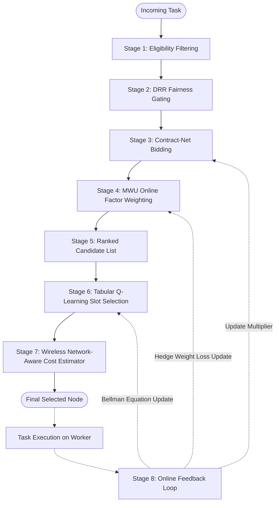

# TaskMesh — Scheduling Algorithms

## 1. Architectural Role of Scheduling in TaskMesh

In a heterogeneous compute cluster across an unmanaged local network, scheduling cannot rely on naive datacenter heuristics:
- **Round Robin** is fair in task counts, but completely blind to hardware capacity, overloading low-spec devices while underutilizing high-end GPU workstations.
- **Least Loaded** and **Highest Bid** are greedy heuristics that route all incoming tasks to the single fastest node, starving other nodes and turning the fastest node into a massive queuing bottleneck.
- **Deep Reinforcement Learning (e.g. DQN)** introduces tens of milliseconds of neural network forward/backward pass inference latency, non-stationary policy instability, and massive sample complexity before convergence.

TaskMesh resolves this dilemma by constructing a **multi-stage hybrid adaptive pipeline** that composes 7 distinct mathematical and algorithmic techniques into a cohesive, sub-millisecond decision pipeline.

---

## 2. Algorithm 1: Base Capability Scoring

### 2.1 Description & Problem Addressed
When a node first connects, TaskMesh needs an initial baseline capacity estimate to represent its computational strength before any historical task telemetry exists.

### 2.2 Mathematical Foundation & Equations
The base capability score $S_{\text{base}}$ is a weighted linear combination of three normalized hardware factors:

$$S_{\text{base}} = 0.4 \cdot f_{\text{cpu}} + 0.3 \cdot f_{\text{ram}} + 0.3 \cdot f_{\text{gpu}}$$

where:
- **CPU Factor**: Normalized around a standard baseline of 4 cores @ 2.5 GHz:
  $$f_{\text{cpu}} = \frac{C \cdot \left(\frac{F}{2500}\right)}{4.0}$$
  ($C$: logical CPU core count; $F$: CPU clock frequency in MHz).
- **RAM Factor**: Normalized around a standard baseline of 4096 MB (4 GB):
  $$f_{\text{ram}} = \frac{M_{\text{total}}}{4096.0}$$
  ($M_{\text{total}}$: total physical RAM in MB).
- **GPU Factor**: Boost factor rewarding dedicated GPU presence:
  $$f_{\text{gpu}} = \begin{cases} 2.0 & \text{if } \text{has\_gpu} = \text{True} \\ 0.5 & \text{if } \text{has\_gpu} = \text{False} \end{cases}$$

The final base score is bounded from below:
$$S_{\text{base}} = \max(0.1, \text{round}(S_{\text{base}}, 3))$$

### 2.3 Implementation
- **Module**: [`taskmesh/scoring/base_score.py`](file:///C:/Malenia/TASK_MESH/taskmesh/scoring/base_score.py)
- **Function**: `compute_base_score(profile: NodeProfile) -> float`
- **Computational Overhead**: $\mathcal{O}(1)$, $< 1$ microsecond.

### 2.4 Practical Numerical Example
Consider a GPU workstation with 16 cores @ 3.8 GHz, 32 GB RAM (32,768 MB), and an NVIDIA RTX 4090 GPU:
1. $f_{\text{cpu}} = \frac{16 \cdot (3800 / 2500)}{4.0} = \frac{16 \cdot 1.52}{4.0} = \frac{24.32}{4.0} = 6.08$
2. $f_{\text{ram}} = \frac{32768}{4096} = 8.0$
3. $f_{\text{gpu}} = 2.0$
4. $S_{\text{base}} = (0.4 \cdot 6.08) + (0.3 \cdot 8.0) + (0.3 \cdot 2.0) = 2.432 + 2.40 + 0.60 = 5.432$

---

## 3. Algorithm 2: Dynamic EWMA Performance Multiplier

### 3.1 Description & Problem Addressed
Static hardware specifications do not reflect real-world execution speeds. A node may experience thermal throttling, background OS processes, or memory paging. TaskMesh uses an Exponentially Weighted Moving Average (EWMA) multiplier to dynamically adjust a node's effective capability based on empirical task execution times.

### 3.2 Mathematical Foundation & Equations
Upon completion of a task, an execution speed ratio $\rho$ is computed:

$$\rho = \begin{cases} 2.0 & \text{if } t_{\text{actual}} \le 0.001 \\ \frac{t_{\text{expected}}}{t_{\text{actual}}} & \text{otherwise} \end{cases}$$

To prevent extreme single-task outliers from destabilizing the multiplier, the ratio is clamped:
$$\rho_{\text{clamped}} = \max(0.2, \min(5.0, \rho))$$

The dynamic multiplier $M$ is updated using smoothing factor $\alpha \in (0, 1]$ (default $\alpha = 0.2$):
$$M(t+1) = \alpha \cdot \rho_{\text{clamped}} + (1 - \alpha) \cdot M(t)$$
bounded within:
$$M(t+1) = \max(0.1, \min(10.0, \text{round}(M(t+1), 4)))$$

The node's **Effective Score** is then defined as:
$$S_{\text{eff}} = \max(0.01, S_{\text{base}} \cdot M)$$

### 3.3 Implementation
- **Module**: [`taskmesh/scoring/base_score.py`](file:///C:/Malenia/TASK_MESH/taskmesh/scoring/base_score.py)
- **Class**: `EWMAUpdater`
- **Method**: `update_multiplier(current_multiplier, expected_duration, actual_duration) -> float`
- **Computational Overhead**: $\mathcal{O}(1)$, floating-point arithmetic ($< 1\,\mu\text{s}$).

### 3.4 Practical Numerical Example
Suppose a node has current multiplier $M = 1.0$. A task with expected duration $t_{\text{expected}} = 2.0\text{s}$ finishes in $t_{\text{actual}} = 1.0\text{s}$ ($\rho = 2.0$).
$$M_{\text{new}} = (0.2 \cdot 2.0) + (0.8 \cdot 1.0) = 0.4 + 0.8 = 1.2$$
The node completed faster than expected, increasing its effective score by 20%.

---

## 4. Algorithm 3: Deficit Round Robin (DRR) with Adaptive Quantum

### 4.1 Description & Problem Addressed
In heterogeneous clusters, naive bidding or greedy least-loaded schedulers cause **catastrophic starvation**: the single highest-capacity node takes 100% of tasks, leaving other nodes idle. Deficit Round Robin (DRR) provides strict fairness guarantees by maintaining deficit tokens per node.

### 4.2 The Critical DRR Fairness Bug & Its Resolution
In initial project implementations, TaskMesh exhibited a serious defect: benchmarks showed a Fairness CV of 1.5036.
- **Root Cause**: The scheduler was incrementing deficits on **every single task dispatch**. Because high-spec nodes had effective scores greater than task cost ($S_{\text{eff}} = 2.8 > \text{cost} = 1.0$), their deficit increased by $+1.8$ on every task, never depleting!
- **The Corrected DRR Mechanism**: In genuine Deficit Round Robin, candidate deficits are **only replenished upon round exhaustion** (when no eligible candidate has $\text{deficit} \ge \text{cost}$). When a node is chosen, its deficit is decremented by $\text{cost} = 1.0$.

### 4.3 Mathematical Formulation & Equations
1. **Deficit Check**:
   $$\mathcal{C}_{\text{fair}} = \{n \in \mathcal{C}_{\text{eligible}} \mid D_n \ge \text{cost}\}$$
2. **Round Replenishment (Triggered only when $\mathcal{C}_{\text{fair}} = \emptyset$)**:
   $$\bar{S} = \max\left(0.01, \frac{1}{|\mathcal{C}|} \sum_{n \in \mathcal{C}} S_{\text{eff}, n}\right)$$
   For each node $n \in \mathcal{C}$:
   $$Q_n = Q_{\text{base}} \cdot \left(\frac{S_{\text{eff}, n}}{\bar{S}}\right)$$
   $$D_n \leftarrow D_n + Q_n$$
3. **Deficit Deduction**:
   $$D_{n^*} \leftarrow \max(0.0, D_{n^*} - \text{cost})$$

### 4.4 Fairness Evaluation Metric: Coefficient of Variation (CV)
Task allocation equality is quantified using the Coefficient of Variation of task allocations:
$$\text{CV} = \frac{\sigma}{\mu} = \frac{\sqrt{\frac{1}{N}\sum_{i=1}^N (x_i - \bar{x})^2}}{\bar{x}}$$
- $\text{CV} = 0.0$: Perfect uniform distribution across nodes.
- Lower CV indicates superior fairness; high CV indicates severe starvation.

### 4.5 Implementation
- **Module**: [`taskmesh/fairness/drr.py`](file:///C:/Malenia/TASK_MESH/taskmesh/fairness/drr.py)
- **Class**: `DRRFairnessManager`
- **Methods**: `get_eligible_with_deficit()`, `replenish_round()`, `deduct_cost()`, `calculate_fairness_cv()`
- **Computational Overhead**: $\mathcal{O}(|\mathcal{C}|)$, array traversal over candidates ($< 5\,\mu\text{s}$).

### 4.6 Practical Numerical Example
Consider two nodes: Node A ($S_{\text{eff}} = 3.0$) and Node B ($S_{\text{eff}} = 1.0$), with $Q_{\text{base}} = 1.0$ and $\text{cost} = 1.0$.
1. Initial state: $D_A = 0.0, D_B = 0.0$.
2. Round 1 starts ($\bar{S} = 2.0$):
   - $Q_A = 1.0 \cdot (3.0 / 2.0) = 1.5 \implies D_A = 1.5$
   - $Q_B = 1.0 \cdot (1.0 / 2.0) = 0.5 \implies D_B = 0.5$
3. Task 1 arrives: Only Node A has $D \ge 1.0$. Node A is selected! $D_A = 1.5 - 1.0 = 0.5$.
4. Task 2 arrives: Candidates have $D_A = 0.5, D_B = 0.5$. No node has $D \ge 1.0$! Round 1 is exhausted.
5. Round 2 replenishment:
   - $D_A = 0.5 + 1.5 = 2.0$
   - $D_B = 0.5 + 0.5 = 1.0$
6. Task 2 allocated to Node A ($D_A = 2.0 - 1.0 = 1.0$).
7. Task 3 allocated to Node B ($D_B = 1.0 - 1.0 = 0.0$).
*Node B receives execution turns proportionally, completely preventing starvation!*

---

## 5. Algorithm 4: Contract-Net Multi-Factor Auction Bidding

### 5.1 Description & Problem Addressed
Inspired by the Contract Net Protocol, compute nodes compute suitability bids reflecting how well their hardware, current load, and network connectivity fit a specific task's requirements.

### 5.2 Mathematical Formulation & 5 Factors
The bid value $B_n \in [0, \infty)$ for node $n$ and task $t$ is:

$$B_n = \left( \sum_{k \in \mathcal{F}} w_k \cdot f_k(n, t) \right) \cdot S_{\text{eff}, n}$$

where $\mathcal{F} = \{\text{cpu}, \text{gpu}, \text{load}, \text{latency}, \text{reliability}\}$, with $\sum w_k = 1.0$.

#### The Five Normalized Factors ($f_k \in [0, 1]$):
1. **CPU Factor ($f_{\text{cpu}}$)**:
   $$f_{\text{cpu}} = \min\left(1.0, \frac{\text{cpu\_cores}}{16.0}\right)$$
2. **GPU Factor ($f_{\text{gpu}}$)**:
   $$f_{\text{gpu}} = \begin{cases} 1.0 & \text{if } t.\text{requires\_gpu} \land \text{caps.has\_gpu} \\ 0.0 & \text{if } t.\text{requires\_gpu} \land \neg \text{caps.has\_gpu} \\ 0.5 & \text{if } \neg t.\text{requires\_gpu} \end{cases}$$
3. **Load Factor ($f_{\text{load}}$)** (Higher is better, meaning lower load):
   $$f_{\text{load}} = \max\left(0.0, 1.0 - \frac{\text{cpu\_percent} + \text{ram\_percent}}{200.0}\right)$$
4. **Latency Factor ($f_{\text{lat}}$)**:
   If local node: $f_{\text{lat}} = 1.0$. If remote:
   $$f_{\text{rtt}} = \max\left(0.0, 1.0 - \frac{\text{RTT}_{\text{ms}}}{200.0}\right)$$
   $$f_{\text{bw}} = \min\left(1.0, \frac{B_{\text{upload\_mbps}}}{100.0}\right)$$
   $$f_{\text{lat}} = \max\left(0.0, \min(1.0, 0.7 \cdot f_{\text{rtt}} + 0.3 \cdot f_{\text{bw}})\right)$$
5. **Reliability Factor ($f_{\text{rel}}$)**:
   $$f_{\text{rel}} = \begin{cases} \frac{\text{total\_completed}}{\text{total\_completed} + \text{total\_failed}} & \text{if total tasks} > 0 \\ 0.95 & \text{otherwise} \end{cases}$$

### 5.3 Implementation
- **Module**: [`taskmesh/bidding/contract_net.py`](file:///C:/Malenia/TASK_MESH/taskmesh/bidding/contract_net.py)
- **Function**: `calculate_node_bid(node: NodeProfile, task: Task, weights: Dict[str, float]) -> float`

---

## 6. Algorithm 5: Multiplicative Weights Update (MWU / Hedge)

### 6.1 Description & Problem Addressed
Static weights ($w_k = 0.2$) assume all factors are equally important. But in reality, during heavy network congestion, latency dominates; during high computational load, CPU/GPU dominates. MWU dynamically tunes factor weights online without requiring offline training.

### 6.2 Mathematical Foundation & Update Rule
Let $\mathbf{w}(t) = \langle w_{\text{cpu}}, w_{\text{gpu}}, w_{\text{load}}, w_{\text{lat}}, w_{\text{rel}} \rangle$ be the weight vector at step $t$.
Upon task completion or failure, a bounded loss vector $\mathbf{l} \in [0, 1]^5$ is calculated:
- $l_{\text{cpu}} = 0.5 \cdot \text{time\_loss}$
- $l_{\text{gpu}} = 0.8 \cdot \text{status\_loss}$ (if task required GPU)
- $l_{\text{load}} = \text{time\_loss} = \min(1.0, t_{\text{actual}} / t_{\text{timeout}})$
- $l_{\text{lat}} = \min(1.0, \text{latency}_{\text{ms}} / 100.0)$
- $l_{\text{rel}} = 1.0 \text{ if failed else } 0.0$

Each weight is updated via the Hedge exponential loss rule with learning rate $\eta$ (default $\eta = 0.1$):
$$w'_k(t+1) = w_k(t) \cdot e^{-\eta \cdot l_k}$$
Normalized to form a valid probability distribution:
$$w_k(t+1) = \frac{w'_k(t+1)}{\sum_{j} w'_j(t+1)}$$

### 6.3 Implementation
- **Module**: [`taskmesh/learning/mwu.py`](file:///C:/Malenia/TASK_MESH/taskmesh/learning/mwu.py)
- **Class**: `MWUWeightLearner`
- **Method**: `update(factor_losses: Dict[str, float]) -> Dict[str, float]`

---

## 7. Algorithm 6: Tabular Q-Learning Scheduler

### 7.1 Description & Problem Addressed
While bidding sorts candidate nodes, auction formulas are deterministic. Tabular Q-learning introduces reinforcement learning to dynamically learn policy trade-offs (e.g., when it is advantageous to choose the 2nd-ranked candidate to avoid queue contention on the 1st candidate).

### 7.2 Invariant State and Action Space Formulation
In traditional distributed RL, assigning actions to specific node IDs (e.g. Action 0 = `node-alpha`) fails when nodes dynamically join or leave the network.
TaskMesh solves this by formulating an **invariant candidate-slot action space**:
- **Action $a \in \{0, 1, 2\}$**:
  - $a = 0$: Select top-ranked candidate from the bid-sorted list.
  - $a = 1$: Select 2nd-ranked candidate.
  - $a = 2$: Select 3rd-ranked candidate.

#### State Space Discretization:
Continuous telemetry is mapped into a discrete 3-tuple state:
$$s = \langle \text{score\_bucket}, \text{load\_bucket}, \text{priority\_bucket} \rangle \in \{0, 1, 2\}^3$$
yielding a bounded tabular state space of exactly $3 \times 3 \times 3 = 27$ states:
- $\text{score\_bucket}$: $0$ ($S_{\text{eff}} < 0.8$), $1$ ($0.8 \le S_{\text{eff}} \le 1.5$), $2$ ($S_{\text{eff}} > 1.5$).
- $\text{load\_bucket}$: $0$ ($< 40\%$), $1$ ($40\% - 75\%$), $2$ ($> 75\%$).
- $\text{priority\_bucket}$: $0$ ($P \le 0$), $1$ ($1 \le P \le 10$), $2$ ($P > 10$).

### 7.3 Bellman Update Equation & Exploration Decay
$$\mathcal{Q}(s, a) \leftarrow \mathcal{Q}(s, a) + \alpha_{\text{lr}} \left[ r + \gamma \max_{a'} \mathcal{Q}(s', a') - \mathcal{Q}(s, a) \right]$$

Reward function:
$$r = \begin{cases} -1.5 & \text{if execution failed} \\ +1.5 & \text{if completed in } < 50\% \text{ of deadline} \\ +1.0 & \text{if completed successfully} \end{cases}$$

Exploration decays exponentially towards $\epsilon_{\min} = 0.01$ (default decay rate $\delta = 0.995$):
$$\epsilon \leftarrow \max(\epsilon_{\min}, \epsilon \cdot \delta)$$

### 7.4 Implementation
- **Module**: [`taskmesh/learning/qlearning.py`](file:///C:/Malenia/TASK_MESH/taskmesh/learning/qlearning.py)
- **Class**: `QLearningScheduler`
- **Computational Overhead**: $\mathcal{O}(1)$ dictionary hash lookup ($< 2\,\mu\text{s}$).

---

## 8. Algorithm 7: Wireless Network-Aware Cost Estimator

### 8.1 Description & Problem Addressed
Offloading AI inference to a remote GPU node is only beneficial if network transmission latency does not eclipse the execution acceleration gained by using the remote GPU.

### 8.2 Mathematical Formulation & Comparison
Given binary payload size $S$ bytes:
1. **Remote Execution Cost Prediction ($T_{\text{remote}}$)**:
   $$T_{\text{remote}} = T_{\text{upload}} + \text{RTT} + T_{\text{queue}} + T_{\text{remote\_infer}} + T_{\text{download}}$$
   where:
   $$T_{\text{upload}} = \frac{S \cdot 8}{B_{\text{upload\_mbps}} \cdot 10^6} \cdot 1000 \quad (\text{ms})$$
   $$T_{\text{queue}} = \text{active\_tasks} \cdot 25.0 \quad (\text{ms})$$
   $$T_{\text{remote\_infer}} = \frac{T_{\text{base\_infer}}}{M_{\text{remote}}} \quad (\text{ms})$$
2. **Local Execution Cost Prediction ($T_{\text{local}}$)**:
   $$T_{\text{local}} = T_{\text{local\_queue}} + T_{\text{local\_infer}}$$
3. **Offloading Decision Rule**:
   $$\text{Decision} = \begin{cases} \text{Local} & \text{if } T_{\text{local}} \le T_{\text{remote}} \\ \text{Remote} & \text{if } T_{\text{remote}} < T_{\text{local}} \end{cases}$$

### 8.3 Implementation
- **Module**: [`taskmesh/wireless/estimator.py`](file:///C:/Malenia/TASK_MESH/taskmesh/wireless/estimator.py)
- **Class**: `NetworkEstimator`
- **Method**: `compare_local_vs_remote()`

---

## 9. Baseline Schedulers

TaskMesh implements three deterministic baseline schedulers for empirical evaluation and benchmarking:

1. **Round Robin (`RoundRobinScheduler`)**:
   - File: [`taskmesh/scheduler/baseline.py`](file:///C:/Malenia/TASK_MESH/taskmesh/scheduler/baseline.py)
   - Cycles index modulo eligible nodes: `index = (index + 1) % len(eligible)`.
2. **Least Loaded (`LeastLoadedScheduler`)**:
   - Selects candidate minimizing:
     $$\text{Load} = 20.0 \cdot \text{active\_tasks} + \text{cpu\_percent} + \text{ram\_percent}$$
   - Resolves ties via round-robin index.
3. **Highest Bid (`HighestBidScheduler`)**:
   - Computes static Contract-Net bid and selects node with maximum bid.
   - Resolves ties via round-robin index.

