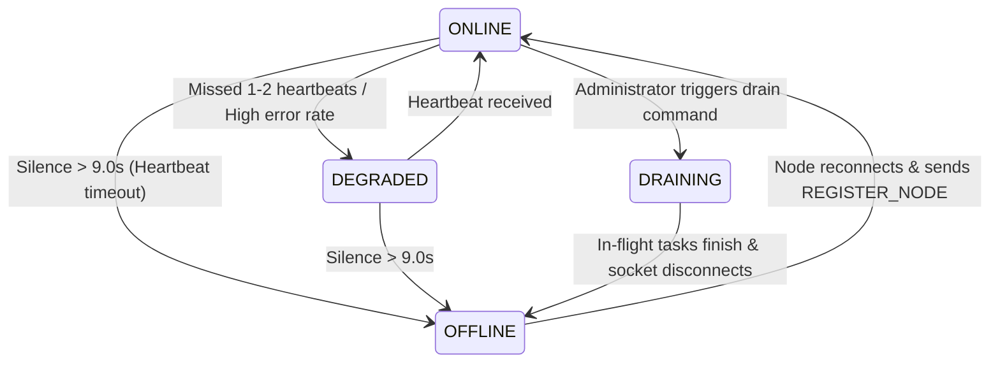

# TaskMesh — Distributed Systems Concepts

## 1. Core Distributed Systems Principles in TaskMesh

TaskMesh applies classic and modern distributed systems patterns tailored for heterogeneous edge computing environments. This document explains how each concept is mapped into the codebase and analyzes unsolved distributed systems challenges.

---

## 2. Distributed Task Execution & Decoupling

In monolithic systems, task execution shares memory and process space with the task scheduler. In TaskMesh:
- **Control Plane Decoupling**: The orchestrator process (`OrchestratorRuntime`) does not execute tasks. It acts purely as a coordinator.
- **Worker Plane Decoupling**: Compute workers (`NodeAgent`) run as separate OS processes on distinct physical machines. They execute workloads within a local `WorkerPool` via `ThreadPoolExecutor` or `asyncio.create_task()`.
- **Fault Boundary Isolation**: If a task handler crashes (e.g. segmentation fault in a C++ vision library, CUDA out-of-memory error), the orchestrator process remains unaffected.

---

## 3. Node Registration, Discovery & Dynamic Cluster Membership

### 3.1 Zero-Configuration UDP Discovery
Rather than requiring static IP configuration or third-party service registries (Consul, ZooKeeper), TaskMesh uses **UDP broadcast discovery** on port `37020`:
- `NodeDiscoveryAdvertiser` listens on UDP socket (`SO_BROADCAST`, `SO_REUSEADDR`).
- `DiscoveryClient` broadcasts probe JSON packets. Nodes reply directly with their LAN IP, port, and hardware capabilities.
- This allows nodes to join an ad-hoc Wi-Fi mesh without manual DNS configuration.

### 3.2 Dynamic Registration & Session Lifecycle
When a node starts, it connects via WebSocket to `/v1/ws/nodes`:
1. It immediately transmits `REGISTER_NODE` with its hardware manifest and cluster join token.
2. The orchestrator authenticates the token and responds with `REGISTER_ACK`, providing dynamic heartbeat and telemetry intervals.
3. If a node re-registers after a brief disconnect, `NodeRegistry` detects the existing ID and preserves historical performance statistics (base score, EWMA multiplier, completed task counts).

---

## 4. Heartbeats, Health Checks & Failure Detection

### 4.1 Failure Detector Architecture
TaskMesh implements a variant of the $\phi$-Accrual / Heartbeat Timeout failure detector:
- Each node agent sends periodic `HEARTBEAT` messages (default every 3.0s).
- The orchestrator's `_health_monitor_loop` runs every 3.0s, checking `elapsed = now - node.last_heartbeat`.
- If `elapsed > node_timeout_seconds` (default: 9.0s), the node is transitioned from `ONLINE` to `OFFLINE`.



---

## 5. Leases, Ownership & Stale Result Rejection

A fundamental hazard in distributed systems is the **split-brain or delayed worker problem**: a worker node freezes due to garbage collection or Wi-Fi packet loss; the orchestrator assumes it is dead and reassigns the task; later, the original worker unfreezes and attempts to submit its result.

TaskMesh resolves this using **Attempt-Scoped Leases**:
1. When a task is dispatched, the runtime generates a unique attempt ID (e.g. `task_123-A1`) and a `TaskLease` with an expiration timestamp (`expires_at = now + 30.0s`).
2. If the task does not finish before `expires_at`, `_lease_checker_loop` revokes the lease and increments the attempt counter (`task_123-A2`).
3. When any `TASK_COMPLETED` message arrives, the orchestrator verifies:
   ```python
   if task.current_attempt_id and task.current_attempt_id != attempt_id:
       logger.warning("Discarding stale completed result for task")
       return
   ```
   Stale or out-of-order results are discarded, preserving execution correctness.

---

## 6. Fault Tolerance, Retries & Dead-Letter Queues (DLQ)

### 6.1 Exponential Backoff with Random Jitter
When a task fails due to a transient error, immediately re-executing it can cause "thundering herd" congestion. TaskMesh uses exponential backoff with full uniform jitter:

$$d = \min\left(\text{base\_delay} \cdot 2^{\text{attempt}-1}, \text{max\_delay}\right)$$
$$\text{delay} = \text{random.uniform}(0.5 \cdot d, d)$$

This spreads retries across time, preventing synchronized retries from overwhelming recovering nodes.

### 6.2 Dead-Letter Queue (DLQ)
When a task's retry count exceeds `max_attempts`, it is classified as a "poison pill" and moved to `DLQ`:
- The task is removed from active scheduling.
- Its error history and failure count are preserved in `DLQManager`.
- Operators can inspect DLQ items or manually recover them via `taskmeshctl dlq recover <task_id>`.

### 6.3 Intermediate Checkpointing
For long-running computational workloads, nodes can periodically stream intermediate execution state (`CheckpointData`) back to the orchestrator via `TASK_CHECKPOINT`:
- Checkpoints are saved in `CheckpointManager`.
- If a node crashes mid-execution, the orchestrator retrieves the latest checkpoint and injects it into the new attempt's assignment payload (`checkpoint_state`), enabling the new worker to resume from the last saved step.

---

## 7. High Availability: Primary / Standby Failover

Rather than requiring complex consensus protocols (such as Raft or Multi-Paxos) which require an odd quorum of at least 3 nodes, TaskMesh implements an **Active-Passive Warm-Standby Failover**:

1. **State Snapshot Replication**:
   - The primary orchestrator exposes `GET /v1/standby/snapshot`.
   - The standby orchestrator continuously polls snapshots (every 1.0s to 5.0s) and synchronizes local tables (tasks, nodes, checkpoints, DRR deficits, MWU weights, Q-table).
2. **Failure Detection & Promotion**:
   - If the primary orchestrator fails to respond to 3 consecutive probes, the standby logs:
     `Primary orchestrator failure confirmed! Promoting to PRIMARY.`
   - The standby promotes itself, starts its internal dispatch and health loops, and re-enqueues uncompleted tasks.
3. **Client & Node Auto-Rotation**:
   - Compute nodes are configured with `--url ws://primary:8000/v1/ws/nodes` and `--standby-url ws://standby:8001/v1/ws/nodes`.
   - When the primary socket disconnects, the node agent automatically rotates its connection target to the standby URL.

---

## 8. Concurrency & Asynchronous Programming

TaskMesh relies on Python's `asyncio` event loop for non-blocking I/O combined with thread pools for CPU-bound computation:
- **Coroutines & Event Loops**: All network operations (WebSocket send/receive, HTTP request handling, timer loops) run asynchronously on single-threaded event loops, avoiding OS thread context-switching overhead.
- **Thread Pool Offloading**: Blocking computations (image decoding, YOLO neural net inference, mathematical loops) are offloaded to `ThreadPoolExecutor` via `loop.run_in_executor()`, preventing them from stalling heartbeat processing.
- **Asyncio Locks & Mutexes**: Shared mutable state (in-memory task heap, node registry, Q-table) is protected by `asyncio.Lock()`.

---

## 9. Distributed Systems Problems TaskMesh Does NOT Yet Solve

To ensure architectural clarity, engineers should understand the boundaries of TaskMesh:

1. **Split-Brain Risk in Asymmetric Network Partitions**:
   Because TaskMesh uses active-passive standby rather than quorum-based consensus (Raft/Paxos), an asymmetric network partition where the primary can talk to workers but the standby cannot talk to the primary could theoretically cause both to believe they are primary.
2. **Byzantine Fault Tolerance (BFT)**:
   TaskMesh assumes cooperative nodes. It handles crash faults (fail-stop) and authentication spoofing via HMAC, but does not handle malicious nodes providing intentionally falsified AI inference outputs.
3. **Distributed Transactions & Multi-Task DAG Pipelines**:
   TaskMesh manages independent tasks. It does not provide two-phase commit (2PC) or distributed ACID transactions across multiple tasks.
4. **Network Backpressure & Congestion Collapse**:
   If clients submit tasks at a rate higher than total cluster capacity, the orchestrator queues them in memory and SQLite. It does not currently implement TCP-style adaptive admission backpressure to reject submissions when memory reaches critical thresholds.

