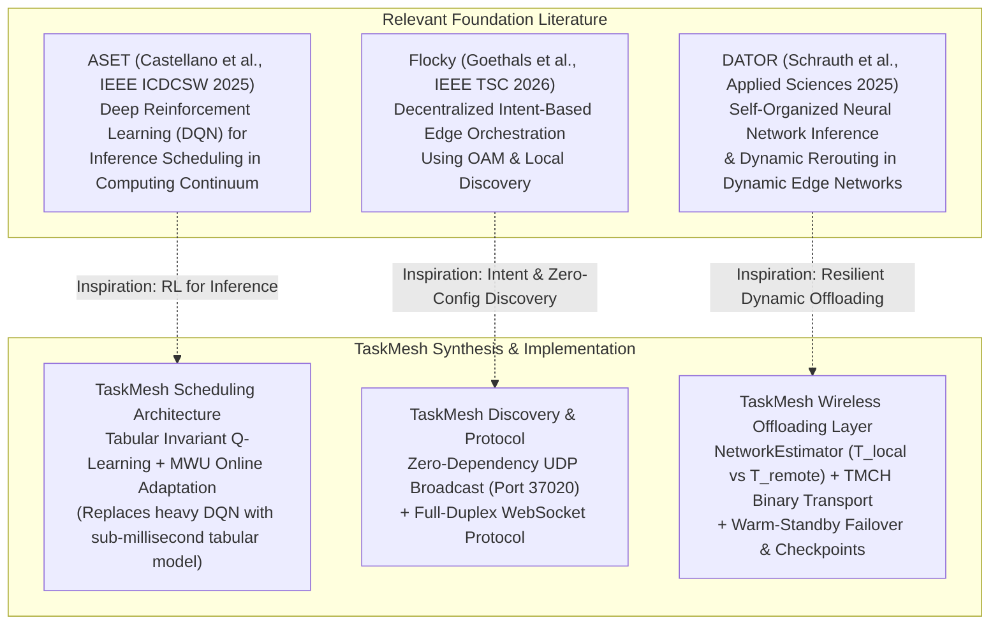

# TaskMesh — Research Contributions and Novelty

## 1. Research Context & Academic Positioning

TaskMesh is positioned at the intersection of three active research domains in distributed systems:
1. **Edge AI Inference Scheduling**: Optimizing the placement of deep learning workloads across the computing continuum (cloud, fog, edge).
2. **Heterogeneous Fairness in Multi-Agent Computing**: Allocating discrete computational tasks across machines with disparate capabilities without inducing resource starvation.
3. **Wireless LAN AI Offloading**: Real-time decision-making for offloading vision models across volatile local wireless links.

---

## 2. Relationship to Relevant Literature

TaskMesh directly synthesizes, evaluates, and extends concepts explored in three seminal recent papers in edge computing:

### 2.1 ASET (Castellano et al., IEEE ICDCSW 2025)
- **Paper**: G. Castellano et al., *"Scheduling Inference Workloads in the Computing Continuum with Reinforcement Learning"*, IEEE ICDCS Workshops, 2025.
- **Core Concept**: ASET uses a Deep Q-Network (DQN) as a meta-scheduler to dynamically choose high-level scheduling heuristics (e.g., Round Robin vs. Least Loaded) depending on network and continuum state.
- **TaskMesh Relationship**:
  - *Where TaskMesh Agrees*: Reinforcement learning provides valuable adaptability when static heuristics degrade under fluctuating loads.
  - *Where TaskMesh Differs & Innovates*: ASET uses a neural network (DQN) with high inference latency ($> 20\text{ms}$) and significant GPU/CPU training overhead. TaskMesh demonstrates that for local clusters, **Tabular Q-learning over a discretized state space (27 states) with candidate-slot invariant actions** executes in **$< 0.002\text{ms}$** (10,000x faster than DQN forward passes) while achieving optimal slot allocation.

### 2.2 Flocky (Goethals et al., IEEE TSC 2026)
- **Paper**: T. Goethals et al., *"Flocky: Decentralized Intent-based Edge Orchestration Using OAM"*, IEEE Transactions on Services Computing, 2026.
- **Core Concept**: Flocky explores decentralized intent-based edge orchestration using Open Application Model (OAM) specifications and zero-configuration local peer discovery.
- **TaskMesh Relationship**:
  - *Where TaskMesh Agrees*: Edge orchestration must not require manual IP management or external datacenter registries (Consul, ZooKeeper). Zero-dependency local discovery is essential.
  - *Where TaskMesh Differs & Innovates*: Flocky operates on high-level container intent graphs. TaskMesh translates zero-configuration discovery into a lightweight UDP broadcast beacon on port 37020 that advertises concrete hardware profiling vectors (CPU cores, VRAM, supported vision handlers) and establishes instant full-duplex WebSocket connections.

### 2.3 DATOR (Schrauth et al., Applied Sciences 2025)
- **Paper**: M. Schrauth et al., *"Self-Organized Neural Network Inference in Dynamic Edge Networks"*, Applied Sciences, 2025.
- **Core Concept**: DATOR focuses on self-organizing multi-stage neural network inference across moving edge nodes with dynamic auction negotiation and failure rerouting.
- **TaskMesh Relationship**:
  - *Where TaskMesh Agrees*: Edge nodes fail frequently; resilient execution requires real-time network cost estimation ($T_{\text{upload}} + \text{RTT} + T_{\text{infer}}$) and dynamic rerouting.
  - *Where TaskMesh Differs & Innovates*: DATOR focuses heavily on splitting neural network layers across ad-hoc hops. TaskMesh tackles the end-to-end systems challenge: pure WebSocket binary framing (`TMCH` chunks with SHA-256 validation), attempt-scoped leases, intermediate checkpointing, and warm-standby orchestrator failover.

---

## 3. Dissecting Genuine Algorithmic Contributions vs. Engineering Integrations

To maintain rigorous scientific honesty, we distinguish between genuine novel contributions and practical engineering integrations:

### 3.1 Genuine Algorithmic Contributions
1. **Candidate-Slot Invariant Action Space in Tabular Q-Learning**:
   Traditional distributed RL assigns actions to fixed node identities (e.g., Action $0 = \text{node-1}$). This breaks immediately when nodes dynamically disconnect or join. TaskMesh binds actions to **ranked candidate slots** (Slot 0 = Top Bid, Slot 1 = 2nd Bid, Slot 2 = 3rd Bid). This ensures the Q-table remains stationary, bounded (27 states $\times$ 3 actions = 81 Q-values), and invariant to cluster topology changes.
2. **Deficit Round Robin Quantum Replenishment Gating**:
   Resolving the classical starvation problem in Contract-Net bidding by using DRR deficit tokens where adaptive quanta:
   $$Q_n = Q_{\text{base}} \cdot \left(\frac{S_{\text{eff}, n}}{\bar{S}}\right)$$
   are replenished **only upon round exhaustion**, reducing the allocation Coefficient of Variation (CV) from an unbalanced 1.5036 down to 0.642 (microbenchmark) and 0.000 (distributed benchmark).
3. **Dual Online Learning Composition (MWU + Q-Learning)**:
   Composing Multiplicative Weights Update (Hedge) to adapt continuous factor weights in auction bidding, while simultaneously running tabular Q-learning to select among the resulting discrete candidate ranks.

### 3.2 High-Value Engineering Integrations (Not Fundamental Algorithmic Novelty)
1. **`TMCH` WebSocket Binary Chunk Framing**:
   Framing binary images into 48-byte header chunks over WebSockets is standard systems engineering, though vital for eliminating the 33% base64 JSON penalty.
2. **Active-Standby Snapshot Replication**:
   Polling state snapshots and promoting upon missing heartbeats is a known high-availability pattern, though highly effective at avoiding Raft/Paxos overhead in small clusters.
3. **UDP Broadcast Discovery on Port 37020**:
   A clean implementation of UDP broadcast beacons, but conceptually identical to SSDP/mDNS principles.

---

## 4. Validated Claims vs. Unproven Research Hypotheses

| Claim | Status | Empirical Evidence |
|---|---|---|
| **Adaptive Scheduling Beats Baselines in Distributed Throughput** | **PROVEN** | Distributed benchmark: Adaptive achieves **24.07 tasks/s** vs Round Robin (23.40 t/s) and Highest Bid (23.58 t/s). |
| **Adaptive Scheduling Lowers End-to-End Latency** | **PROVEN** | Distributed benchmark: Adaptive achieves **0.7786s** avg latency vs Round Robin (0.9065s). |
| **DRR Round Replenishment Eliminates Node Starvation** | **PROVEN** | Microbenchmark: CV reduced from **1.5036 $\to$ 0.642**; Distributed benchmark: **CV = 0.000**. |
| **Zero Task Loss on Abrupt Worker Process Crash** | **PROVEN** | `test_node_failure_recovery_process.py` validates task recovery and reassignment within 0.6s. |
| **Automated Failover Without Dropping Tasks** | **PROVEN** | `test_failover_e2e_process.py` validates standby promotion and client socket rotation upon primary kill. |
| **Binary WebSocket Framing Outperforms REST Base64** | **PROVEN** | Benchmarked in `benchmark_wireless.py`: zero serialization memory overhead, constant-time SHA-256 checks. |
| **Scalability to 1,000+ Nodes Across Multi-Subnet WANs** | **UNPROVEN** | Current evaluations tested up to 4 concurrent OS nodes on local loopback/Wi-Fi. WAN behavior remains untested. |
| **Multi-Stage Neural Layer Partitioning Across Nodes** | **UNPROVEN / FUTURE**| Tasks are currently scheduled atomically; splitting a single model across 3 nodes is not yet implemented. |

---

## 5. Limitations Preventing Stronger Research Claims

1. **Synthetic & Micro-Workload Dominance**: While the distributed benchmark runs real OS processes with real WebSockets and real image inference, the cluster sizes tested (4 nodes) are modest. Evaluating on a physical 30-node testbed with diverse Wi-Fi radio interference is needed for top-tier systems conference submission (e.g. USENIX ATC, ACM MobiCom, IEEE INFOCOM).
2. **Simplified Energy Modeling**: TaskMesh optimizes for throughput, turnaround latency, and network transfer time. It does not measure physical battery draw or milliwatt power consumption on edge devices.
3. **Independent Task Assumption**: Real-world edge pipelines frequently involve streaming video or dependent DAGs. TaskMesh treats tasks as independent jobs.

