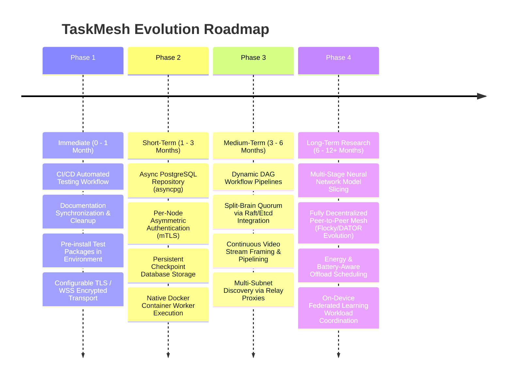

# TaskMesh — Future Roadmap

## 1. Overview & Vision

TaskMesh has successfully validated its core thesis: an adaptive, multi-layer scheduling pipeline (combining hardware profiling, dynamic EWMA tracking, DRR fairness, Contract-Net bidding, MWU factor learning, tabular Q-learning, and wireless cost estimation) can coordinate heterogeneous consumer and edge devices across local Wi-Fi networks with high throughput, low latency, and zero starvation.

This roadmap outlines realistic, prioritized milestones to evolve TaskMesh from a proven research prototype into a production-grade, self-healing edge computing fabric.

---

## 2. Phased Roadmap

---

## 3. Milestone Details

### Phase 1: Immediate Improvements (0 – 1 Month)
*Focus: Developer experience, documentation hygiene, and network encryption.*

1. **Automated CI/CD Workflow**:
   - Add `.github/workflows/test.yml` running unit tests, multi-process tests, and security validation on every pull request across Ubuntu, Windows, and macOS runners.
2. **Documentation Synchronization**:
   - Deprecate and archive stale Go-era markdown files in `docs/` (`codebase.md`, `workers.md`, `retries.md`, `api.md`), redirecting all references to this unified Python technical onboarding suite (`docs/project-knowledge/`).
3. **Transport Layer Security (TLS / WSS)**:
   - Provide built-in SSL/TLS context options for both FastAPI and `websockets.connect()` (`--ssl-cert` and `--ssl-key`), enabling encrypted `https://` and `wss://` out of the box without requiring external reverse proxies.

---

### Phase 2: Short-Term Development (1 – 3 Months)
*Focus: Storage scalability, security hardening, and process isolation.*

1. **PostgreSQL / TimescaleDB Repository Implementation**:
   - Implement an asynchronous PostgreSQL repository (`PostgresTaskRepository`) implementing the existing `TaskRepository` protocol.
   - Utilize connection pooling (`asyncpg`) to eliminate SQLite single-writer database lock contention during high-throughput benchmarking.
2. **Per-Node Asymmetric Authentication & RBAC**:
   - Replace the shared cluster secret token (`join_token`) with per-node public/private key pairs or mutual TLS (mTLS) certificates.
   - Introduce role-based access control (RBAC): restrict worker nodes from invoking administrative REST routes.
3. **Containerized Worker Execution**:
   - Add an optional `DockerWorkerExecutor` or `PodmanWorkerExecutor` to `WorkerPool`, isolating untrusted task code within disposable, resource-constrained container sandboxes.

---

### Phase 3: Medium-Term Improvements (3 – 6 Months)
*Focus: Workflow expressiveness, consensus robustness, and continuous streaming.*

1. **DAG Workflow Pipelines**:
   - Extend the core task entity to support dependency graphs (e.g., Task B executes after Task A completes, receiving Task A's output tensors as input).
   - Enable pipeline parallelism across heterogeneous nodes (e.g., Node A runs video frame decoding, Node B runs object detection, Node C runs text summarization).
2. **Quorum Consensus for Orchestrator Failover**:
   - Replace active-passive snapshot polling with a 3-node Raft consensus cluster (or external etcd/Consul leader election), eliminating the possibility of split-brain self-promotion during asymmetric network partitions.
3. **Continuous Video Streaming Framing**:
   - Expand `BinaryPayloadMeta` fields (`stream_id`, `frame_seq`, `is_keyframe`) into an active streaming pipeline for real-time RTSP/WebRTC camera feeds.

---

### Phase 4: Long-Term Research Directions (6 – 12+ Months)
*Focus: Advanced distributed AI, decentralized mesh topologies, and physical testbed evaluation.*

1. **Multi-Stage Neural Network Model Slicing (DATOR Evolution)**:
   - Split large deep learning models (e.g. LLaMA, Vision Transformers) across multiple edge nodes: Node 1 runs early convolutional layers, Node 2 runs intermediate attention blocks, Node 3 runs final classification heads.
   - Dynamically adjust model split points based on wireless bandwidth and individual node memory limits.
2. **Fully Decentralized Peer-to-Peer Mesh (Flocky Evolution)**:
   - Eliminate the central orchestrator entirely in remote field deployments. Implement distributed Contract-Net auctions and gossip-based state synchronization directly between edge devices.
3. **Energy-Aware & Thermal-Adaptive Scheduling**:
   - Integrate battery state telemetry (charging status, discharge rate, battery percentage) and thermal sensor readings into Contract-Net suitability bidding, preventing battery depletion and overheating on mobile robotics.
4. **Physical 30-Node Wireless Testbed Publication**:
   - Deploy TaskMesh across 30 physical heterogeneous devices (laptops, Raspberry Pis, Jetson Orin boards, desktops) in a real research building with active 2.4 GHz / 5 GHz Wi-Fi interference.
   - Publish comprehensive empirical results in top-tier computer systems and mobile computing conferences (USENIX ATC, ACM MobiCom, IEEE INFOCOM).

