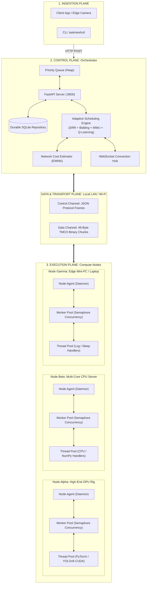
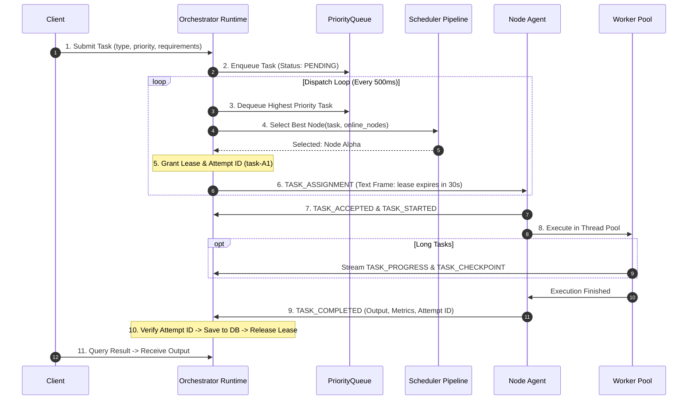
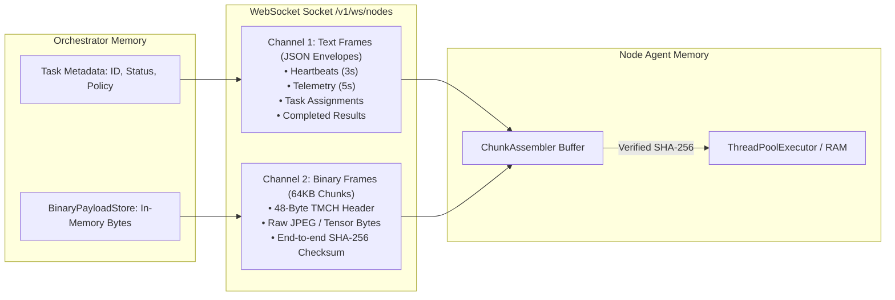
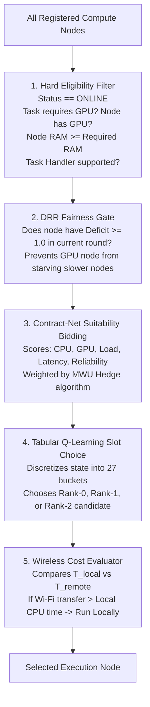
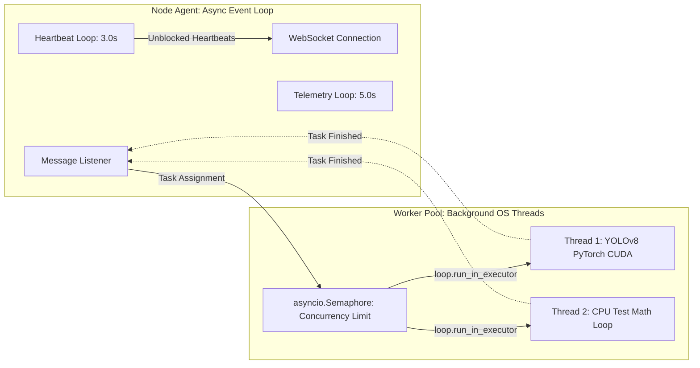

# TaskMesh — Distributed Data, Task, and Inference Sharing Architecture

## 1. Executive Summary

In a networked, distributed computing system operating across heterogeneous hardware (GPU workstations, standard laptops, edge mini-PCs) and unmanaged local networks (Wi-Fi / LAN), coordinating work is fundamentally about three distinct dimensions:

1. **The Task Flow**: How a unit of computational work is ingested, registered, scheduled, granted execution rights via time-bounded leases, monitored, and completed.
2. **The Data Flow**: How control instructions, telemetry, metadata, and heavy binary image/tensor payloads travel across process, memory, disk, and network boundaries without causing congestion or head-of-line blocking.
3. **The Inference Flow**: How artificial intelligence models (such as YOLOv8) are evaluated, isolated, and executed on diverse hardware without freezing network event loops or saturating return bandwidth.

This document serves as the comprehensive architectural reference for how TaskMesh orchestrates and shares data, tasks, and inference across all cluster participants.

---

## 2. The Three-Plane Architectural Model

TaskMesh separates responsibilities into three decoupled architectural planes:



---

## 3. The 5 Main Participants and Their Roles

| Participant | Process & Memory Boundary | Core Architectural Responsibility |
|---|---|---|
| **1. The Client** | External Process (CLI, Camera, Script) | Submits tasks with parameters and payloads; polls or awaits completion results. |
| **2. The Orchestrator** | Central Control Process (`OrchestratorRuntime`) | **Control plane authority**: Manages global queues, task state persistence, hardware registry, scheduling decisions, and lease revocations. |
| **3. The Standby** | Secondary Python Process (Warm Replica) | Continuously pulls state snapshots over HTTP; ready to self-promote to Primary if heartbeats fail. |
| **4. The Node Agent** | Worker Python Process (`NodeAgent`) | Connects via WebSocket to the Orchestrator, profiles local OS hardware, streams heartbeats/telemetry, and handles chunk assembly. |
| **5. The Worker Pool** | Local Worker Threads (`WorkerPool`) | **Execution plane**: Enforces task concurrency limits, runs heavy ML models (YOLO, PyTorch) inside thread pools, and generates structured output. |

---

## 4. How Tasks Are Shared and Governed (The Task Flow)

In distributed systems, tasks are never merely "pushed and forgotten." If a worker dies, the system must know who owned the task, what attempt failed, and where to resume.



### The Concept of Attempt-Scoped Leases
TaskMesh uses **Lease-Based Distributed Ownership**:
1. When the Orchestrator dispatches a task to a node, it does not mark it permanently completed or assigned. It issues a `TaskLease` with an expiration window (e.g., 30 seconds) and generates an attempt ID:
   $$\text{attempt\_id} = \text{task\_id} + \text{"-A"} + \text{attempt\_number}$$
2. The node must complete the task and return results before the lease expires.
3. If the node freezes (e.g., thermal throttle, Wi-Fi drop), the Orchestrator’s `_lease_checker_loop` revokes the lease, increments the attempt counter to `-A2`, and re-enqueues the task as `PENDING`.
4. **Stale Result Rejection**: If the frozen worker later revives and sends a result for `-A1`, the Orchestrator inspects the current active attempt ID, sees `-A2`, and immediately discards the stale result, guaranteeing **at-most-once state transitions**.

---

## 5. How Data Is Shared Across Network Boundaries (The Data Flow)

Mixing heavy binary image bytes with lightweight control signals is a common failure mode in distributed computing. TaskMesh splits network data into two distinct channels over a single WebSocket connection:



### 5.1 The Control Channel (Typed JSON)
All orchestration events (registrations, heartbeats, task offers, cancellations, telemetry) travel as standard JSON text frames matching the `ProtocolMessage` schema:
- **Lightweight**: Envelopes are small (< 1 KB).
- **Security**: In secure mode, each envelope includes an **HMAC-SHA256 signature** computed over canonical sorted fields, verified in constant time.
- **Replay Protection**: Enforces timestamp freshness ($\le 60\text{s}$ skew) and strictly increasing sequence numbers per node session.

### 5.2 The Heavy Data Channel (Pure Binary `TMCH` Chunks)
When an AI image or tensor is transmitted, TaskMesh completely bypasses JSON:
- Large files are split into **64 KB chunks**.
- Each chunk is framed with a **48-byte header**:
  $$\text{[4B Magic: } \texttt{b"TMCH"}\text{]} + \text{[36B Task ID]} + \text{[4B Chunk Index]} + \text{[4B Total Chunks]} + \text{[Raw Bytes]}$$
- **Zero Base64 Waste**: Saves 33% bandwidth and eliminates memory-doubling string allocation.
- **Interleaving**: Because chunks are only 64 KB, urgent control frames (such as heartbeats or cancellation requests) can interleave between image chunks without waiting for a massive multi-megabyte transfer to finish.

### 5.3 Data Persistence Sharing
- **Primary Persistence**: Task state is written to a durable SQLite database (`TaskRepository`) with indexes on status and assigned node IDs.
- **Standby Snapshot Synchronization**: The warm standby orchestrator polls `GET /v1/standby/snapshot` every 1 to 5 seconds. The primary extracts all in-memory and database states (tasks, active nodes, DRR deficit balances, MWU weights, and Q-tables) into a JSON snapshot that the standby applies to its local memory and database.

---

## 6. How AI Inference Is Planned, Shared, and Executed (The Inference Flow)

### 6.1 The Planning Phase: The Network Cost Model
The orchestrator treats inference offloading as an economic optimization problem governed by real-time network conditions. Before choosing where to send an image, it evaluates two predicted completion times:

#### 1. Remote Execution Time ($T_{\text{remote}}$)
$$T_{\text{remote}} = T_{\text{upload}} + \text{RTT} + T_{\text{queue}} + T_{\text{infer}} + T_{\text{download}}$$

- **$T_{\text{upload}}$**: Estimated time to transmit the raw image across the wireless link, based on EWMA-smoothed upload bandwidth:
  $$T_{\text{upload}} = \frac{\text{Payload Size (bytes)} \times 8}{\text{Bandwidth}_{\text{upload}} \times 10^6} \times 1000 \quad (\text{ms})$$
- **$\text{RTT}$**: Round-Trip Time measured continuously by background heartbeat pings.
- **$T_{\text{queue}}$**: Estimated queue wait time on the target machine based on its currently active tasks ($25\text{ms} \times \text{active\_tasks}$).
- **$T_{\text{infer}}$**: Expected neural network forward pass time on the remote GPU ($\approx 28\text{ms}$ for YOLOv8n on CUDA).
- **$T_{\text{download}}$**: Time to return the 1 KB structured detection result ($\approx 0.2\text{ms}$).

#### 2. Local Execution Time ($T_{\text{local}}$)
$$T_{\text{local}} = T_{\text{local\_queue}} + T_{\text{local\_infer}}$$
- On a CPU edge device, $T_{\text{local\_infer}}$ is typically $135\text{ms}$ to $450\text{ms}$.

#### The Offload Decision Rule
- If the image is **small** (e.g. 200 KB) and Wi-Fi is clean: $T_{\text{remote}} \approx 88\text{ms} < T_{\text{local}} \approx 135\text{ms} \implies$ **Offload to Remote GPU**.
- If the image is **large** (e.g. 2 MB) or Wi-Fi suffers packet drops: $T_{\text{remote}} \approx 460\text{ms} > T_{\text{local}} \approx 135\text{ms} \implies$ **Execute Locally on CPU**.

---

### 6.2 The Scheduler Pipeline: Matching Work to Devices
When multiple remote machines are available, the `AdaptiveScheduler` selects the optimal candidate via a 5-stage funnel:



---

### 6.3 Thread and Event Loop Isolation on the Worker Node
A fatal hazard in asynchronous programming (`asyncio`) is that running a heavy model (such as PyTorch CUDA inference) on the main thread freezes the event loop. If the event loop freezes, the node stops sending heartbeats, causing the orchestrator to mark the node as dead!

TaskMesh prevents this through **strict thread pool offloading**:



1. **Async Event Loop**: Dedicated purely to network I/O (handling WebSockets, ping/pong RTT calculation, sending heartbeats every 3s, sending telemetry every 5s).
2. **`WorkerPool` Semaphore**: Restricts concurrent executions to the node's configured capacity (e.g. 4 concurrent tasks).
3. **`ThreadPoolExecutor`**: Synchronous AI handlers (`image_inference_handler`, `cpu_test_handler`) are executed in background worker threads via `loop.run_in_executor()`. Even if YOLO takes 100% of a GPU/CPU core, network heartbeats fire without a millisecond of delay.

---

### 6.4 Asymmetric Result Packaging
Once YOLO finishes inference:
- The node **never sends the heavy image back**.
- It returns only the **extracted numerical bounding box telemetry**:
  ```json
  {
    "model": "yolov8n",
    "backend": "ultralytics-yolo",
    "inference_latency_ms": 27.8,
    "detections": [
      {"class": "person", "confidence": 0.9412, "bbox": [102.5, 45.0, 310.2, 420.1]},
      {"class": "car", "confidence": 0.8845, "bbox": [320.0, 200.5, 480.0, 360.0]}
    ]
  }
  ```
- **Bandwidth Ratio**: Up to **5,000 KB sent**, but only **0.5 KB returned**. This asymmetry preserves wireless link capacity for subsequent incoming frames.

---

## 7. Complete End-to-End Interaction Matrix

Here is how all components interact across a complete task lifecycle:

| Subsystem | Interacts With | Protocol / Mechanism | What Information Travels |
|---|---|---|---|
| **Client $\to$ Orchestrator** | FastAPI REST Server | HTTP `POST /v1/tasks/binary` | Image file + Task requirements (`priority`, `requires_gpu`, `policy`) |
| **Orchestrator $\to$ SQLite** | `TaskRepository` | SQL Transactions via `asyncio.Lock` | Full serialized task record, attempt ID, lease expiry |
| **Orchestrator $\to$ Standby** | Standby Replicator | HTTP `GET /v1/standby/snapshot` | Complete cluster state (tasks, nodes, deficits, weights, Q-table) |
| **Node Agent $\to$ Orchestrator** | WebSocket Hub | WS JSON Envelope (`HEARTBEAT`, `TELEMETRY`) | CPU %, RAM %, GPU %, RTT EWMA, active task count |
| **Orchestrator $\to$ Node Agent** | WebSocket Hub | WS JSON Envelope (`TASK_ASSIGNMENT`) | Task ID, Attempt ID, Lease duration, timeout, model name |
| **Orchestrator $\to$ Node Agent** | WebSocket Hub | WS Binary Frames (`b"TMCH"`) | Raw 64KB image chunks with 48-byte headers and SHA-256 |
| **Node Agent $\to$ Worker Pool** | Thread Executor | Python In-Memory Function Call | Raw bytes $\to$ OpenCV decode $\to$ YOLO CUDA tensor |
| **Node Agent $\to$ Orchestrator** | WebSocket Hub | WS JSON Envelope (`TASK_COMPLETED`) | Bounding boxes, class labels, inference execution latency |
| **Orchestrator $\to$ Scheduler** | Feedback Loop | Internal Python Async Method Call | Duration and success flag $\to$ Updates EWMA, MWU, and Q-table |

---

## 8. Failure Scenarios: What Happens When Things Break?

### Scenario A: A Worker Node Loses Power Mid-Task
1. **Detection**: The node abruptly stops transmitting heartbeats. The Orchestrator's `_health_monitor_loop` checks `last_heartbeat` and flags the node `OFFLINE` after 9 seconds.
2. **Reclamation**: The Orchestrator queries `TaskRepository.find_by_assigned_node(node_id, status=RUNNING)`.
3. **Resumption**: If intermediate checkpoints were streamed, the latest checkpoint is attached. The task is reset to `PENDING` and returned to `PriorityQueue`.
4. **Re-dispatch**: The dispatcher awards the task to a healthy node under attempt ID `-A2`.

### Scenario B: Wi-Fi Latency Spikes (Network Congestion)
1. **Detection**: Background WebSocket `ping`/`pong` frames observe RTT jumping from 15ms to 350ms.
2. **Telemetry Update**: `NetworkEstimator` updates its EWMA RTT metric.
3. **Planning Adaptation**: On the next task submission, the scheduler evaluates $T_{\text{remote}}$. Because upload time and RTT now exceed local computation time ($T_{\text{remote}} > T_{\text{local}}$), the scheduler **stops sending frames over Wi-Fi** and routes tasks to the local machine until Wi-Fi stabilizes.

### Scenario C: A Task Crashes Worker Code (Poison Pill)
1. **Handling**: Worker captures the exception and transmits `TASK_FAILED`.
2. **Backoff**: Orchestrator runs `evaluate_retry()`, applying exponential backoff with random jitter ($1\text{s} \to 2\text{s} \to 4\text{s}$).
3. **DLQ Isolation**: If the task fails past `max_attempts` (e.g. 3 attempts), it is removed from active scheduling and placed into the **Dead-Letter Queue (DLQ)**, preventing poison tasks from bringing down the cluster.
