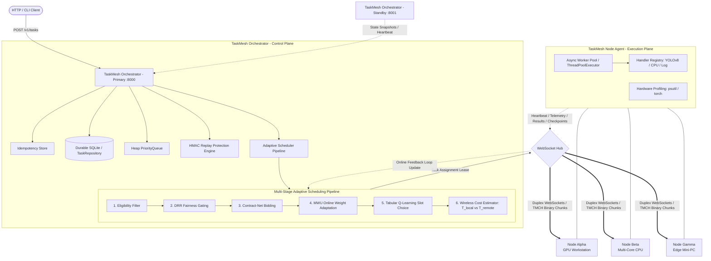

# TaskMesh — Master Technical Documentation & Project Knowledge Base

Welcome to the definitive technical onboarding and architectural knowledge base for **TaskMesh**.

TaskMesh is an asynchronous, distributed multi-node task orchestration and adaptive scheduling system engineered specifically for heterogeneous computer clusters operating across local area networks (LAN / Wi-Fi).

This repository documentation was extracted directly from the underlying Python source code, test suites, and empirical benchmarks. It is designed to enable an engineer with zero prior knowledge of TaskMesh to completely understand its motivation, architecture, algorithms, code implementation, and operations without requiring an introductory briefing with the project creator.

---

## 1. Documentation Index

The complete knowledge suite is organized into 17 modular documents located in `docs/project-knowledge/`:

| Document | Title | Description | Target Audience |
|---|---|---|---|
| [`00_EXECUTIVE_OVERVIEW.md`](file:///C:/Malenia/TASK_MESH/docs/project-knowledge/00_EXECUTIVE_OVERVIEW.md) | **Executive Overview** | High-level summary, 30s/2m/5m explanations, primary & secondary goals, architectural overview, and current status snapshot. | All Readers |
| [`01_PROBLEM_STATEMENT_AND_MOTIVATION.md`](file:///C:/Malenia/TASK_MESH/docs/project-knowledge/01_PROBLEM_STATEMENT_AND_MOTIVATION.md) | **Problem Statement & Motivation** | Heterogeneous edge compute pooling vs. cloud offload, formal mathematical problem statement, use cases, and limitations. | Systems Architects, Researchers |
| [`02_SYSTEM_ARCHITECTURE.md`](file:///C:/Malenia/TASK_MESH/docs/project-knowledge/02_SYSTEM_ARCHITECTURE.md) | **System Architecture** | Complete subsystem decomposition, control plane vs. worker plane, full-duplex WebSocket protocol, and Mermaid diagrams. | Engineers, Architects |
| [`03_TASK_EXECUTION_PIPELINE.md`](file:///C:/Malenia/TASK_MESH/docs/project-knowledge/03_TASK_EXECUTION_PIPELINE.md) | **Task Execution Pipeline** | Step-by-step walkthrough of the 17-stage task journey from HTTP submission to completion, retries, and checkpointing. | Developers, Operators |
| [`04_SCHEDULING_ALGORITHMS.md`](file:///C:/Malenia/TASK_MESH/docs/project-knowledge/04_SCHEDULING_ALGORITHMS.md) | **Scheduling Algorithms** | Mathematical formulations, equations, variable glossaries, and numerical examples for Base Scoring, EWMA, DRR, Bidding, MWU, and Q-Learning. | Algorithms & Research Engineers |
| [`05_DISTRIBUTED_SYSTEMS_CONCEPTS.md`](file:///C:/Malenia/TASK_MESH/docs/project-knowledge/05_DISTRIBUTED_SYSTEMS_CONCEPTS.md) | **Distributed Systems Concepts** | Leases, failure detection, heartbeats, exponential backoff, DLQ, primary/standby failover, and unsolved problems. | Distributed Systems Engineers |
| [`06_TECHNOLOGY_STACK.md`](file:///C:/Malenia/TASK_MESH/docs/project-knowledge/06_TECHNOLOGY_STACK.md) | **Technology Stack** | Rationale, usage locations, and replacement viability for Python, FastAPI, Uvicorn, asyncio, WebSockets, psutil, SQLite, and YOLO. | Engineers, DevOps |
| [`07_SECURITY_ARCHITECTURE.md`](file:///C:/Malenia/TASK_MESH/docs/project-knowledge/07_SECURITY_ARCHITECTURE.md) | **Security Architecture** | HMAC-SHA256 message signing, sequence numbers, timestamp skew, replay cache, join tokens, and threat model analysis. | Security Engineers |
| [`08_CODEBASE_DEEP_DIVE.md`](file:///C:/Malenia/TASK_MESH/docs/project-knowledge/08_CODEBASE_DEEP_DIVE.md) | **Codebase Deep Dive** | Complete file-by-file directory navigation, function signatures, module call graph, and reading priority sequence. | New Developers |
| [`09_TESTING_AND_EXPERIMENTATION.md`](file:///C:/Malenia/TASK_MESH/docs/project-knowledge/09_TESTING_AND_EXPERIMENTATION.md) | **Testing & Experimentation** | Breakdown of 43 automated tests, multi-process tests, scheduler microbenchmarks, distributed WebSocket benchmarks, and ablations. | QA Engineers, Researchers |
| [`10_RESEARCH_CONTRIBUTIONS_AND_NOVELTY.md`](file:///C:/Malenia/TASK_MESH/docs/project-knowledge/10_RESEARCH_CONTRIBUTIONS_AND_NOVELTY.md) | **Research Contributions & Novelty** | Relationship to ASET, Flocky, and DATOR; algorithmic contributions vs. engineering integrations; validated claims vs. future work. | Academic Researchers, Reviewers |
| [`11_SETUP_AND_EXECUTION_GUIDE.md`](file:///C:/Malenia/TASK_MESH/docs/project-knowledge/11_SETUP_AND_EXECUTION_GUIDE.md) | **Setup & Execution Guide** | Step-by-step setup, running local multi-process clusters, configuring physical LAN/Wi-Fi machines, firewall setup, and CLI usage. | All Developers, Operators |
| [`12_CURRENT_IMPLEMENTATION_STATUS.md`](file:///C:/Malenia/TASK_MESH/docs/project-knowledge/12_CURRENT_IMPLEMENTATION_STATUS.md) | **Current Implementation Status** | Honest status matrix of all subsystems (implemented vs. experimental vs. planned), technical debt, and known bottlenecks. | Project Leads, Maintainers |
| [`13_FUTURE_ROADMAP.md`](file:///C:/Malenia/TASK_MESH/docs/project-knowledge/13_FUTURE_ROADMAP.md) | **Future Roadmap** | Phased future development: immediate hygiene, short-term PostgreSQL/mTLS, medium-term DAGs, and long-term neural slicing. | Product Leads, Architects |
| [`14_DEVELOPER_ONBOARDING.md`](file:///C:/Malenia/TASK_MESH/docs/project-knowledge/14_DEVELOPER_ONBOARDING.md) | **Developer Onboarding Guide** | Day-1 curriculum, hands-on coding exercises (adding new handlers, adding schedulers), debugging workflows, and contributing rules. | New Team Members |
| [`15_INTERVIEW_AND_PRESENTATION_GUIDE.md`](file:///C:/Malenia/TASK_MESH/docs/project-knowledge/15_INTERVIEW_AND_PRESENTATION_GUIDE.md) | **Interview & Presentation Guide** | Walkthrough pitches, architectural defense scripts, and 35 hard technical interview questions and comprehensive answers. | Presenters, Interviewees |
| [`GLOSSARY.md`](file:///C:/Malenia/TASK_MESH/docs/project-knowledge/GLOSSARY.md) | **Glossary of Terms** | A-to-Z definitions of all domain concepts, abbreviations, protocols, and mathematical variables used across the project. | All Readers |

---

## 2. Structured Reading Paths

Depending on your role and objectives, follow these curated learning sequences:

### Path A: The New Developer (Joining the Team Today)
1. Read [`00_EXECUTIVE_OVERVIEW.md`](file:///C:/Malenia/TASK_MESH/docs/project-knowledge/00_EXECUTIVE_OVERVIEW.md) to grasp the project scope.
2. Follow [`11_SETUP_AND_EXECUTION_GUIDE.md`](file:///C:/Malenia/TASK_MESH/docs/project-knowledge/11_SETUP_AND_EXECUTION_GUIDE.md) to launch your local cluster.
3. Complete the Day-1 onboarding curriculum in [`14_DEVELOPER_ONBOARDING.md`](file:///C:/Malenia/TASK_MESH/docs/project-knowledge/14_DEVELOPER_ONBOARDING.md).
4. Use [`08_CODEBASE_DEEP_DIVE.md`](file:///C:/Malenia/TASK_MESH/docs/project-knowledge/08_CODEBASE_DEEP_DIVE.md) as your ongoing map of classes and methods.

### Path B: The Distributed Systems Architect / Evaluator
1. Read [`01_PROBLEM_STATEMENT_AND_MOTIVATION.md`](file:///C:/Malenia/TASK_MESH/docs/project-knowledge/01_PROBLEM_STATEMENT_AND_MOTIVATION.md).
2. Deep dive into [`02_SYSTEM_ARCHITECTURE.md`](file:///C:/Malenia/TASK_MESH/docs/project-knowledge/02_SYSTEM_ARCHITECTURE.md) and [`05_DISTRIBUTED_SYSTEMS_CONCEPTS.md`](file:///C:/Malenia/TASK_MESH/docs/project-knowledge/05_DISTRIBUTED_SYSTEMS_CONCEPTS.md).
3. Review security and storage boundaries in [`07_SECURITY_ARCHITECTURE.md`](file:///C:/Malenia/TASK_MESH/docs/project-knowledge/07_SECURITY_ARCHITECTURE.md) and [`12_CURRENT_IMPLEMENTATION_STATUS.md`](file:///C:/Malenia/TASK_MESH/docs/project-knowledge/12_CURRENT_IMPLEMENTATION_STATUS.md).

### Path C: The Machine Learning & Scheduling Researcher
1. Read [`04_SCHEDULING_ALGORITHMS.md`](file:///C:/Malenia/TASK_MESH/docs/project-knowledge/04_SCHEDULING_ALGORITHMS.md) for complete mathematical derivations and equations.
2. Inspect empirical benchmarks and ablation findings in [`09_TESTING_AND_EXPERIMENTATION.md`](file:///C:/Malenia/TASK_MESH/docs/project-knowledge/09_TESTING_AND_EXPERIMENTATION.md).
3. Review academic comparisons (vs. ASET, Flocky, DATOR) in [`10_RESEARCH_CONTRIBUTIONS_AND_NOVELTY.md`](file:///C:/Malenia/TASK_MESH/docs/project-knowledge/10_RESEARCH_CONTRIBUTIONS_AND_NOVELTY.md).

### Path D: The Conference Presenter / Interviewee
1. Memorize the 30-second and 2-minute pitches in [`15_INTERVIEW_AND_PRESENTATION_GUIDE.md`](file:///C:/Malenia/TASK_MESH/docs/project-knowledge/15_INTERVIEW_AND_PRESENTATION_GUIDE.md).
2. Review the slide deck generation script in `build.py` and `Adaptive_Distributed_AI_Inference_Seminar.pptx`.
3. Rehearse the 35 technical defense questions in Section 3 of [`15_INTERVIEW_AND_PRESENTATION_GUIDE.md`](file:///C:/Malenia/TASK_MESH/docs/project-knowledge/15_INTERVIEW_AND_PRESENTATION_GUIDE.md).

---

## 3. High-Level Architecture Snapshot



---

## 4. Repository Verification & Quick Health Check

To verify the installation and run all automated tests:

```bash
# 1. Activate your virtual environment
.\.venv\Scripts\Activate.ps1    # On Windows
source .venv/bin/activate       # On Linux/macOS

# 2. Run the full automated test suite
python -m pytest tests/ -v

# 3. Launch local 3-node multi-process cluster
taskmesh-cluster --nodes 3 --port 8000

# 4. In a separate terminal, submit a test workload
taskmeshctl task submit --type log --payload '{"message": "Hello TaskMesh"}'
```

