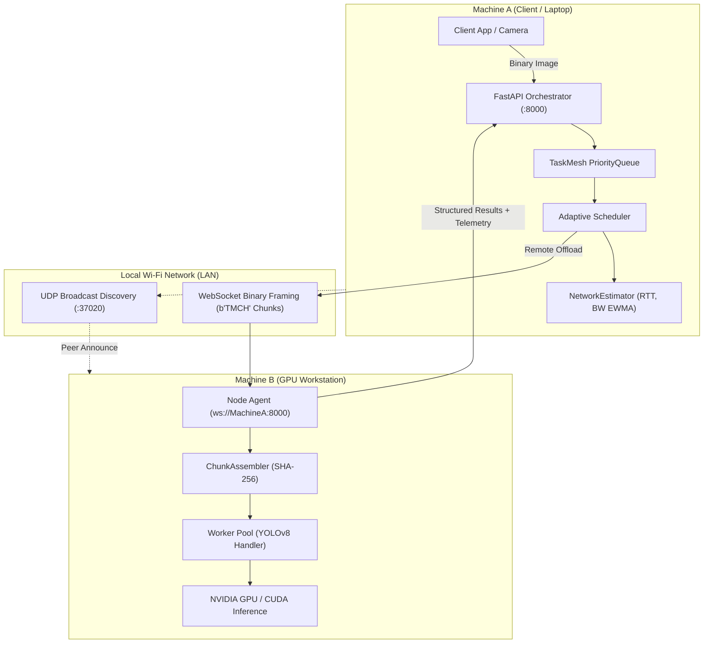

# Wireless AI Inference Sharing in TaskMesh

TaskMesh enables devices connected on the same local Wi-Fi / LAN network (e.g., a low-power laptop, smartphone, or edge device) to offload heavy AI inference tasks (such as YOLO object detection) to a more capable TaskMesh node (such as a workstation with a dedicated GPU), while making intelligent scheduling decisions aware of real-time wireless network conditions.

---

## 1. Architecture Overview



TaskMesh maintains the core distributed pipeline:
`Client -> FastAPI Orchestrator -> Scheduler -> Node Agent -> Worker Pool -> Executor`
Wireless awareness is an extension of the transport and scheduling layers without creating disjoint architectures.

---

## 2. Zero-Dependency Wireless Discovery

To allow nodes on the same Wi-Fi subnet to discover each other effortlessly without external daemons (like Avahi or Consul):

- **Mechanism**: UDP Broadcast (`SO_BROADCAST`) on port `37020`.
- **Frequency**: Configurable periodic beacons (default every 5 seconds).
- **Payload Schema**:
  ```json
  {
    "type": "discovery_beacon",
    "node_id": "wifi-gpu-node",
    "hostname": "alpha-rig",
    "lan_ip": "192.168.1.150",
    "port": 8000,
    "has_gpu": true,
    "gpu_name": "NVIDIA RTX 4080",
    "supported_handlers": ["image_inference", "log"],
    "cpu_cores": 16,
    "ram_total_mb": 32768,
    "status": "online"
  }
  ```
- **Manual Mode**: Discovery is optional. Direct WebSocket registration via IP (`ws://192.168.x.x:8000`) is always supported.

---

## 3. High-Performance Binary Payload Transport

Unlike REST endpoints that base64 encode large images (imposing 33% bandwidth and memory penalties), TaskMesh uses **pure WebSocket binary framing**:

### 48-Byte Binary Header Specification:
```
+---------------+----------------+----------------+-----------------+
| Magic (4B)    | Task ID (16B)  | Attempt ID (4B)| Chunk Index (4B)|
| b"TMCH"       | UTF-8 UUID     | uint32 BE      | uint32 BE       |
+---------------+----------------+----------------+-----------------+
| Total Chk(4B) | Chunk Size(4B) | Total Size(8B) | Payload Data... |
| uint32 BE     | uint32 BE      | uint64 BE      | Raw bytes       |
+---------------+----------------+----------------+-----------------+
```

- **Chunking**: Transmitted in configurable chunks (default `64 KB`), preventing frame head-of-line blocking.
- **Integrity**: End-to-end SHA-256 checksum calculated before chunking and verified via constant-time comparison upon reassembly.
- **Size Limits**: Configurable ceiling (`max_payload_size_bytes = 52,428,800` / 50MB) enforces early rejection of oversized payloads.
- **Future Streaming**: The `BinaryPayloadMeta` envelope reserves `stream_id`, `frame_seq`, and `is_keyframe` for future continuous video streaming.

---

## 4. Structured Result Transport

Rather than transmitting large processed images back across the wireless link, the GPU node returns a compact structured payload:

```json
{
  "detections": [
    {"class": "person", "confidence": 0.94, "bbox": [102.5, 45.0, 310.2, 420.1]},
    {"class": "laptop", "confidence": 0.88, "bbox": [320.0, 200.5, 480.0, 360.0]}
  ],
  "image_shape": [480, 640, 3],
  "inference_time_ms": 24.3,
  "transfer_telemetry": {
    "node_id": "wifi-gpu-node",
    "upload_time_ms": 18.2,
    "rtt_ms": 12.4
  }
}
```

---

## 5. Network-Aware Cost Estimation ($T_{local}$ vs $T_{remote}$)

The scheduler evaluates whether offloading an inference task will be faster than computing it locally:

### Execution Cost Model:

$$T_{local} = T_{local\_queue} + T_{local\_infer}$$

$$T_{remote} = T_{upload} + RTT + T_{remote\_queue} + T_{remote\_infer} + T_{download}$$

Where:
- $T_{upload} = \frac{\text{Payload Size (MB)} \times 8}{\text{EWMA Upload Bandwidth (Mbps)}} \times 1000$
- $RTT = \text{EWMA measured round-trip time via ping/pong probes}$
- $T_{download} = \frac{\text{Result Size (MB)} \times 8}{\text{EWMA Download Bandwidth (Mbps)}} \times 1000$

### Scheduling Outcomes:
1. **Local Execution**: When local CPU/GPU can finish faster than wireless transfer overhead, or when `OffloadPolicy.LOCAL_ONLY` is set.
2. **Nearby Wireless Execution**: When remote GPU inference speedup exceeds wireless upload latency.
3. **Pending Queue**: When no eligible local or wireless candidate satisfies policy/capabilities.

Every decision records full explainability in `SchedulerDecision`:
```json
{
  "selected_node_id": "wifi-gpu-node",
  "offload_decision": "remote",
  "local_estimate_ms": 135.0,
  "remote_estimate_ms": 58.4,
  "upload_ms": 10.2,
  "remote_inference_ms": 28.0,
  "download_ms": 0.2,
  "offload_reason": "remote execution predicted faster (58.4ms < 135.0ms)"
}
```

---

## 6. Real Physical Wi-Fi Deployment Guide

### Machine A (Orchestrator + Client / Originating Laptop)
Bind orchestrator to all interfaces (`0.0.0.0`):
```bash
# Start orchestrator
taskmesh server --host 0.0.0.0 --port 8000

# Obtain Machine A's Wi-Fi IP address (e.g. 192.168.1.100)
```

### Machine B (Remote Compute / GPU Node)
Connect node agent over Wi-Fi directly to Machine A:
```bash
# Connect to Machine A
taskmesh node --orchestrator ws://192.168.1.100:8000
```

### Run Multi-Machine Offloading Verification
From Machine A, submit an image inference task:
```bash
# CLI command
taskmesh submit-image --file frame.jpg --policy wireless_allowed

# Or run the end-to-end automated physical test script:
python scripts/manual_wifi_test.py --orchestrator http://127.0.0.1:8000 --image sample.jpg
```
